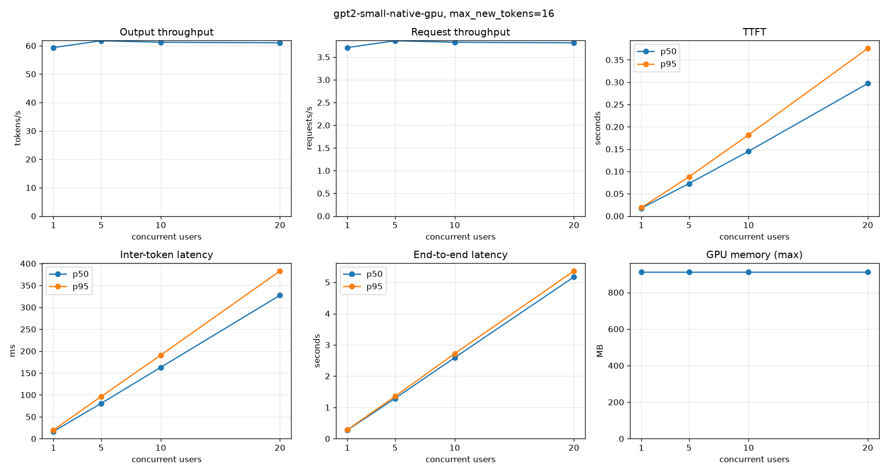
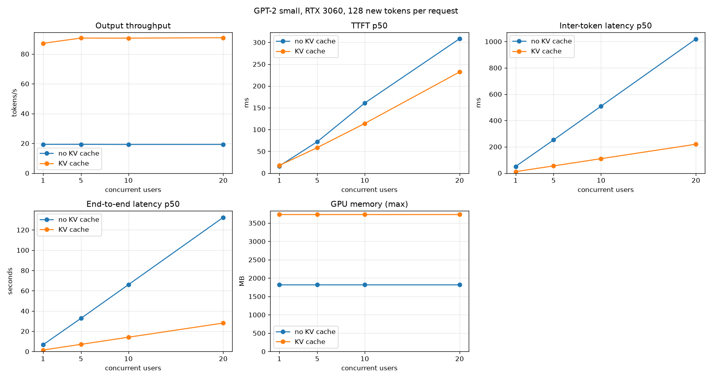
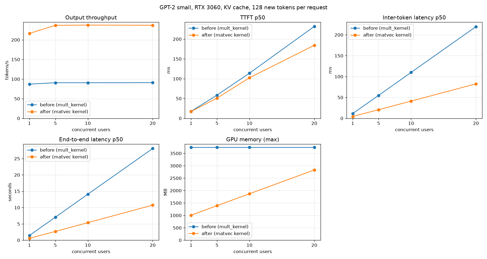
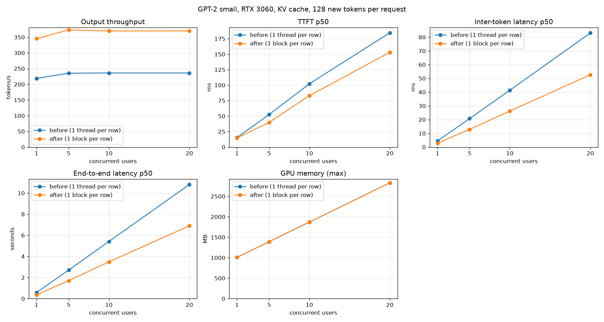
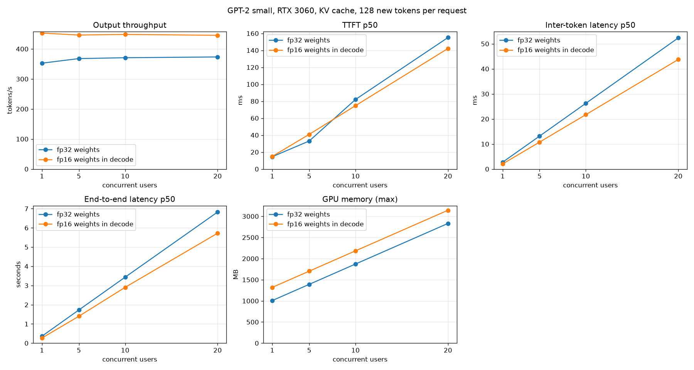

# mini_llm

Having fun with implementing a llm from scratch.
Implemented in C with pytorch bindings.
Now I try to optimze ttft on a single request.
Later I might add sth like vllm and try to optimize throughput.

Intermediate Goal: Learn to use nsys and ncu proerly and learn which optimizations work.

## So far ...

GPT-2 Small, fp32, RTX 3060, 32-token prompt, greedy decoding, 16 decode tokens. No KV cache until the last row.

| Step | Prefill (32 tokens) | Decode | Report |
|---|---|---|---|
| CPU (8-token prompt, not the same workload) | 1959 ms | 0.44 tok/s | – |
| GPU, first version | 174 ms | 3.4 tok/s | [001](docs/001_baseline.md) |
| + attention kernel: online softmax, one pass over the keys | 43.3 ms | 17.0 tok/s | [001](docs/001_baseline.md) |
| + matmul kernel: coalesced memory access | 22.5 ms | 35.5 tok/s | [002](docs/002_mult_kernel.md) |
| + KV cache and a parallel decode attention kernel | 22.2 ms (unchanged) | 86.7 tok/s | [003](docs/003_kv_cache.md) |
| + matrix-vector kernel for single-row products (decode) | 21.9 ms | 204.8 tok/s | [004](docs/004_gemv.md) |
| + layernorm: one block per row | 16.3 ms | 323.1 tok/s | [005](docs/005_layernorm.md) |
| + fp16 weights in the decode matrix products (opt-in) | 16.3 ms (unchanged) | **422.2 tok/s** | [006](docs/006_fp16_weights.md) |

- Since the first GPU version: prefill is **7.7x** faster and decode is **10x** faster.
- Attention kernel: 16.9 ms → 0.81 ms (**21x**), found with Nsight Compute (one loop did the same dot product 64 times).
- Matmul kernel: 1.14 ms → 0.29 ms (**3.9x**) from a two-line change of the thread mapping. 71% of the memory sectors were wasted.
- Each prediction was written before the change. The results are in the reports.

Where the time goes now (one forward pass of 32 tokens, 16.4 ms of kernels): attention 38%, matmul 54%, layernorm 1%.

The decode column of the last row is for 16 tokens. Without a KV cache the decode speed falls as the output gets longer (34.7 tok/s for 16 tokens, 2.7 tok/s for 900). With the cache it stays flat: 88 to 93 tok/s with the matrix-matrix kernel, 222 to 247 tok/s with the matrix-vector kernel, 351 to 417 tok/s with the faster layernorm, 480 to 614 tok/s with fp16 weights.

## Serving

Closed-loop load test with `scripts/benchmark_throughput.py`: N concurrent users, each sends requests one after another. Streaming, short prompts, same GPU as above. The server is FastAPI with one engine. Requests are processed one at a time, there is no batching yet.

### Baseline: no KV cache (`--no-kv-cache`)

16 new tokens per request:

| Users | Output tok/s | Req/s | TTFT p50 | TTFT p95 | Inter-token p50 | End-to-end p50 | End-to-end p95 |
|---|---|---|---|---|---|---|---|
| 1 | 59.6 | 3.72 | 18 ms | 19 ms | 16.4 ms | 0.27 s | 0.28 s |
| 5 | 62.0 | 3.87 | 70 ms | 87 ms | 80.2 ms | 1.29 s | 1.34 s |
| 10 | 61.1 | 3.82 | 145 ms | 184 ms | 163.4 ms | 2.59 s | 2.72 s |
| 20 | 61.2 | 3.83 | 293 ms | 372 ms | 325.6 ms | 5.17 s | 5.35 s |



- Throughput is flat at about 60 tok/s: more users only add waiting time. Latency grows linearly with the number of users.
- A single user gets the same speed as the engine alone. The py-spy profile shows most of the time waiting for the GPU (`cudaMemcpy` of the logits), so Python is not the bottleneck.
- Every decode step runs the whole sequence again. One forward pass takes 11 ms for 1 token, 92 ms for 128 tokens and 895 ms for 1000 tokens.

### With the KV cache ([report 003](docs/003_kv_cache.md))

Same workload, only the cache is different. Speedup is output tok/s after / before.

16 new tokens per request:

| Users | tok/s before | tok/s after | Speedup | Inter-token p50 before | after | End-to-end p50 before | after |
|---|---|---|---|---|---|---|---|
| 1 | 59.6 | 83.5 | 1.4x | 16.4 ms | 11.4 ms | 0.27 s | 0.19 s |
| 5 | 62.0 | 89.1 | 1.4x | 80.2 ms | 54.7 ms | 1.29 s | 0.89 s |
| 10 | 61.1 | 89.8 | 1.5x | 163.4 ms | 108.9 ms | 2.59 s | 1.76 s |
| 20 | 61.2 | 89.6 | 1.5x | 325.6 ms | 218.5 ms | 5.17 s | 3.53 s |

128 new tokens per request:

| Users | tok/s before | tok/s after | Speedup | Inter-token p50 before | after | End-to-end p50 before | after |
|---|---|---|---|---|---|---|---|
| 1 | 19.3 | 87.2 | 4.5x | 50.8 ms | 11.4 ms | 6.61 s | 1.46 s |
| 5 | 19.3 | 90.7 | 4.7x | 252.4 ms | 55.0 ms | 32.73 s | 7.05 s |
| 10 | 19.3 | 90.6 | 4.7x | 508.6 ms | 110.0 ms | 65.96 s | 14.08 s |
| 20 | 19.3 | 90.9 | 4.7x | 1019.3 ms | 219.7 ms | 132.40 s | 28.08 s |



- The longer the output, the bigger the gain: 1.4x at 16 tokens, 4.5x at 128 tokens. One sequence in the C benchmark (32-token prompt, `make bench-gpu`): 2.5x at 16 tokens, 14.6x at 400 and 32x at 900.
- TTFT does not change (prefill is the same, about 18 ms).
- Throughput is still flat when users are added (about 90 tok/s). The server still runs one request at a time, so batching is the next step.
- GPU memory: 1.8 GB for the weights, then +96 MB for each running session (the KV cache). It is 3.7 GB with 20 sessions.
- Reproduce: `make serve-gpu SERVE_ARGS=--no-kv-cache` (baseline) or `make serve-gpu` (cache), then `uv run --group dev scripts/benchmark_throughput.py --max-new-tokens 128`. `scripts/compare_benchmarks.py` draws two runs in one plot.

### With the matrix-vector kernel ([report 004](docs/004_gemv.md))

The decode step multiplies one row by a weight matrix. The old matmul kernel left 15 of 16 thread rows idle in that case and read the weights at 31 to 62 GB/s (ncu: no warp ready to issue in 94% of the cycles). A separate kernel for one row splits `K` over 16 slices per block, keeps 4 loads in flight per thread and reads the weights at 267 GB/s (74% of the peak). Same workload, KV cache on in both columns:

128 new tokens per request:

| Users | tok/s before | tok/s after | Speedup | Inter-token p50 before | after | End-to-end p50 before | after |
|---|---|---|---|---|---|---|---|
| 1 | 87.2 | 216.4 | 2.5x | 11.4 ms | 4.5 ms | 1.46 s | 0.58 s |
| 5 | 90.7 | 237.0 | 2.6x | 55.0 ms | 20.7 ms | 7.05 s | 2.69 s |
| 10 | 90.6 | 237.6 | 2.6x | 110.0 ms | 41.2 ms | 14.08 s | 5.37 s |
| 20 | 90.9 | 237.2 | 2.6x | 219.7 ms | 82.6 ms | 28.08 s | 10.75 s |



- One decode step: 10.67 ms → 3.88 ms of kernel time. The five matmul stages went from 8.63 ms to 1.85 ms.
- Layernorm is now the largest stage (44% of the step) and the next target.
- Throughput is still flat when users are added, because the server handles one request at a time.

### With the layernorm kernel ([report 005](docs/005_layernorm.md))

After report 004, layernorm was 44% of a decode step. The kernel used one thread per row, so a decode step (one row) ran on one thread of one SM: 68 µs for 12 KB of data. A kernel with one block per row, where the 256 threads split the 768 values and add them with warp shuffles, takes 2.8 µs per call. Same workload, matrix-vector kernel in both columns:

128 new tokens per request:

| Users | tok/s before | tok/s after | Speedup | Inter-token p50 before | after | End-to-end p50 before | after |
|---|---|---|---|---|---|---|---|
| 1 | 218.7 | 345.4 | 1.58x | 4.4 ms | 2.8 ms | 0.58 s | 0.36 s |
| 5 | 235.3 | 373.2 | 1.59x | 20.8 ms | 12.9 ms | 2.71 s | 1.71 s |
| 10 | 236.1 | 369.8 | 1.57x | 41.4 ms | 26.2 ms | 5.42 s | 3.48 s |
| 20 | 236.0 | 370.0 | 1.57x | 83.0 ms | 52.6 ms | 10.80 s | 6.90 s |



- One decode step: 3.87 ms → 2.29 ms of kernel time. Layernorm: 1.709 ms → 0.070 ms.
- Prefill (32 tokens) also gains: 21.8 ms → 16.3 ms. Layernorm was 20% of that pass.
- Since the KV cache (report 003), server throughput at 20 users went 90.9 → 237 → 370 tok/s.
- The server now needs about 0.4 ms per token outside the GPU kernels (15% of a token). Batching the decode of several requests is the next step for throughput.

### With fp16 weights in decode ([report 006](docs/006_fp16_weights.md))

A decode step reads every weight once, so it is limited by memory bandwidth (ncu: 63–86% of the DRAM peak, compute units 70–80% idle). With fp16 weights it reads 247 MB instead of 494 MB. The accumulation, activations, KV cache, layernorm and biases stay fp32, and prefill still uses the fp32 weights. It is opt-in (`make serve-gpu SERVE_ARGS=--fp16-weights`) and costs +247 MB of GPU memory. Same workload, fp32 server in the same session:

128 new tokens per request:

| Users | tok/s fp32 | tok/s fp16 | Speedup | Inter-token p50 fp32 | fp16 | End-to-end p50 fp32 | fp16 |
|---|---|---|---|---|---|---|---|
| 1 | 352.6 | 452.7 | 1.28x | 2.7 ms | 2.0 ms | 0.36 s | 0.27 s |
| 5 | 367.9 | 446.3 | 1.21x | 13.1 ms | 10.8 ms | 1.73 s | 1.40 s |
| 10 | 370.7 | 448.4 | 1.21x | 26.2 ms | 21.7 ms | 3.43 s | 2.90 s |
| 20 | 373.3 | 445.4 | 1.19x | 52.4 ms | 43.7 ms | 6.82 s | 5.72 s |



- One decode step: 2.30 ms → 1.57 ms of kernel time (1.46x). The five matrix-vector stages went from 1.90 ms to 1.18 ms (1.61x).
- The server gains less than the kernels (1.19x–1.28x). The time outside the kernels grew from 0.38 to 0.68 ms per token (30% of a token). I did not find the cause yet.
- Accuracy over 1200 teacher-forced positions: top-1 agreement 100%, mean KL 5.7e-06 nats, and all 12 prompts give the same 100 greedy tokens. The largest single logit difference is 3.5 (at a top logit of 42), above the 0.1 that I had set as a limit, so that criterion is reported as not met. See the report.

## Run

```sh
make weights                  # export GPT-2 weights (needs models/gpt2)
make gpt2-gpu-test test-gpu   # correctness first
make bench-gpu                # tokens/s and time per stage (add BENCH_ARGS="--kv-cache" for the cache)
make profile-nsys             # timeline: build/report.nsys-rep
make profile-nsys-decode      # timeline of cached decode steps: build/report_decode.nsys-rep
make profile-ncu KERNEL=mult_kernel   # one kernel in detail
make serve-gpu                # local server, then: uv run scripts/chat.py (SERVE_ARGS=--fp16-weights for fp16 decode)
```
