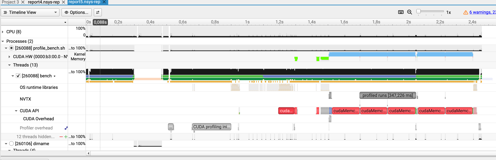
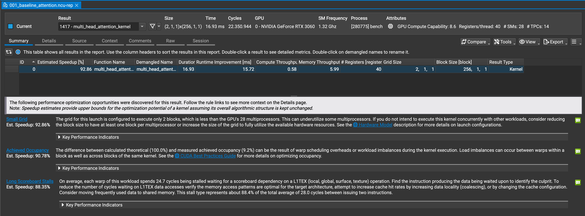
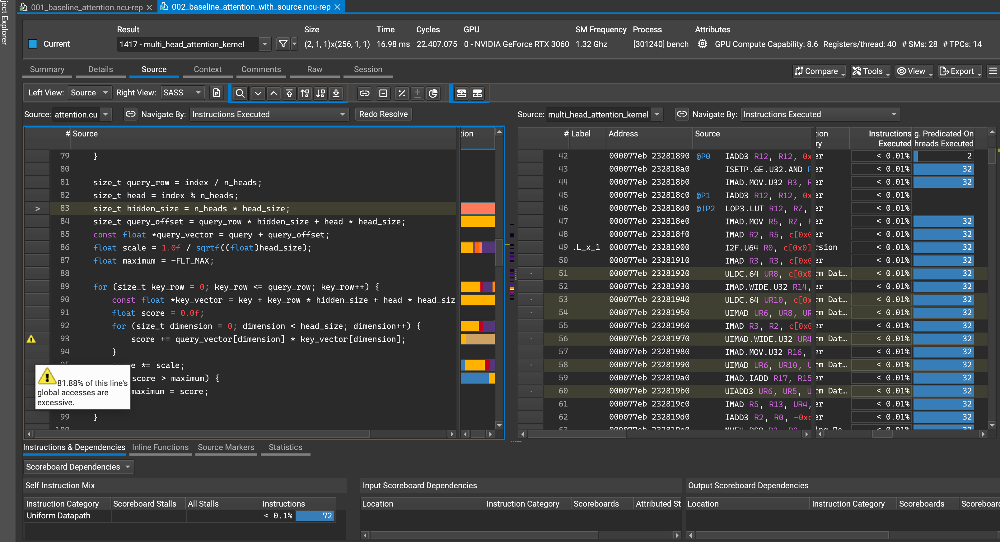
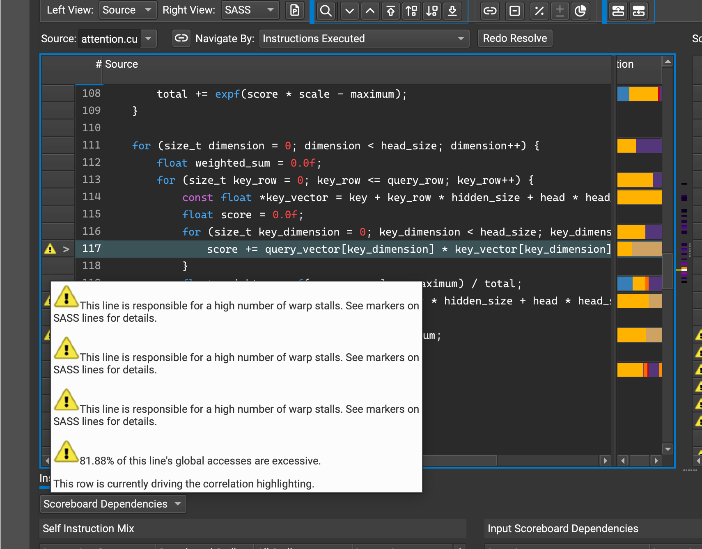

# 001 – Baseline and first fix (attention)

GPU forward pass of GPT-2, RTX 3060, 32-token prompt, no KV cache.
Output is correct (matches CPU and PyTorch) before and after the change.

## 1. Baseline

| | CPU | GPU |
|---|---|---|
| prefill (one pass) | 1959 ms (8 tokens) | 174 ms (32 tokens) |
| decode | 0.44 tok/s | 3.42 tok/s |

| stage | ms | share |
|---|---|---|
| **attention** | **137** | **79%** |
| matmuls (qkv, proj, mlp) | 32 | 18% |
| layernorm | 4 | 2% |
| rest | 2 | 1% |

- The GPU is busy 99.9% of the time. No waiting on the CPU, no big copies in the timed part.
- So the only thing that matters now is the attention kernel.

## 2. Why is attention slow?

- The kernel runs on only 2 of the 28 SMs (2 blocks of 256 threads).
- The threads mostly wait for their loads. Memory bandwidth and compute are almost idle.
- The source view shows where the time goes:
  - loop 3 (lines 111–123) has 97% of the stall samples
  - line 117 alone has 90%
  - line 93 has the warning about scattered reads (4 of 32 bytes used), but only 1.4% of the samples

- Cause: loop 3 computes the dot product `query · key` again for each of the 64 output
  dimensions. The result is always the same.

## 3. Prediction (written before the change)

- Compute each score once, so ~30x less work (not 64x: the dot product and the
  `weight * value` sum are still needed once per key)
- Attention: 11.4 ms -> 0.4–0.6 ms per layer
- Whole pass: 173 ms -> ~42 ms (limit if attention were free: ~37 ms)

## 4. Change

- `multi_head_attention_kernel` in `engine/src/attention.cu`: online softmax, one pass over the keys.
- Per key: one dot product, then update running max, running sum and the output.
- No extra memory, no length limit.

## 5. Result

`make bench-gpu` (32-token prompt, 16 decode tokens, 20 runs). Tests pass (`make gpt2-gpu-test`, `make test-gpu`).

| | before | after | |
|---|---|---|---|
| prefill (median) | 173.7 ms | **43.4 ms** | 4.0x |
| prefill speed | 184 tok/s | **738 tok/s** | |
| decode | 3.42 tok/s | **16.9 tok/s** | 5.0x |
| decode, first / last step | 174 / 364 ms | 44 / 67 ms | |
| attention per pass | 136.7 ms | 6.3 ms | 21.7x |
| attention kernel (ncu) | 16.9 ms | 0.81 ms | 21x |
| instructions in kernel | 6.46 M | 0.17 M | 39x |

| prediction | actual |
|---|---|
| ~30x less work | 39x fewer instructions |
| 0.4–0.6 ms per layer | 0.52 ms per layer |
| pass ~42 ms | 43.4 ms |

## 6. What is slow now

| stage | ms | share |
|---|---|---|
| mlp_down | 10.9 | 25% |
| mlp_up | 9.4 | 22% |
| qkv_linear | 8.3 | 19% |
| attention | 6.3 | 14% |
| layernorm | 4.2 | 10% |
| attn_proj | 2.8 | 6% |
| lm_head | 1.5 | 3% |

- The 4 matmul stages are now 72% of the pass (31 ms).
- Attention still runs on 2 blocks (occupancy 9.8%). It is 14% now, so it comes later.
- Layernorm takes 4 ms. That is a lot for such a small job. Worth a look.
- Next: `make profile-ncu KERNEL=mult_kernel`
