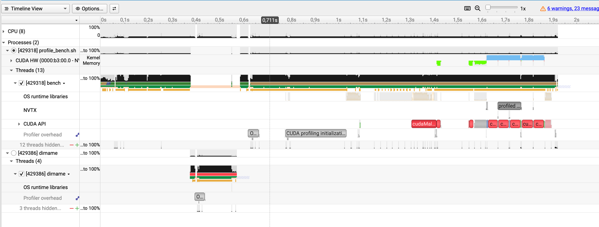
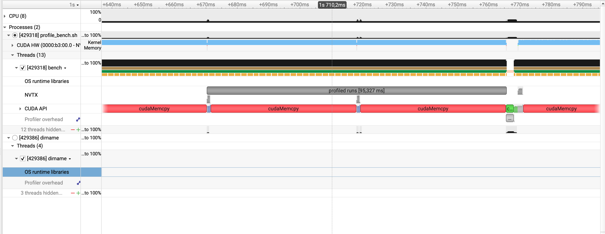
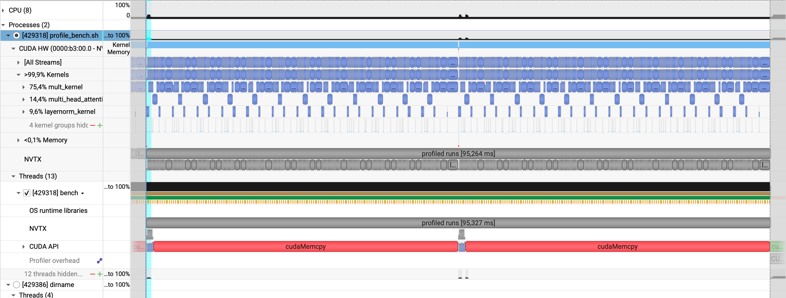

# 002 – mult_kernel (matmul)

GPT-2 on the RTX 3060, 32-token prompt, no KV cache. Start: the state after `001`.
The matmul is 72% of the pass in the benchmark table. I profile it before I change anything.

## 1. Nsight Systems



- The whole run is ~1.9 s. The GPU work is only the last part (~1.6 s to 1.82 s).
- Before that: process start, profiler start-up, weight upload.



- Zoomed into the NVTX range `profiled runs` (95 ms). That is the 2 timed runs, ~48 ms each.
- The benchmark says 43 ms. The profiler adds ~10%.
- The GPU is busy the whole time. No gaps. The CPU is idle.
- The long `cudaMemcpy` bars are the CPU waiting for the GPU, not a slow copy.



| kernel | share of GPU time |
|---|---|
| **mult_kernel** | **75.4%** |
| multi_head_attention_kernel | 14.4% |
| layernorm_kernel | 9.6% |
| 4 other kernels | < 1% |
| memory copies | < 0.1% |

## 2. What I take from it

- `mult_kernel` is the target. 75.4% here, 72% in the benchmark table. Same picture.
- Attention (14%) and layernorm (10%) also match the numbers from `001`.
- Nothing outside the kernels costs time. Copies and gaps are not the problem.
- `mult_kernel` runs 6 times per layer, with different sizes:

| launch in layer | job | shape (32 rows) |
|---|---|---|
| 0, 1, 2 | Q, K, V | 768 → 768 |
| 3 | attention projection | 768 → 768 |
| 4 | MLP up | 768 → 3072 |
| 5 | MLP down | 3072 → 768 |

- MLP down (25% of the pass) and MLP up (22%) are the biggest.
- `make profile-ncu` uses `-c 1`. That is launch 0, the Q projection: the smallest one. So I skip 4 launches and take MLP up and down.

## 3. Nsight Compute capture

```sh
CUDA_VISIBLE_DEVICES=1 /usr/local/cuda/bin/ncu --set full --import-source yes \
  --profile-from-start off -k regex:mult_kernel -s 4 -c 2 --force-overwrite \
  -o build/ncu_mult_mlp ./build/bench --backend gpu --prompt-tokens 32 \
  --decode-tokens 0 --warmup 1 --runs 2 --no-check --profile \
  --weights engine/tests/reference_data/weights
```

- Captured: launch 4 (MLP up) and launch 5 (MLP down) of layer 0. 43 passes each (`--set full` replays the kernel).
- Report: `build/ncu_mult_mlp.ncu-rep`.
- GPU: RTX 3060, sm_86, 28 SMs.
- The profiled run took 3219 ms. The run without the profiler took 47.76 ms. Only the 47.76 ms is a real timing.
- Stage table of this run (ms per pass): mlp_down 12.0 (25%), mlp_up 10.3 (22%), qkv 9.1 (19%), attention 6.9 (14%), layernorm 4.7 (10%), attn_proj 3.0 (6%), lm_head 1.6 (3%).
- Every layer takes ~3.84 ms, so layer 0 is a fair sample.
- Time outside the kernels: 0.5%.
- The banner says `git=b60d004-dirty`, but HEAD is `1974347`. Probably the text from an old build. I rebuild before I take the numbers for the report.

## 4. Nsight Compute numbers (before)

Read from `build/ncu_mult_mlp.ncu-rep` with `ncu --import ... --page details`.

| | MLP up (grid 2×192) | MLP down (grid 2×48) |
|---|---|---|
| Duration (under ncu) | 1.14 ms | 1.34 ms |
| Memory throughput (L1) | 95% | 81% |
| DRAM throughput | 2.7% | 2.4% |
| Compute (SM) throughput | 22% | 19% |
| L1 hit rate | 97.5% | 97.4% |
| Sectors total / excessive | 40.2 M / 28.3 M (71%) | 40.1 M / 28.3 M (71%) |
| Waves per SM | 2.29 | 0.57 |
| Achieved occupancy | 87% | 49% |
| Registers per thread | 30 | 30 |

- The kernel is limited by L1, not by DRAM. DRAM is almost idle (2–3%).
- 71% of all sectors are excess: the accesses are uncoalesced.
- My guess about the weight reads (~26 µs from DRAM bandwidth) was wrong. The kernel is far from the DRAM limit and far from the compute limit.
- MLP down runs only 96 blocks (0.57 waves). About half of the GPU has no work. This is a second, smaller problem.

Why the accesses are bad, from `matrixmult.cu`:

- `row` comes from `threadIdx.x`, `col` from `threadIdx.y`. A warp is 16 values of `threadIdx.x` times 2 values of `threadIdx.y`.
- So a warp has 16 different rows and 2 neighbouring columns.
- `a[row * a_columns + inner]`: 16 different rows, 16 sectors per load. Each sector gives 4 useful bytes of 32.
- `out[row * b_columns + col]`: the same problem for the write.
- `b[inner * b_columns + col]`: only 2 neighbouring floats, 1 sector. Fine.
- Per iteration of the inner loop, a warp touches ~17 sectors. The ideal is ~4.

## 5. Prediction (written before the change)

Change 1: `row` from `threadIdx.y`, `col` from `threadIdx.x`. Nothing else.

- A warp is then 16 neighbouring columns times 2 rows.
  - `b`: 16 neighbouring floats = 64 bytes = 2 sectors.
  - `a`: 2 rows, each a broadcast of one float = 2 sectors.
  - `out`: 2 × 64 bytes = 4 sectors.
- Excess sectors: 71% → close to 0%.
- Sectors per inner-loop iteration: ~17 → ~4, so ~4× less L1 traffic.
- `mult_kernel`: 2.5–4× faster. The compute work stays the same, so I do not expect the full 4×.
- Matmul stages: 31 ms → ~9–12 ms.
- Whole pass: 43.3 ms → ~22–25 ms (prefill ~1400 tokens/s).
- Decode: 17 → ~30 tokens/s.
- Not changed: the grid size (MLP down stays at 0.57 waves), no tiling, no data reuse.

## 6. Baseline for the comparison

Tests pass (`make gpt2-gpu-test test-gpu`: 13 passed). `make bench-gpu`, 3 runs, GPU 1:

| | before |
|---|---|
| prefill (median) | 43.28 ms (3 runs: 43.28, 43.27, 43.28) |
| prefill speed | 739 tokens/s |
| decode | 17.0–17.1 tokens/s |
| qkv_linear | 8.33 ms |
| attn_proj | 2.79 ms |
| mlp_up | 9.41 ms |
| mlp_down | 10.94 ms |
| lm_head | 1.51 ms |
| attention / layernorm | 6.28 / 4.24 ms |

JSON files: `build/run_002_before_{1,2,3}.json`.

## 7. Change

- `engine/src/matrixmult.cu`: `col` from `threadIdx.x`, `row` from `threadIdx.y`. The grid is swapped to match (`x` over columns, `y` over rows).
- Two lines in the kernel, two lines in the launch. No other change.
- Tests pass: `make gpt2-gpu-test test-gpu` (13 passed). GPU vs CPU check: max difference 8.4e-07, same as before.

## 8. Result

`make bench-gpu`, 3 runs. JSON: `build/run_002_after1_{1,2,3}.json`.

| | before | after | |
|---|---|---|---|
| prefill (median) | 43.28 ms | **22.5 ms** (22.1, 22.5, 22.5) | 1.9x |
| prefill speed | 739 tokens/s | **1423 tokens/s** | |
| decode | 17.0 tokens/s | **35.5 tokens/s** | 2.1x |
| decode, first / last step | 43 / 67 ms | 22 / 33 ms | |

| stage | before (ms) | after (ms) | |
|---|---|---|---|
| qkv_linear | 8.33 | 2.57 | 3.2x |
| attn_proj | 2.79 | 0.87 | 3.2x |
| mlp_up | 9.41 | 2.70 | 3.5x |
| mlp_down | 10.94 | 3.23 | 3.4x |
| lm_head | 1.51 | 1.07 | 1.4x |
| **matmul stages together** | **33.0** | **10.4** | **3.2x** |
| attention | 6.28 | 6.25 | – |
| layernorm | 4.24 | 4.22 | – |
| sum of the pass | 43.6 | 21.1 | 2.1x |

Nsight Compute, same capture as before (`-s 4 -c 2`, report `build/ncu_mult_mlp_after1.ncu-rep`):

| | MLP up, before → after | MLP down, before → after |
|---|---|---|
| Duration (under ncu) | 1.14 ms → **291 µs** (3.9x) | 1.34 ms → **334 µs** (4.0x) |
| Global-load sectors | 40.1 M → **9.4 M** | 40.1 M → **9.4 M** |
| Sectors per load request | 8.5 → **2.0** | 8.5 → **2.0** |
| Global-store sectors | 49152 → 12288 | 12288 → 3072 |
| Instructions executed | 18.4 M → 18.4 M | 18.3 M → 18.3 M |
| Memory / mem pipes busy | 95% → 89% | 81% → 77% |
| Compute (SM) throughput | 22% → **89%** | 19% → **77%** |
| DRAM throughput | 2.7% → 20% | 2.4% → 9% |
| Executed IPC | 0.45 → 1.76 | 0.43 → 1.53 |
| Waves per SM | 2.29 → 2.29 | 0.57 → 0.57 |
| Achieved occupancy | 87% → 86% | 49% → 57% |

| prediction | actual |
|---|---|
| ~17 → ~4 sectors per inner-loop iteration (2 loads) | 8.5 → 2.0 sectors per load, so 17 → 4 |
| excess sectors 71% → ~0% | load sectors down 4.25x, store sectors down 4x |
| `mult_kernel` 2.5–4x faster | 3.9x and 4.0x (ncu), 3.2–3.5x (benchmark) |
| matmul stages 31 ms → 9–12 ms | 10.4 ms |
| pass 43.3 ms → 22–25 ms | 22.5 ms |
| decode 17 → ~30 tokens/s | 35.5 tokens/s |

- The prediction was right on the sectors and on the pass time. Decode came out better than I guessed.
- The instruction count did not change (18.4 M). The kernel does the same work. Only the memory pattern changed.
- ncu runs the GPU at a lower clock than the benchmark: MLP up takes 1.14 ms under ncu, but 9.4 ms / 12 = 0.78 ms in the benchmark. I compare ncu with ncu and the benchmark with the benchmark.
- `lm_head` gained only 1.4x. It uses 1 row, so a 16×16 block has only 1 useful row out of 16. The weights are 154 MB, so DRAM sets a floor of ~0.4 ms (my estimate at 360 GB/s). It is at 1.07 ms.

## 9. What is slow now

| stage | ms | share |
|---|---|---|
| attention | 6.25 | 30% |
| layernorm | 4.22 | 20% |
| mlp_down | 3.23 | 15% |
| mlp_up | 2.70 | 13% |
| qkv_linear | 2.57 | 12% |
| lm_head | 1.07 | 5% |
| attn_proj | 0.87 | 4% |

- The matmul went from 75% of the pass to 49% (10.4 ms of 21.1 ms). Attention and layernorm are now the biggest two: 50% together.
- `mult_kernel` is now busy: compute throughput 77–89%, IPC 1.5–1.8, and the loads are 2 sectors per request. It is limited by the number of instructions, not by the memory pattern.
- Every multiply-add needs 2 loads from global memory (one from `a`, one from `b`), with no reuse. The next gain in the matmul needs shared-memory tiling or register blocking, to cut the loads per multiply-add.
- MLP down still has 0.57 waves (96 blocks on 28 SMs). Tiling does not fix that by itself.
- LayerNorm takes 4.2 ms for 25 calls, 170 µs per call, for a 32×768 input. That looks far too slow for so little work.
- Attention still runs on 2 blocks (occupancy 9.8%, from `001`).

## 10. Conclusion

- The hypothesis was right. The thread mapping was the problem: 71% of the global sectors were wasted, and the kernel was limited by L1 traffic.
- Two lines of mapping gave 3.9x on the kernel and 2.1x on the whole pass (43.3 → 22.5 ms, 17 → 35.5 tokens/s). The result is still correct.
- The prediction held: sectors per load 8.5 → 2.0, as predicted. The pass time was inside the predicted range.
- The matmul is not the biggest stage anymore (49%, from 75%). The kernel is now limited by instructions, not by memory.
- DRAM was never the limit. My first guess (weight reads) was wrong, and the measurement showed it before I changed any code.

## 11. Next

- [x] `ncu` capture of MLP up and MLP down.
- [x] Prediction written before the change.
- [x] Change 1: `threadIdx.x` over the columns. Measured alone.
- [ ] Screenshots from the ncu reports (before and after): Speed of Light, Memory Workload, Launch Statistics, Source view.
- [ ] A new Nsight Systems screenshot of the kernel share after the change.
- [ ] The benchmark banner still says `git=b60d004-dirty`, also after the rebuild. Probably `bench.o` is not rebuilt when only `.cu` files change. Check before I use the banner in a report.
- [ ] Order for the next steps (one doc each): LayerNorm (4.2 ms, looks the cheapest to fix), attention occupancy (6.3 ms), then shared-memory tiling for the matmul, then the KV cache.
- [ ] cuBLAS as the upper bound for the matmul.
- [ ] Not committed yet.
