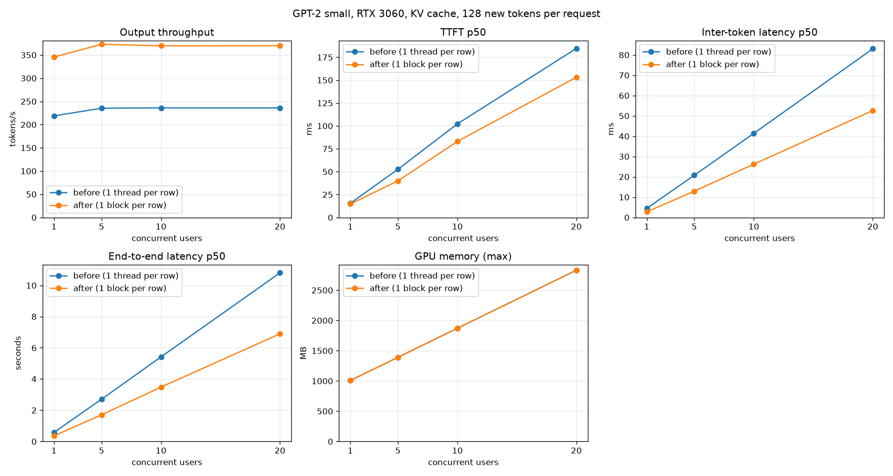

# 005 – Layernorm: one block per row

GPT-2 small, fp32, RTX 3060, KV cache on, matrix-vector kernel from `004`. Start: the state after `004`.
Sections 1 to 5 were written **before** I changed any code. The sections after that are filled in after the change.

## 1. What the profile shows

After `004` the decode step takes 3.87 ms of kernel time (`make profile-nsys-decode`, 128-token prompt, 40 steps, GPU 2,
read with `scripts/nsys_stage_breakdown.py`). Layernorm is the largest stage.

| stage | per step | avg per call | ms / step | share |
|---|---|---|---|---|
| **layernorm** | 25 | 68.4 µs | **1.709** | **44.2%** |
| lm_head | 1 | 477.3 µs | 0.477 | 12.3% |
| mlp_up | 12 | 34.8 µs | 0.417 | 10.8% |
| qkv_linear (3 launches) | 12 | 34.4 µs | 0.413 | 10.7% |
| mlp_down | 12 | 33.2 µs | 0.399 | 10.3% |
| attention (decode) | 12 | 22.5 µs | 0.270 | 7.0% |
| attn_proj | 12 | 11.2 µs | 0.135 | 3.5% |
| residual, gelu, embed | | | 0.049 | 1.3% |
| **sum** | | | **3.87** | |

Layernorm also matters in prefill. The stage table of `make bench-gpu` (32-token prompt, one pass of 20.6 ms) shows
layernorm at **4.25 ms, 20.7%**, with 170 µs per call.

## 2. Nsight Compute: what the kernel does

`ncu --set full` on two decode launches (GPU 2). ncu runs kernels slower than nsys (112 µs against 68 µs), so I only use ratios and counts.

| metric | value |
|---|---|
| grid × block | **1 block × 256 threads** |
| warps active (of the peak) | 2.2% |
| active threads per warp instruction | **1.11 of 32** |
| issued warp instructions per scheduler cycle | 0.11 |
| active warps per scheduler | 1.02 |
| registers per thread | 24 |
| memory throughput / DRAM throughput | 0.24% / 0.06% |

## 3. Hypothesis

`layernorm_kernel` gives **one thread per row** (token). Decoding has one row, so one thread of 256 does all the work:
three loops over 768 values (mean, variance, output) one after another, with every load waiting for the previous one.
The 255 other threads in the block exit immediately. That is why 1.11 of 32 lanes are active, and why only one SM of 28 has any work.

The data volume is tiny. One call reads 3 KB of input and 6 KB of gamma and beta, and writes 3 KB: 12 KB in total, which is
**0.03 µs at 360 GB/s**. Memory bandwidth cannot be the limit. The cost of 68 µs comes from the serial dependent loop (about 2300 loads and adds on one thread).

In prefill the same kernel has `n_tokens` threads in `ceil(n/256)` blocks. For 32 tokens that is 32 working threads in 1 block, which also uses one SM.
Cost per call: 170 µs for 32 rows.

What I do **not** know: how much of the 68 µs is the loop and how much is launch latency. A launch of an empty kernel takes a few µs, so I expect it to be a small part.

## 4. Change

A kernel with **one block per row**; the threads of the block split the 768 values.

- **Grid = `n_tokens` blocks, 256 threads each.** Every thread handles 3 values of a 768-wide row (`dim = threadIdx.x, +256, +512`), and the lanes of a warp read neighbouring floats: coalesced.
- **Mean and variance by block reduction.** Each thread sums its values. A warp shuffle (`__shfl_down_sync`) reduces within each warp. The 8 warp sums go through shared memory, and the first warp adds them. The value is then shared with all threads.
- **Same three passes as the CPU reference (mean, variance, output), each one parallel.** The row is read from global memory in each pass. After the first pass it sits in L1/L2, and the row is only 3 KB. The variance is computed from the centred values `(x - mean)²`, as in the CPU reference, not from `E[x²] - mean²`, which loses precision.
- **Any `n_embd` works.** Each pass is a loop `for (dim = threadIdx.x; dim < n_embd; dim += blockDim.x)`, so sizes that are not a multiple of 256 are handled (the tests use 3, 255, 257 and 1000). The fully parallel case is `n_embd = 768`: 3 values per thread.
- **Block size 256.** For n_embd = 768 that is 3 values per thread. For short rows, such as the 3-wide test rows, most threads idle, and that is fine.
- **The order of the sums changes**, so results differ from the CPU by float rounding (around 1e-6 relative). The tests compare with a tolerance.

Not changed: the matmul kernels, the attention, the residual and bias kernels, and the number of layernorm launches (25 per step).

## 5. Prediction (written before the change)

The unknown part is the cost of one launch plus the reduction steps: two block reductions (mean and variance) with a few barriers each, and a few hundred cycles per reduction. I expect **8–15 µs per call** at decode, mostly latency.

- Decode call: 68.4 µs → **8–15 µs**. Layernorm per step: 1.709 ms → **0.20–0.38 ms**.
- Decode step (kernel time): 3.87 ms → **2.4–2.6 ms**. Layernorm falls from 44% to about 10% of the step. `lm_head` (0.477 ms) becomes the largest stage.
- C benchmark, 32-token prompt, 200 decode tokens: 246 tok/s → **360–400 tok/s**.
- Server, 128 tokens, 20 users: 236 tok/s → **330–370 tok/s**. This is lower than the kernel factor suggests, because about 0.3 ms per token is spent outside the kernels.
- Prefill, 32 tokens: layernorm 4.25 ms (170 µs per call) → **0.3–0.6 ms (12–25 µs per call)**; whole pass 20.6 ms → **16.5–17 ms**. Prefill with 512 tokens: the kernel has 512 blocks, so layernorm should no longer be a visible stage there.
- It would be wrong if: the decode call stays above 25 µs (then the launch or the barriers cost more than I think), or the output differs from the CPU by more than 1e-4.

## 6. Tests (written first, before the kernel)

The tests in `engine/tests/test_layernorm.cu` were written before the kernel.

1. The tests that check numbers against the CPU passed on the old kernel (39 passed). That is on purpose: they fix the behaviour that must not change.
2. **Red:** one test checks the launch shape, `layernorm_last_launch()`. For 5 rows it expects 5 blocks. The old kernel put all 5 rows in 1 block, so the test failed (39 passed, 1 failed).
3. **Green:** the new kernel. 40 passed.

| test | what it covers |
|---|---|
| 1 row, 32 rows and 300 rows of 768 | the GPT-2 size, decode and prefill |
| row lengths 1, 31, 255, 257, 1000 | lengths that are not a multiple of the block (256) or the warp (32) |
| rows are independent | row 2 of a 3-row call equals the same row alone (1e-6) |
| zero mean, unit variance | with gamma = 1 and beta = 0 the output of each row has mean 0 and variance 1 |
| large mean (inputs near 1000) | the centred variance stays accurate. `E[x²] - mean²` would lose its digits here |
| constant row | zero variance: the output is finite and equals beta |
| launch shape | 1 row → 1 block, 5 rows → 5 blocks, at least 128 threads per block |

**Mutation checks** (I broke the kernel on purpose and ran the tests):

| change | tests that failed |
|---|---|
| variance as `E[x²] - mean²` | 1 (large mean) |
| the first loop stops after 256 values | 6 |
| warp 0 adds only 4 of the 8 warp sums | 6 |
| removed the last `__syncthreads()` of `block_sum` | **0** |

The last mutation was not caught: 40 passed. The barrier protects the shared array in case `block_sum` is called a second time before the other threads have read the result. In this kernel `mean` is read right after the call and the second call uses other slots at the start, so the missing barrier does not change the result in the tests. I could not make the race show up. I kept the barrier and changed its comment to say that the current callers do not need it. The cost is one more barrier per call.

Model level: `prefill` + 12 `decode` steps still match the full forward pass (1e-3, same argmax). `make bench-gpu` checks the GPU against the CPU on 8 tokens: max scaled difference 2.4e-06 (limit 1e-3).

Totals: `make test-gpu` 40 passed, `make gpt2-gpu-test` 11 passed, `pytorch/tests` 29 passed, `make test` 20 passed, `make check` clean.

## 7. Result

### 7.1 Kernel time per decode step (`make profile-nsys-decode`, 128-token prompt, 40 steps, GPU 2)

`scripts/nsys_stage_breakdown.py` read the report from before (`build/report_decode_before_layernorm.nsys-rep`) and after the change.

| stage | before: avg per call | before: ms/step | after: avg per call | after: ms/step |
|---|---|---|---|---|
| layernorm | 68.4 µs | 1.709 | **2.8 µs** | **0.070** |
| lm_head | 477.3 µs | 0.477 | 477.9 µs | 0.478 |
| qkv_linear (3 launches) | 34.4 µs | 0.413 | 38.6 µs | 0.463 |
| mlp_up | 34.8 µs | 0.417 | 34.8 µs | 0.417 |
| mlp_down | 33.2 µs | 0.399 | 33.3 µs | 0.399 |
| attention | 22.5 µs | 0.270 | 22.6 µs | 0.271 |
| attn_proj | 11.2 µs | 0.135 | 11.5 µs | 0.138 |
| residual, gelu, embed | | 0.049 | | 0.049 |
| **sum** | | **3.87** | | **2.29** (1.69x) |

- Layernorm: 24.4x faster per call, from 44.2% of the step to 3.1%.
- The other stages did not change, except `qkv_linear`: 0.413 → 0.463 ms (+12%). I did not change that code. I do not know why it is slower. It may be noise between captures, or the layernorm before it now ends sooner, so the first matmul starts with less overlap. This is a guess.
- `lm_head` is now the largest stage (20.9%), followed by the three matmuls of the block.

### 7.2 Prediction against result

| | prediction | result | |
|---|---|---|---|
| layernorm per call (decode) | 8–15 µs | **2.8 µs** | much faster |
| layernorm per step | 0.20–0.38 ms | **0.070 ms** | much faster |
| layernorm is not a visible stage in prefill with 512 tokens | stated, no number | **not measured** (I have a stage table only for 32 tokens) | open. See section 8 |
| decode step, kernel time | 2.4–2.6 ms | **2.29 ms** | faster |
| C bench, 200 decode tokens | 360–400 tok/s | **416.9 tok/s** | faster |
| server, 128 tokens, 20 users | 330–370 tok/s | **370.0 tok/s** | top of the range |
| prefill 32 tokens, pass time | 16.5–17 ms | **16.3 ms** (17.4 ms in the stage-table run) | in range |
| prefill 32 tokens, layernorm | 0.3–0.6 ms | **0.123 ms** | faster |

I expected a call to take 8–15 µs, because of the barriers of two block reductions. It takes 2.8 µs. My estimate of the barrier cost was too high, and I did not know the real latency of a warp-shuffle reduction. The estimate for the whole step was still close, because layernorm is only one part of it.

### 7.3 Prefill

Layernorm in prefill: 4.249 ms (170 µs per call, 20.7% of the pass) → 0.123 ms (4.9 µs per call, 0.7%).

| prompt tokens | before | after | |
|---|---|---|---|
| 32 | 21.83 ms (1466 tok/s) | 16.33 ms (1959 tok/s) | 1.34x |
| 128 | 91.77 ms (1395 tok/s) | 84.09 ms (1522 tok/s) | 1.09x |
| 512 | 367.32 ms (1394 tok/s) | 353.82 ms (1447 tok/s) | 1.04x |

The gain shrinks for longer prompts, because the time is mostly attention and the matmuls there, and layernorm was a smaller share. The (old) attention kernel is now 38% of the 32-token pass (6.29 ms of 16.4 ms), the next prefill target. TTFT for a 32-token prompt in the server went from about 18 ms to 15 ms.

### 7.4 End to end

C benchmark, 32-token prompt, KV cache, one sequence (`make bench-gpu`):

| decode tokens | before | after | |
|---|---|---|---|
| 16 | 203.9 tok/s | 323.1 tok/s | 1.58x |
| 200 | 246.0 tok/s | 416.9 tok/s | 1.69x |
| 900 | 221.9 tok/s | 350.8 tok/s | 1.58x |

Server (`scripts/benchmark_throughput.py`), KV cache on, matrix-vector kernel in both columns. "Before" was measured again today with the library built from the `004` code, not taken from the `004` report.

128 new tokens per request:

| Users | tok/s before | tok/s after | Speedup | Inter-token p50 before | after | TTFT p95 before | after | End-to-end p50 before | after |
|---|---|---|---|---|---|---|---|---|---|
| 1 | 218.7 | 345.4 | 1.58x | 4.4 ms | 2.8 ms | 20 ms | 16 ms | 0.58 s | 0.36 s |
| 5 | 235.3 | 373.2 | 1.59x | 20.8 ms | 12.9 ms | 92 ms | 81 ms | 2.71 s | 1.71 s |
| 10 | 236.1 | 369.8 | 1.57x | 41.4 ms | 26.2 ms | 166 ms | 145 ms | 5.42 s | 3.48 s |
| 20 | 236.0 | 370.0 | 1.57x | 83.0 ms | 52.6 ms | 307 ms | 284 ms | 10.80 s | 6.90 s |

16 new tokens per request:

| Users | tok/s before | tok/s after | Speedup | Inter-token p50 before | after | TTFT p95 before | after | End-to-end p50 before | after |
|---|---|---|---|---|---|---|---|---|---|
| 1 | 181.4 | 291.2 | 1.60x | 4.5 ms | 2.6 ms | 20 ms | 16 ms | 0.08 s | 0.05 s |
| 5 | 213.0 | 315.4 | 1.48x | 20.4 ms | 12.8 ms | 64 ms | 56 ms | 0.37 s | 0.25 s |
| 10 | 212.6 | 317.7 | 1.49x | 40.9 ms | 25.8 ms | 151 ms | 120 ms | 0.74 s | 0.49 s |
| 20 | 214.0 | 320.0 | 1.50x | 81.8 ms | 51.7 ms | 260 ms | 219 ms | 1.48 s | 0.98 s |

- The kernel time of a decode step fell by 1.69x (3.87 → 2.29 ms), and the server gained 1.5 to 1.6x. The server rate (370 tok/s = 2.7 ms per token) is above the kernel time (2.29 ms) by about 0.4 ms. That gap was 0.37 ms before (4.24 ms per token against 3.87 ms of kernel time), so it did not change. It is now 15% of each token, against 9% before.
- The generated text is the same as before: ` the capital of the French Republic, and the capital of the` for the prompt "The capital of France is".
- Throughput is still flat when users are added (about 370 tok/s from 5 to 20 users). The server handles one request at a time.
- Total since the start of the KV cache work (`003`), server, 128 tokens, 20 users: 90.9 tok/s (cache, matrix-matrix kernel) → 237 tok/s (`004`) → 370 tok/s (`005`).

## 8. What I do not know yet

- **Why one layernorm call takes 2.8 µs.** I expected 8–15 µs. I did not run ncu on the new kernel, so I cannot say if the time is launch latency, the barriers or the loads. A launch of an empty kernel costs a few µs, so most of the 2.8 µs may be the launch itself and there is little left to win in this kernel.
- **Why `qkv_linear` got 12% slower** (0.413 → 0.463 ms) when I did not touch it. Noise between captures or an effect of the changed timing before it. I took one capture each.
- **The gap between the kernels and the server.** 0.4 ms per token (2.7 ms per token against 2.29 ms of kernel time) is now 15% of a token. I measured it, I do not know the parts: the logits copy to the CPU and the argmax (a 200 KB copy), the tokenizer decode of the whole generated list at every token, the thread hop of the server, and 219 launches (3.5 µs each on the CPU side, 0.77 ms per step, which overlaps with the GPU work).
- **Prefill with long prompts.** I have a stage table only for 32 tokens. For 512 tokens I measured the total time only (354 ms), not the share of each stage.
- **The missing-barrier mutation was not caught** (section 6). The barrier is cheap and I kept it. I could not show the race, so I cannot say whether it exists.
- **Precision.** The sums are in a different order from the CPU. The GPU-vs-CPU check in the benchmark shows a max scaled difference of 2.4e-06 on 8 tokens, and the tests pass at 1e-4. I did not measure it on a long sequence.

## 9. Next

1. The next biggest kernel stages in a decode step are the matmuls (1.8 ms of 2.29 ms together), at about 74% of the memory peak. The gain left there is at most about 25% of those 1.8 ms.
2. The 219 launches per step. Launching q, k and v as one kernel, and fusing the bias into the matmul, would remove 36+48 launches. A CUDA graph for the whole decode step would remove nearly all of the CPU launch cost.
3. The scheduler and batched decode. This is where throughput can go up with the number of users. The step is now short (2.3 ms of kernel time), so the Python work per token (about 0.4 ms) is a visible share.
4. For prefill: the old attention kernel (38% of a 32-token pass).

## 10. Files

- Kernel: `engine/src/layernorm.cu` (`layernorm_kernel`, `block_sum`, `layernorm_device`, `layernorm_last_launch`), `engine/include/layernorm.h`.
- Tests: `engine/tests/test_layernorm.cu`.
- Tools: `scripts/nsys_stage_breakdown.py`, `make profile-nsys-decode`, `scripts/compare_benchmarks.py`.
- Raw data: `build/report_decode_{before,after}_layernorm.nsys-rep`, `build/benchmarks/{ln_before128,ln_after128,ln_before16,ln_after16}/*.json` (`build/` is not in git).
