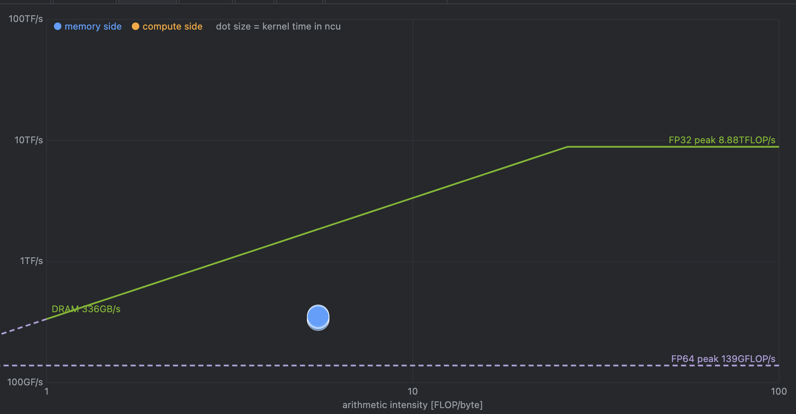
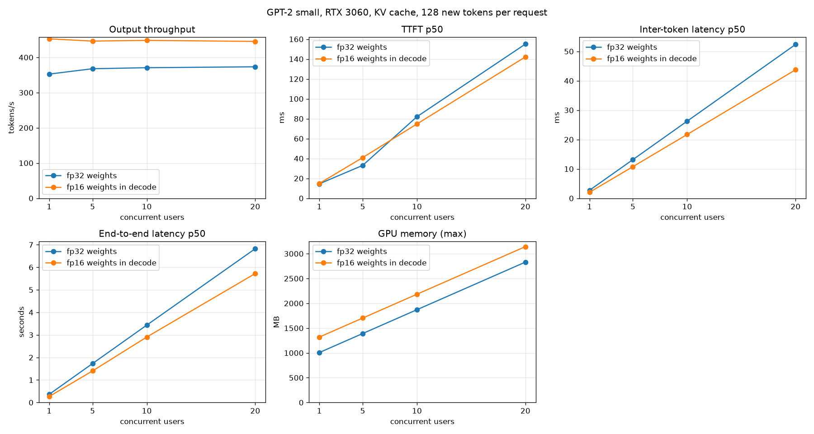

# 006 – fp16 weights for the decode matmuls

GPT-2 small, RTX 3060, KV cache on, matrix-vector kernel (`004`) and one-block-per-row layernorm (`005`).
Start: the state after `005`.
Sections 1 to 5 were written **before** I changed any code. The sections after that are filled in after the change.

## 1. Why: the decode step is memory-bound

After `005` a decode step takes 2.29 ms of kernel time (`make profile-nsys-decode`, 128-token prompt, 40 steps, GPU 2, read with `scripts/nsys_stage_breakdown.py`).

| stage | per step | avg per call | ms / step | share |
|---|---|---|---|---|
| lm_head (768→50257) | 1 | 477.9 µs | 0.478 | 20.9% |
| qkv_linear (3 launches) | 12 | 38.6 µs | 0.463 | 20.3% |
| mlp_up (768→3072) | 12 | 34.8 µs | 0.417 | 18.3% |
| mlp_down (3072→768) | 12 | 33.3 µs | 0.399 | 17.5% |
| attention (decode) | 12 | 22.6 µs | 0.271 | 11.8% |
| attn_proj (768→768) | 12 | 11.5 µs | 0.138 | 6.0% |
| layernorm, residual, gelu, embed | | | 0.150 | 6.5% |
| **sum** | | | **2.29** | |

The five matrix-vector stages take **1.90 ms, 83% of the step**.

`ncu --set full` on the matrix-vector kernel (GPU 2, decode launches):

| shape | grid | time | DRAM throughput (% of peak) | GB/s | SM throughput | DRAM bytes read / weight bytes |
|---|---|---|---|---|---|---|
| 768→768 (q, k, v, attn_proj) | 24 blocks | 13.0 µs | 63% | 220 | 20% | 2.37 / 2.36 MB |
| 768→3072 (mlp_up) | 96 blocks | 37.5 µs | 79% | 277 | 26% | 9.45 / 9.44 MB |
| 768→50257 (lm_head) | 1571 blocks | 516.7 µs | 86% | 301 | 29% | 154.6 / 154.4 MB |

- The kernel reads each weight once and does 2 FLOPs per 4 bytes read, which is 0.5 FLOP/byte. The compute units are 70–80% idle. It is on the memory side of the roofline.

How to read the roofline for this kernel (my numbers, not read off the screenshot):

- **Arithmetic intensity** is FLOPs per byte read from DRAM. The fp32 matrix-vector kernel has 2 FLOPs per 4-byte weight = **0.5 FLOP/byte**. With fp16 weights it is 2 FLOPs per 2-byte weight = **1.0 FLOP/byte**. The FLOPs do not change. Only the bytes do, so fp16 moves the kernel to the **right** on the roofline, along the memory-bound slope.
- **On the slope, performance = bandwidth × intensity.** At the ~350 GB/s that ncu implies, 0.5 FLOP/byte allows about 175 GFLOP/s, and 1.0 FLOP/byte about 350 GFLOP/s. That is the 2× that fp16 can give at most, if the kernel stays at the same fraction of the bandwidth.
- **The ridge point** (where the slope meets the compute roof) is at roughly 40 FLOP/byte for this card. I estimated it as 28 SMs × 128 FP32 lanes × 2 FLOPs × 2.1 GHz ≈ 15 TFLOP/s, divided by 350 GB/s. The 128 lanes per SM is my assumption from the architecture, not something I measured. Either way, both points are about 40× to the left of it, so fp16 does not change which side of the roofline the kernel is on. Only a much larger intensity would: that needs **batching**, because a batch of sequences reuses each weight for every sequence in the step.
- The measured positions of the kernel on this plot are in section 7.
- The bytes read from DRAM equal the weight size, so the kernel wastes no traffic. There are two ways to go faster: use more of the bandwidth, or **read fewer bytes**.
- The first way is small. At 90% of the peak for every shape (about 350 GB/s), the matrix-vector stages would take 1.57 ms instead of 1.90 ms.
- The second way is larger. The step reads **494 MB** of fp32 weights. In fp16 it is 247 MB.

## 2. Is fp16 safe for these weights? (checked before any design)

All 77 weight files of GPT-2 small, 201,532,416 values, converted to fp16 and back:

| check | result |
|---|---|
| values that overflow to infinity | **0** (the largest weight is 17.4, fp16 goes up to 65504) |
| non-zero values that become 0 | **73** of 201.5 M (0.00004%) |
| RMS rounding error / RMS of the weights, worst file | **2.2e-4** (fp16 has 11 bits of precision, the relative step is 4.9e-4) |

No overflow, and the rounding error is at the expected size. What this does **not** tell me is how the error adds up through 12 layers and the output head. That is measured in section 6 (accuracy).

## 3. Hypothesis

A decode step is limited by the bytes it reads from DRAM. If the matrix-vector stages read fp16 weights and keep fp32 for everything else (inputs, accumulators, activations, KV cache, layernorm, softmax), they read half the bytes, and the step gets faster by about the same factor on those stages.

The risks I see:

1. **Latency instead of bandwidth.** The fp32 kernel already runs at 63–86% of the peak. A thread that loads 2-byte values moves half as many bytes per load as before. If the kernel is limited by the number of loads in flight (84% of the cycles had no warp ready in the ncu data), then halving the bytes per load gives **no** speedup unless there are twice as many loads in flight. My first version therefore unrolls 8 loads per thread instead of 4.
2. **Small shapes.** `768→768` launches only 24 blocks on 28 SMs (0.43 waves). It will not get close to a 2× speedup, since it was at 63% already and its time is partly launch and tail latency.
3. **Accuracy.** Greedy decoding may pick a different token where the two best logits are close.

## 4. Change

**What becomes fp16:** the six weight matrices per layer that are used in decode (q, k, v, attention projection, MLP up, MLP down) and the output head (`lm_head`, the transposed token embedding). That is 494 MB in fp32.

**What stays fp32:** the token and position embeddings (a row lookup, not a product), layernorm weights, all biases (tiny), activations, the KV cache, the accumulators of the matrix-vector kernel, softmax and attention.

Design, and why:

- **Opt-in, per model: `gpt2_gpu_model_enable_fp16_decode(model)`.** It converts the weights on the GPU (a conversion kernel) and keeps the fp32 copies. **Prefill still uses the fp32 weights** and the matrix-matrix kernel, because that kernel is written for fp32 and prefill is not memory-bound. The price is **+247 MB of GPU memory**. The fp32 baseline stays reproducible, and `forward_last` and `prefill` are unchanged.
- **A separate kernel, `matvec_half_kernel`.** Same thread layout as `matvec_kernel` (32 columns × 16 slices of `K`, partial sums added in shared memory, input vector in shared memory), but the weight element is a 2-byte `__half` that is converted to fp32 and **accumulated in fp32**. Unroll 8 instead of 4 (risk 1).
- **Scalar 2-byte loads, not `half2` or 16-byte loads, in the first version.** `lm_head` has 50257 columns, an odd number, so rows would not be aligned for wider loads without padding the matrix. A warp still reads 64 contiguous bytes per row (2 full sectors). If the measurement shows the kernel is limited by the load instructions, wider loads with a padded matrix are the next variant.
- **The type in the C header is `unsigned short`** (a bit pattern), so the plain C files can include it. `__half` is used only in the `.cu` file.
- **Python:** `NativeGPT2(..., fp16_decode=True)` and the server flag `--fp16-weights`. The default stays fp32.
- **The decode block gets the fp16 weights as an optional extra argument** (NULL = fp32), so the same code serves both.

**Accuracy criteria, set before I look at any result:**

- Kernel level: against a CPU product that uses the **same fp16-rounded weights** in fp32, the kernel must agree to float accuracy (this isolates the kernel from the rounding of the weights). Against the true fp32 weights, the error must be at the size of the rounding (about 1e-3 relative).
- Model level, **teacher-forced** (both models read the same fp32-generated tokens, so one different choice does not change the following steps): maximum absolute logit difference **< 0.1**, top-1 agreement **≥ 98%** over at least 300 positions.
- Free-running greedy generation is reported too (how many tokens match before the first difference). I do not set a limit for it, because one close call changes everything after it.

## 5. Prediction (written before the change)

Weight bytes: 494 MB → 247 MB. At the 350 GB/s that ncu implies, the floor is 0.71 ms (it is 1.41 ms in fp32).

- **Matrix-vector stages: 1.90 ms → 1.0–1.3 ms** (a gain of 1.5–1.9×, not 2×: the small shapes do not scale and the efficiency drops a little because the loads are smaller).
- By shape: `lm_head` 478 µs → **250–300 µs**; `mlp_up` and `mlp_down` 34–35 µs → **18–24 µs**; `qkv_linear` (3 launches) 38.6 µs → **22–30 µs**; `attn_proj` 11.5 µs → **7–9 µs**.
- **Decode step (kernel time): 2.29 ms → 1.4–1.7 ms.** The matrix-vector stages fall from 83% to about 70% of the step; the attention (0.27 ms) and the layernorms do not change.
- **C benchmark, 32-token prompt, 200 decode tokens: 417 tok/s → 550–650 tok/s.**
- **Server, 128 tokens, 20 users: 370 tok/s → 470–550 tok/s.** This is lower than the kernel factor because about 0.4 ms per token is spent outside the kernels.
- **GPU memory: +247 MB** (±30 MB).
- **Prefill and TTFT: no change** (prefill does not use the fp16 weights).
- **Accuracy:** maximum logit difference < 0.1 and top-1 agreement ≥ 98%, teacher-forced (the criteria above).
- It would be wrong if: the matrix-vector stages stay above 1.5 ms (then the kernel is limited by something other than the bytes read), or the top-1 agreement is below 98%.

## 6. Tests (written first, before the kernel)

Steps, as in `004` and `005`:

1. **Red:** the kernel tests did not link (the functions did not exist), and so did the model tests.
2. **Red on behaviour:** with do-nothing stubs, **7 of 49** kernel tests and **2 of 16** model tests failed (the others only use code that already existed).
3. **Green:** the conversion kernel, `matvec_half_kernel`, the fp16 path through the block and the model. 49 and 16 passed.
4. **One more test after the mutation checks** (see the table): `every_decode_product_uses_the_matching_kernel`. Now 17 model tests.

**Kernel tests** (`engine/tests/test_matrix_mult_half.cu`):

| test | what it covers |
|---|---|
| conversion | 1000 values (and 0, 1e-9, -17.4) have the same bit pattern as `__float2half` (round to nearest even) |
| `[1,2,4] x [3,2]` | exact result by hand (all values exact in fp16) |
| `k=1, n=1` | smallest shape |
| `(17,33) (5,70) (100,31) (129,32) (3,1000) (255,65)` | `k` and `n` that are not a multiple of the slices (16), the unroll (8) or the warp (32) |
| `(768,768) (768,3072) (3072,768) (768,50257)` | the GPT-2 shapes, against a CPU product with the **fp16-rounded** weights (float accuracy: this isolates the kernel from the rounding of the weights) |
| against the true fp32 product | the error is below 0.05 but not zero (zero would mean the weights stayed fp32) |
| wide and narrow call | the same columns from a 100-column and a 40-column call |
| launch counters | the fp16 kernel and the fp32 kernel are counted separately |

**Model tests** (`engine/tests/test_gpt2_gpu_half.c`):

| test | what it covers |
|---|---|
| off by default; memory when enabled | `uses_fp16_decode` is 0 before, **247,064,064 bytes** after (the sum of the matrices times 2, as the test computes it), a second call allocates nothing, `NULL` is handled |
| prefill unchanged | prefill logits before and after enabling fp16 are **bit-identical** |
| teacher-forced accuracy | 24 decode steps, both models read the same tokens: max logit difference **0.043**, top-1 **24/24** (criteria: < 0.1 and ≥ 98%) |
| really uses fp16 | the logits differ from fp32 (> 0) |
| every product uses the right kernel | one decode step runs exactly 6 × 12 + 1 = 73 fp16 matrix-vector launches and 0 fp32 ones, and the other way round without fp16 |
| invalid input | same rejections as the fp32 decode, and the cache is unchanged |

**Mutation checks** (I broke the code on purpose and ran the tests):

| change | tests that failed |
|---|---|
| fp16 kernel drops the loop tail (k not a multiple of 128) | 3 |
| conversion truncates (`__float2half_rz`) instead of rounding to nearest | 4 |
| fp16 kernel accumulates in half precision instead of fp32 | 3 |
| decode ignores the fp16 weights of the blocks | **1** (only after I added the launch-counter test) |
| output head ignores its fp16 weights | **1** (only after the launch-counter test) |
| the MLP-down product uses the MLP-up matrix | 2 (the process aborted) |

The 4th and 5th mutations passed all 16 tests at first. The accuracy test could not see them: using fp32 for part of the work gives logits **closer** to fp32, so it passes. The launch counters can see it. I re-ran these two mutations after splitting the test files (below) and they are still caught.

Other checks: `make sanitize-gpu` (compute-sanitizer memcheck on all 49 kernel tests): **0 errors**. `make test` 20 passed, `pytorch/tests` 31 passed (two of them new: fp16 decode on a real prompt, and the argument checks), `make check` clean.

I also had to split two test files and move the options of `bench.c` into `bench_options.c`, because the repo limits a file to 400 lines (`test_gpt2_gpu.c` had 543, `test_matrix_mult.cu` 404, `bench.c` 401 with the new flag). The test counts are the same before and after the split.

## 7. Result

### 7.1 Kernel time per decode step (`make profile-nsys-decode`, 128-token prompt, 40 steps, GPU 2)

`scripts/nsys_stage_breakdown.py` on `build/report_decode_fp32_ref.nsys-rep` (taken in the same session) and `build/report_decode_fp16.nsys-rep`.

| stage | fp32: avg per call | fp32: ms/step | fp16: avg per call | fp16: ms/step | change |
|---|---|---|---|---|---|
| lm_head | 477.8 µs | 0.478 | **251.6 µs** | 0.252 | 1.90x |
| qkv_linear (3 launches) | 38.6 µs | 0.463 | 30.5 µs | 0.366 | 1.27x |
| mlp_up | 34.8 µs | 0.417 | 19.7 µs | 0.237 | 1.76x |
| mlp_down | 33.3 µs | 0.399 | 19.2 µs | 0.231 | 1.73x |
| attn_proj | 11.5 µs | 0.138 | 7.7 µs | 0.092 | 1.50x |
| attention | 22.6 µs | 0.271 | 22.6 µs | 0.271 | none |
| layernorm, residual, gelu, embed | | 0.150 | | 0.119 | none (the layernorm is 0.070 in both) |
| **sum** | | **2.30** | | **1.57** | **1.46x** |

The five matrix-vector stages together: 1.895 ms → **1.178 ms (1.61x)** for half the bytes (494 MB → 247 MB). Effective bandwidth of the weights, from the stage times: **210 GB/s** against 261 GB/s in fp32.

| stage | fp16 weight MB | GB/s (fp16) | change over fp32 |
|---|---|---|---|
| qkv_linear | 42.5 | 116 | 1.27x |
| attn_proj | 14.2 | 154 | 1.50x |
| mlp_up | 56.6 | 239 | 1.76x |
| mlp_down | 56.6 | 245 | 1.73x |
| lm_head | 77.2 | 306 | 1.90x |

### 7.2 Nsight Compute on the fp16 kernel (decode launches, GPU 2)

| shape | grid | time | DRAM, % of peak | GB/s | DRAM MB read / weight MB | issued warp / scheduler | no eligible warp |
|---|---|---|---|---|---|---|---|
| 768→768 | 24 blocks | 8.2 µs | **47%** | 165 | 1.19 / 1.18 | 0.23 | 77% |
| 768→3072 | 96 blocks | 22.3 µs | 72% | 252 | 4.73 / 4.72 | 0.28 | 72% |
| 768→50257 | 1571 blocks | 265.5 µs | **85%** | 296 | 77.6 / 77.2 | 0.29 | 71% |

The kernel still reads exactly the weight bytes (no waste). The large shape stays at 85%, the same fraction as in fp32 (86%), so halving the bytes halved its time. The small shape falls from 63% to 47% of the peak: the same 24 blocks have half the data to read, so the fixed cost (launch, the copy of `x` to shared memory, the reduction at the end) is a larger part of 8 µs. In all three cases about 70–77% of the cycles have no warp ready. That is the same picture as in fp32.

### 7.3 Prediction against result

| | prediction (section 5) | result | |
|---|---|---|---|
| matrix-vector stages | 1.0–1.3 ms | **1.18 ms** | in range |
| `lm_head` | 250–300 µs | **251.6 µs** | in range |
| `mlp_up` and `mlp_down` | 18–24 µs | **19.7 and 19.2 µs** | in range |
| `qkv_linear` (3 launches) | 22–30 µs | **30.5 µs** | at the top edge |
| `attn_proj` | 7–9 µs | **7.7 µs** | in range |
| decode step, kernel time | 1.4–1.7 ms | **1.57 ms** | in range |
| C bench, 32-token prompt, 200 tokens | 550–650 tok/s | **614 tok/s** | in range |
| server, 128 tokens, 20 users | 470–550 tok/s | **445 tok/s** | **below the range** |
| GPU memory | +247 MB (±30) | **+312 MB** at the server, 247 MB for the weights | see below |
| prefill and TTFT | no change | prefill 84.65 ms in both; TTFT p50 15 ms in both at 1 user | as predicted |
| max logit difference | < 0.1 | **0.043** in the C test; **3.54** over 1200 positions | see section 7.5 |
| top-1 agreement | ≥ 98% | **100%** (24/24 and 1200/1200) | as predicted |

Two predictions did not hold:

- **Server throughput was below my range** (445 against 470–550 tok/s). The kernel part came out as predicted. The part outside the kernels did not shrink. See 7.4.
- **The memory at the server grew by 312 MiB**, not 247. The weights take 247 MB (the test checks that exactly). The remaining ~65 MiB I did not trace. It could be the CUDA allocator or the library; I did not measure it.

### 7.4 End to end

C benchmark, 32-token prompt, KV cache, one sequence (`make bench-gpu`, both columns measured in the same session):

| decode tokens | fp32 | fp16 | |
|---|---|---|---|
| 16 | 327.1 tok/s | 422.2 tok/s | 1.29x |
| 200 | 418.9 tok/s | 614.0 tok/s | 1.47x |
| 900 | 352.4 tok/s | 480.2 tok/s | 1.36x |

Prefill for 128 tokens: 84.65 ms in both (fp16 is not used there).

Server (`scripts/benchmark_throughput.py`, KV cache, new layernorm in both). Both columns were measured again today, in this order: fp32 server, then fp16 server.

128 new tokens per request:

| Users | tok/s fp32 | tok/s fp16 | Speedup | Inter-token p50 fp32 | fp16 | TTFT p50 fp32 | fp16 | TTFT p95 fp32 | fp16 | End-to-end p50 fp32 | fp16 |
|---|---|---|---|---|---|---|---|---|---|---|---|
| 1 | 352.6 | 452.7 | 1.28x | 2.7 ms | 2.0 ms | 15 ms | 15 ms | 16 ms | 17 ms | 0.36 s | 0.27 s |
| 5 | 367.9 | 446.3 | 1.21x | 13.1 ms | 10.8 ms | 33 ms | 41 ms | 76 ms | 89 ms | 1.73 s | 1.40 s |
| 10 | 370.7 | 448.4 | 1.21x | 26.2 ms | 21.7 ms | 82 ms | 75 ms | 146 ms | 129 ms | 3.43 s | 2.90 s |
| 20 | 373.3 | 445.4 | 1.19x | 52.4 ms | 43.7 ms | 155 ms | 142 ms | 278 ms | 257 ms | 6.82 s | 5.72 s |

16 new tokens per request:

| Users | tok/s fp32 | tok/s fp16 | Speedup | Inter-token p50 fp32 | fp16 | TTFT p50 fp32 | fp16 | End-to-end p50 fp32 | fp16 |
|---|---|---|---|---|---|---|---|---|---|
| 1 | 299.7 | 341.9 | 1.14x | 2.5 ms | 1.9 ms | 14 ms | 15 ms | 0.05 s | 0.04 s |
| 5 | 316.9 | 369.3 | 1.17x | 12.9 ms | 10.6 ms | 37 ms | 35 ms | 0.25 s | 0.21 s |
| 10 | 316.3 | 364.7 | 1.15x | 26.0 ms | 21.5 ms | 69 ms | 65 ms | 0.49 s | 0.42 s |
| 20 | 318.0 | 364.8 | 1.15x | 51.7 ms | 43.9 ms | 135 ms | 120 ms | 0.98 s | 0.86 s |

- **The kernel gain is 1.46x and the server gain is 1.19x–1.28x.** Per token the server needs 2.68 ms with fp32 and 2.25 ms with fp16 (at 20 users). The kernel time of the step is 2.30 and 1.57 ms. The time **outside the kernels** is therefore 0.38 ms (14% of a token) in fp32 and **0.68 ms (30% of a token)** in fp16. That is a measured difference. The cause is something I did not find: it is not the same 0.4 ms as before, which would give 1.95 ms per token and 513 tok/s.
- The text is the same as before for the two test prompts: ` the capital of the French Republic, and the capital of the French Republic` and `, the world was a place of great beauty and great danger. The`.
- Throughput is still flat when users are added (about 445 tok/s from 1 to 20 users), because the server handles one request at a time.
- From the start of the KV cache work, server throughput at 20 users, 128 tokens: 90.9 → 237 → 370 → 445 tok/s.

### 7.5 Accuracy (`scripts/compare_fp16_quality.py`)

12 prompts (text, code, a question), 100 teacher-forced decode steps each, **1200 positions**, GPU 2:

| measure | result |
|---|---|
| top-1 agreement | **100.00%** (1200 of 1200) |
| mean KL(fp32 ‖ fp16) | 5.7e-06 nats (max 7.7e-05) |
| mean of the per-step maximum |logit difference| | 0.118 |
| **largest** |logit difference| over all positions | **3.54** |
| positions with a maximum difference below 0.1 / below 0.5 | 81% / 96% |
| free-running greedy, 100 tokens | all 12 prompts **identical** to fp32 |

The 3.54 is above my criterion of 0.1 for the maximum difference. I looked at where it comes from (a separate run over the same 1200 positions):

- The worst cases are at the **top logits** (e.g. 42.05 in fp32 and a difference of 3.32 at that token), which are large numbers. The logits of GPT-2 go up to about 50 and down to about -130, so a difference of 3 is 7% of a top logit at 42.
- The difference at the top-1 token is 0.074 on average and 3.32 at most.
- The gap between the best and the second best token was never small enough to flip the choice: only 5 positions had a gap smaller than twice the difference at the top token, and none flipped.

So the criterion "max logit difference < 0.1" **failed** over 1200 positions (3.54), although it passed in the 24-step test (0.043). Top-1 agreement (100%), the KL divergence and the free-running text all say the output is the same in practice. I do not think the criterion was well chosen: an absolute difference scales with the size of the logits. But I set it before the measurement and it did not hold, so I report it as not met. A relative measure, or the KL divergence, would have been the better one to write down.

## 8. What I do not know yet

- **Why the time outside the kernels grew** from 0.38 ms to 0.68 ms per token when the kernels got faster. It looks like something that waits for the GPU and so shows up as non-kernel time, but I have not measured it.
- **The extra ~65 MiB** of GPU memory at the server on top of the 247 MB of weights.
- **Why `qkv_linear` gains only 1.27x.** It is three 768→768 launches. ncu shows 47% of the peak bandwidth for that shape, with 24 blocks on 28 SMs (0.43 waves): 4 SMs have no work, and each block has half as much to read. Splitting the 768 columns into smaller tiles (more blocks) or merging q, k and v into one launch could help. I have not tried either.
- **Whether wider loads would help.** The kernel reads one 2-byte value per load. A padded matrix with 16-byte loads is a possible variant. I did not try it. With 70–77% of the cycles without a ready warp, it may or may not matter.
- **Longer sequences.** The accuracy was measured over 100 decode steps after prompts of 5–12 tokens. Errors could add up over 1000 tokens, and I did not test that.
- **The accuracy criterion.** The maximum absolute logit difference is not a good measure (section 7.5).
- **Larger models.** GPT-2 small has no weights outside the fp16 range. Another model may need scaling.
- **fp16 for prefill.** Not done and not needed here, since prefill is not memory-bound.

## 9. Next

1. Find the 0.68 ms per token outside the kernels. It is now 30% of a token, so it is worth more than any kernel left. Candidates are the copy of the logits to the CPU, the tokenizer decode of the whole generated list at every token, and the thread hops of the server.
2. Reduce the launches of a step (219): q, k and v in one launch, the bias fused into the matrix-vector kernel, and a CUDA graph.
3. The scheduler with batched decode: the arithmetic intensity grows with the batch size, which is the one thing that moves the kernel to the right of the roofline.
4. Quantisation to 8 bits (int8) for the weights would halve the bytes again. It needs a scale per row or group and a bigger accuracy study.

## 10. Files

- Kernels: `engine/src/matrixmult.cu` (`convert_f32_to_f16_kernel`, `matvec_half_kernel`, `matvec_half_device`), `engine/src/linear.cu` (`linear_half_device`), `engine/src/transformer_block.cu` (fp16 weights of a block, fp16 path of the decode block), `engine/src/gpt2_gpu.cu` (`gpt2_gpu_model_enable_fp16_decode`).
- Python: `pytorch/src/mini_llm/native.py` (`EngineOptions`, `fp16_decode`), `pytorch/src/mini_llm/server.py` (`--fp16-weights`).
- Tests: `engine/tests/test_matrix_mult_half.cu`, `engine/tests/test_gpt2_gpu_half.c`, `engine/tests/test_gpt2_gpu_common.h`, `engine/tests/test_gpu_helpers.h`, `pytorch/tests/test_native_gpu.py`.
- Tools: `scripts/compare_fp16_quality.py`, `scripts/nsys_stage_breakdown.py`, `make bench-gpu BENCH_ARGS="--kv-cache --fp16-weights"`, `make profile-nsys-decode PROFILE_DECODE_EXTRA=--fp16-weights`.
- Raw data: `build/report_decode_fp32_ref.nsys-rep`, `build/report_decode_fp16.nsys-rep`, `build/ncu_half_*.ncu-rep`, `build/benchmarks/{fp32_128,fp16_128,fp32_16,fp16_16}/*.json` (`build/` is not in git).
