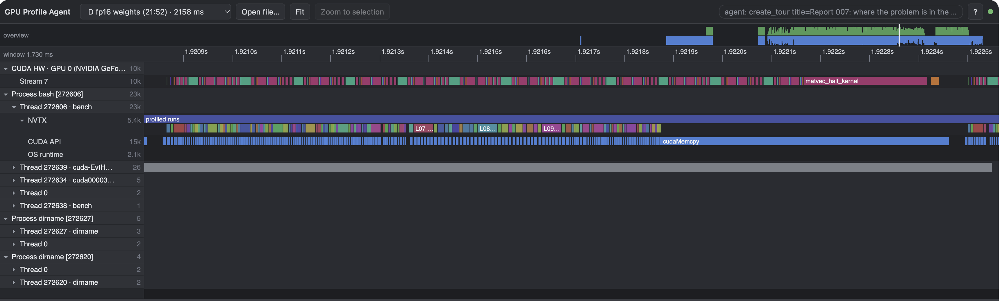
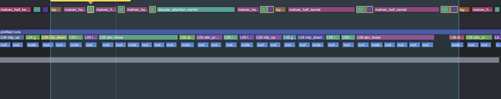
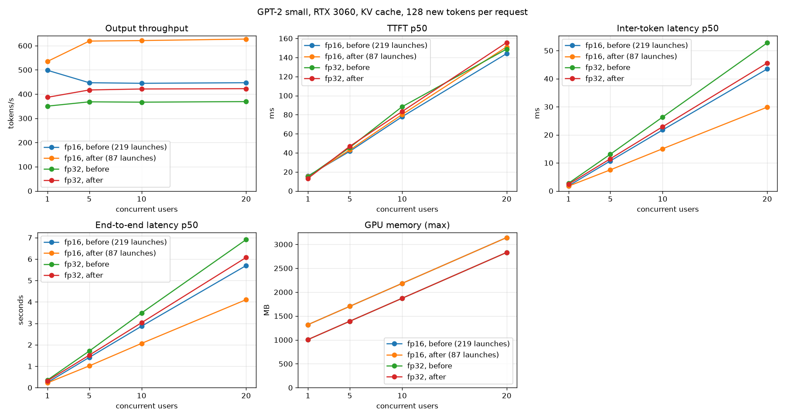

# 007 – Fewer kernel launches per decode step

GPT-2 small, RTX 3060, KV cache on, matrix-vector kernel (`004`), one-block layernorm (`005`), optional fp16 weights (`006`).
Start: the state after `006`.
Sections 1 to 5 were written **before** I changed any engine code. The sections after that are filled in after the change.

## 1. What the timeline shows

| | fp32 weights | fp16 weights |
|---|---|---|
| kernel launches per step | 219 | 219 |
| step period (first kernel to the next step's first kernel) | 2.537 ms | 1.925 ms |
| kernels running | 2.171 ms (85.6%) | 1.419 ms (73.7%) |
| GPU idle **inside** the step | 0.262 ms (10.3%) | **0.400 ms (20.8%)** |
| …of it, the GPU waited for the CPU to launch the kernel | 0.132 ms (50%) | **0.284 ms (71%)** |
| GPU idle **between** two steps (median) | 0.093 ms | 0.091 ms |
| `cudaLaunchKernel` on the CPU (median) | 3.24 µs | 3.11 µs |
| kernels shorter than 4 µs | 61% | 61% |

How I decide that "the GPU waited for the CPU": a kernel that starts less than 4 µs after the `cudaLaunchKernel` call that launched it returned. This is a heuristic.

The idle time inside the fp16 step, by the kernel that waited (ms per step): `matvec_half_kernel` 0.152, `add_bias_kernel` 0.080, `layernorm_kernel` 0.066, `vector_addition_kernel` 0.039, `decode_attention_kernel` 0.034, `gelu_new_kernel` 0.029.

### The 219 launches of a step

| per layer | launches |
|---|---|
| layernorm (before attention, before MLP) | 2 |
| matrix-vector product q, k, v | 3 |
| bias add for q, k, v | 3 |
| decode attention | 1 |
| matrix-vector product, attention projection | 1 |
| bias add, attention projection | 1 |
| residual add (after the attention) | 1 |
| matrix-vector product, MLP up | 1 |
| bias add, MLP up | 1 |
| gelu | 1 |
| matrix-vector product, MLP down | 1 |
| bias add, MLP down | 1 |
| residual add (after the MLP) | 1 |
| **per layer** | **18** |

12 layers × 18 = 216, plus the embed kernel, the final layernorm and the output-head product: **219**.

Of the 219 launches, 132 are not matrix products, layernorm or attention: 72 bias adds, 24 residual adds, 12 gelu, and 24 more that exist only because q, k and v are three separate launches. Their kernels run for about 1.3–1.7 µs each (nsys kernel summary: `add_bias_kernel` 1.66 µs, `vector_addition_kernel` 1.4 µs, `gelu_new_kernel` 1.4 µs), which is **less than the 3.1–3.2 µs the CPU needs to launch them**.

Without the profiler the step takes 1.62 ms in the C benchmark (fp16, 200 decode tokens), against 1.42 ms of kernels. So the real loss is about 0.2 ms, smaller than the 0.5 ms (0.40 inside, 0.09 between) that the profile shows. The profiler adds overhead to every CUDA call. I did not measure how much.

## 2. Where the gap between two steps comes from

After the last kernel of a step the CPU copies 200 KB of logits back (`cudaMemcpy`, about 16 µs of GPU time, but the call waits for the GPU), takes the argmax (0.005 ms), copies the next token to the GPU and launches the first kernel. The gap is 0.09 ms, about 5% of a step. A fix would be to take the argmax on the GPU and feed the token back without the CPU. That is **not** part of this change.

## 3. Hypothesis

The decode step has too many tiny kernels. The CPU needs about 3.2 µs per launch, and 61% of the kernels are shorter than that, so the GPU finishes each one and waits for the next launch. The CPU needs 1.30 ms to issue the 219 launches of a step, against 1.82 ms for the GPU from the first to the last kernel (measured in `006`'s profile). They are close, so any small hiccup of the CPU shows up as a gap.

If the small kernels are fused into the matrix-vector kernel that comes before them, then:

1. The launches fall from 219 to 87, and the CPU needs about 0.28 ms to issue them, against about 1.2 ms of GPU work. The CPU stays far ahead and the GPU does not wait.
2. The bias, residual and gelu kernels read and write the 3–12 KB result of the product again from global memory. A fused epilogue does this in registers. The busy time falls by about 0.17 ms.
3. q, k and v become one launch with 72 blocks instead of three launches with 24 blocks. That fills the 28 SMs better. `006` found that `qkv_linear` ran at only 47% of the memory peak in fp16, because 24 blocks leave 4 SMs without work.

What I do **not** know: how much of the 0.40 ms the profiler itself causes, and whether the real step in the C benchmark (1.62 ms) loses 0.2 ms to launches or something else.

## 4. Change

All of this is for the **decode** path (one row). Prefill keeps the separate kernels, because it is not launch-bound (a 32-token pass takes 16 ms for 219 launches).

**Fused matrix-vector kernel with an epilogue.** The kernel is a template on the weight type (fp32 or fp16) and on what happens to the result of a column before it is stored:

| epilogue | used for | stored value |
|---|---|---|
| none | output head | `sum` |
| bias | q, k, v, | `sum + bias` |
| bias + gelu | MLP up | `gelu(sum + bias)` |
| bias + residual | attention projection, MLP down | `residual + (sum + bias)` |

- **The order of the operations is the order of the separate kernels,** so the fused result should be **bit-identical** to the old one: `add_bias_kernel` computed `out += bias`, and `vector_addition` computed `a + b` with the residual as one operand. Floating-point addition is commutative, so `residual + (sum + bias)` is the same value. The gelu formula moves into a shared `__device__` function (`gelu_math.h`) that both `gelu_new_kernel` and the fused kernel call.
- **q, k and v in one launch:** `blockIdx.y` selects the product. The kernel gets three weight pointers, three bias pointers and three output pointers by value. The weights stay three separate buffers, so there is **no extra memory** and no change to the weight upload.
- **Residual fused into the epilogue of the projection and of the MLP down product,** not into the layernorm that follows. The residual add is elementwise, so it fits at the end of the product. Fusing it into the layernorm would work too, but the layernorm needs a reduction over the whole row, and the product is the natural place for it. The result is the same: both residual kernels (24 per step) disappear.
- **Same thread layout and same loop as before** (32 columns × 16 slices, unroll 4 for fp32 and 8 for fp16). The sum is accumulated in the same order, so the products are unchanged.
- **The existing functions stay** (`matvec_device`, `matvec_half_device`) as thin wrappers with the "none" epilogue, so the earlier tests still apply. `linear_half_device` has no caller after this change and is removed.
- **Code layout:** the matrix-vector kernels move from `matrixmult.cu` (253 lines) to a new `matvec.cu`, because the templates would push the file past the repo's 400-line limit.

**A counter of kernel launches.** `CUDA_CHECK_LAUNCH()` is already written after every launch (a lint rule requires it). It now also increments a global counter, read with `cuda_launch_count()`. A test can then assert "one decode step is exactly 87 launches". This is the main measurement of this change, and nothing in the code enforced it before.

Not changed: the 25 layernorm launches, the attention kernel, the embed kernel, the copy of the logits, and everything in prefill.

## 5. Prediction (written before the change)

Launches per layer: 18 → **7** (2 layernorm, 1 fused qkv, 1 attention, 1 projection, 1 up, 1 down). Per step: 219 → **87** (12 × 7 + embed + final layernorm + head).

nsys, `make profile-nsys-decode` (128-token prompt, 40 steps, GPU 2):

| | fp16 now | fp16 predicted | fp32 now | fp32 predicted |
|---|---|---|---|---|
| launches per step | 219 | **87** (exact) | 219 | **87** (exact) |
| kernels running | 1.419 ms | 1.20–1.30 ms | 2.171 ms | 1.98–2.05 ms |
| GPU idle inside the step | 0.400 ms | 0.05–0.15 ms | 0.262 ms | 0.05–0.12 ms |
| …waiting for a launch | 0.284 ms | below 0.08 ms | 0.132 ms | below 0.06 ms |
| step period | 1.925 ms | **1.35–1.50 ms** | 2.537 ms | **2.15–2.30 ms** |

- **C benchmark, 32-token prompt, 200 decode tokens, no profiler:** fp16 616 tok/s → **690–790 tok/s**; fp32 420 tok/s → **445–490 tok/s**. The gain is smaller than in the profile, because without the profiler the loss was already only about 0.2 ms per step.
- **Server, 128 tokens, 20 users:** fp16 447 tok/s → **490–540 tok/s**; fp32 369 tok/s → **395–425 tok/s**. About 0.6 ms per token is spent outside the engine (fp16), and this change does not touch it.
- **Correctness:** the logits of the golden runs (`scripts/golden_logits.py`: 6 prompts, 40 teacher-forced decode steps each, fp32 and fp16 weights) should be **bit-identical** to the ones saved before the change. The criterion I set: maximum absolute difference ≤ 1e-4 and the same top-1 token at every step. I report whether they are bit-identical as well.
- **GPU memory:** no change (no weights are copied).
- **Prefill and TTFT:** no change.
- It would be wrong if: the launches are not 87, or the fp16 step period stays above 1.65 ms (then launches are not the main cost of the idle time), or the logits differ by more than 1e-4.

## 6. Tests (written first, before the kernel)

Steps, as in `004` to `006`:

1. **Red:** the fused tests did not compile (the API did not exist).
2. **Red on behaviour:** with a do-nothing stub, **9 of 59** kernel tests failed (the 50 older ones passed) and the model test failed (it counted **219** launches, not 87).
3. **Green:** the templated kernel in `matvec.cu` and the new decode block: 59 kernel tests, 17 model tests.
4. **Two tests were added after mutation checks** showed gaps: an independent check of the gelu formula (`test_gelu.cu`), and a fix of the GPU test build so that it rebuilds when a header changes (see below).

The reference of every fused test is the **real old kernels**: `matvec_device`, `matvec_half_device`, `vectoraddition_device` (for `out + bias` and for the residual add) and `gelu_new_device`, run one after the other. The fused result must have the **same bits**.

| test (`engine/tests/test_matvec_fused.cu`) | what it covers |
|---|---|
| no epilogue | the fused kernel with no epilogue equals the plain product (fp32 and fp16) |
| bias | product, then `out += bias` |
| bias + gelu | `768→3072`, product, bias, then `gelu_new_device` |
| bias + residual | `768→768` and `3072→768`, product, bias, then `residual + out` |
| odd shapes | 6 shapes (1×1, 5×70, 17×33, 100×31, 129×32, 255×65), fp32 and fp16, three epilogues each |
| partial block | the epilogue is applied to the columns of the last, partly empty block |
| q, k, v in one launch | three products with different weights, biases and outputs: **one** launch, each output equals its separate kernels, and the three outputs differ |
| one launch | a single fused product counts as exactly one launch |
| no overrun | the 32 floats after the end of an output keep their garbage value |

| test (`test_gpt2_gpu_half.c`) | what it covers |
|---|---|
| a decode step is 87 launches | `cuda_launch_count()` grows by exactly 12 × 7 + 3 = **87** per step, with fp32 and with fp16 weights |
| the right kernel | 4 × 12 + 1 = 49 matrix-vector launches per step, of the fp32 kernel only (fp32) or of the fp16 kernel only (fp16) |
| (earlier tests) | prefill + 12 decode steps equal the full forward pass; fp16 stays close to fp32; invalid input is rejected |

The launch count comes from a new counter in `CUDA_CHECK_LAUNCH()`, which every launch has to call (a lint rule enforces it). It is defined in `engine/src/launch_count.cu`.

**Bit-for-bit check of the whole model** (`scripts/golden_logits.py`): before the change I saved the logits of 6 prompts × (prefill + 40 teacher-forced decode steps), 12,363,222 values, for fp32 and for fp16 weights. After the change, both runs are **bit-identical** (maximum difference 0, no value differs, same top-1 at every step). This also held after I later changed how the kernel reads its arguments (section 7.1).

**Mutation checks** (I broke the code on purpose and ran the tests):

| change | tests that failed |
|---|---|
| F1: bias added after the gelu instead of before | 2 |
| F2: the residual epilogue forgets the residual | 3 |
| F3: the three q/k/v products all use the weights of product 0 | 2 |
| F4: the last column of every block is skipped | **13** (the plain and the fp16 matrix-vector tests; none of the new fused tests is among the first ones to fail, because the older tests already cover this) |
| F6: the MLP-down product gets the wrong residual buffer in the block (`s->ln2` instead of `s->residual`) | 3 (model level) |
| G1: gelu coefficient 0.7978 instead of 0.7978845608 (error 2.4e-5) | 1 (the new gelu test) |
| G2: gelu constant 0.0447 instead of 0.044715 (error 3e-6) | 1 (the new gelu test) |
| F5: gelu constant 0.044716 instead of 0.044715 (error 6e-7, about 2 float steps) | **0**: not caught |

The mutation checks found two real gaps:

- **The gelu formula had no independent test.** The fused kernel and the old gelu kernel now call the same function (`gelu_math.h`), so "fused equals separate" cannot see an error in the formula. A wrong constant passed all 59 tests at first. I added a test against the formula in double precision, with a tolerance of 1e-6 × (1 + |x|). It catches G1 and G2. It does **not** catch F5: a change of 6e-7 is two float32 steps, inside any tolerance I could justify. I did not tighten it further.
- **The GPU test binary did not rebuild when a header changed.** My first gelu mutation (a change in `gelu_math.h`) showed "60 passed" because the Makefile rule for `test_runner_gpu` did not list the headers. I fixed the dependency (`$(wildcard engine/include/*.h)` and `engine/tests/*.h`) and ran the mutations again. Earlier mutation results in reports `004` to `006` changed `.cu` files, which were listed, so they are not affected.

Other checks: `make sanitize-gpu` (compute-sanitizer memcheck, 60 tests): **0 errors**. `compute-sanitizer --tool racecheck` over the same 60 tests: **0 hazards**. `make test` 20 passed, `make gpt2-gpu-test` 17 passed, `pytorch/tests` 31 passed, `make check` clean.

A build problem showed up late: the torch extension (`vector_addition.py`) compiles `vector_addition.cu`, and its `CUDA_CHECK_LAUNCH()` now calls the counter. The extension did not link (`undefined symbol: cuda_launch_counted`) and 4 Python test files failed to import. I added `launch_count.cu` to the sources of that extension. `make check` did not catch this: it does not run the Python tests.

## 7. Result

### 7.1 One fix during the work

My first version of the kernel was **slower** than the old separate kernels, although it had 87 launches:

| fp16 | launches | kernels running | step period |
|---|---|---|---|
| before | 219 | 1.419 ms | 1.925 ms |
| first fused version | 87 | **1.941 ms** | **2.150 ms** |
| final | 87 | 1.283 ms | 1.526 ms |

`nvcc -Xptxas -v` showed the cause: the kernel had a **96-byte stack frame** per thread. I indexed the kernel-argument struct with a run-time value (`args.b[product]`). The compiler cannot do that in the constant memory of the arguments, so it copied the whole struct to local memory in every thread. I replaced the run-time index with a select chain (`pick(...)`). The stack frame is now 0 bytes with 0 spills, and the registers are 35–40. The bits of the result did not change.

### 7.2 Kernel time per decode step (`make profile-nsys-decode`, 128-token prompt, 40 steps, GPU 2)

`scripts/nsys_gap_analysis.py` and `scripts/nsys_stage_breakdown.py`, 38 steps analysed. Before and after were measured in the same session.

| | fp32 before | fp32 after | fp16 before | fp16 after |
|---|---|---|---|---|
| launches per step | 219 | **87** | 219 | **87** |
| step period | 2.537 ms | **2.236 ms** | 1.925 ms | **1.526 ms** |
| kernels running | 2.171 ms | 2.041 ms | 1.419 ms | 1.283 ms |
| GPU idle inside the step | 0.262 ms | **0.083 ms** | 0.400 ms | **0.115 ms** |
| …the GPU waited for a launch | 0.132 ms | 0.027 ms | 0.284 ms | 0.067 ms |
| GPU idle between two steps (median) | 0.093 ms | 0.089 ms | 0.091 ms | 0.113 ms |
| kernels shorter than 4 µs | 61% | 30% | 61% | 30% |
| stage-table sum (nsys NVTX) | 2.27 ms | 2.04 ms | 1.56 ms | 1.28 ms |

Stages, fp16 (the other columns are in `build/`):

| stage | before: ms/step | after: ms/step | change |
|---|---|---|---|
| qkv_linear (now 1 launch with 72 blocks) | 0.357 | **0.168** | 2.1x |
| mlp_up (+ bias + gelu) | 0.238 | 0.216 | 1.1x |
| mlp_down (+ bias + residual) | 0.231 | 0.214 | 1.1x |
| attn_proj (+ bias + residual) | 0.094 | 0.077 | 1.2x |
| lm_head | 0.252 | 0.252 | none |
| attention | 0.270 | 0.277 | none |
| layernorm | 0.070 | 0.076 | none |
| residual, gelu (separate kernels) | 0.047 | 0 | removed |
| **sum** | **1.56** | **1.28** | **1.22x** |

The three `qkv` launches with 24 blocks each (the 47%-of-peak problem of report `006`) became one launch with 72 blocks, and that stage got twice as fast. The "after" stage table has no `residual` or `gelu` rows, because those kernels no longer exist in the decode step.

ncu on the fused fp16 kernels (decode launches): q/k/v fused 19.0 µs for 3.56 MB (188 GB/s, 54% of 350 GB/s), attention projection 8.9 µs (135 GB/s, 38%), MLP up 23.1 µs (206 GB/s, 59%), MLP down 23.5 µs (202 GB/s, 58%). MLP down and the projection still launch **24 blocks** (0.43 waves on 28 SMs), as before.

### 7.3 Prediction against result

| | prediction (section 5) | result | |
|---|---|---|---|
| launches per step | 87 (exact), fp32 and fp16 | **87** | as predicted |
| fp16 step period | 1.35–1.50 ms | **1.526 ms** | just above the range |
| fp32 step period | 2.15–2.30 ms | **2.236 ms** | in range |
| fp16 kernels running | 1.20–1.30 ms | **1.283 ms** | in range |
| fp32 kernels running | 1.98–2.05 ms | **2.041 ms** | in range |
| fp16 idle inside the step | 0.05–0.15 ms | **0.115 ms** | in range |
| fp32 idle inside the step | 0.05–0.12 ms | **0.083 ms** | in range |
| fp16 waited for a launch | below 0.08 ms | **0.067 ms** | in range |
| fp32 waited for a launch | below 0.06 ms | **0.027 ms** | in range |
| C bench, fp16, 200 tokens | 690–790 tok/s | **696 tok/s** | at the bottom of the range |
| C bench, fp32, 200 tokens | 445–490 tok/s | **457 tok/s** | in range |
| server, fp16, 128 tokens, 20 users | 490–540 tok/s | **627 tok/s** | **above the range** |
| server, fp32, 128 tokens, 20 users | 395–425 tok/s | **422 tok/s** | in range (top) |
| bit-identical logits | yes (criterion ≤ 1e-4) | **yes, 0 difference** | as predicted |
| GPU memory | no change | 1319 MiB at 1 user, before and after | as predicted |
| prefill and TTFT | no change | prefill 84.16 ms (128 tokens, before: 84.65); TTFT p50 15 ms | as predicted |

One prediction was clearly off: the **fp16 server throughput** came out 16% above my range (627, against 490–540), and 40% above the 447 before. I repeated the benchmark on the same server and got 627.4 tok/s again, so it is not a lucky run. The kernel step fell by only 22% (1.56 → 1.28 ms), but the server's time per token fell by 29% (2.24 → 1.59 ms). The time **outside the kernels** per token (server time per token minus the nsys step time, at 20 users):

| | before | after |
|---|---|---|
| fp32 | 0.44 ms | 0.33 ms |
| fp16 | **0.68 ms** | **0.31 ms** |

In report `006` I noted that the time outside the kernels had grown to 0.68 ms with fp16 and did not know why. It is now 0.31 ms, **about the same as fp32**. I did not change anything outside the engine. So a good part of that "outside" time was really launch cost: with 219 launches the CPU thread was busy launching while the next step could not start. I have not proven this; it is the explanation that fits the numbers.

### 7.4 End to end

C benchmark, 32-token prompt, KV cache, one sequence (`make bench-gpu`; "before" measured earlier in the same session):

| decode tokens | fp32 before | fp32 after | fp16 before | fp16 after |
|---|---|---|---|---|
| 16 | 313.3 tok/s | 335.0 tok/s | 423.7 tok/s | 459.2 tok/s |
| 200 | 420.5 tok/s | **457.1 tok/s** (1.09x) | 615.7 tok/s | **695.6 tok/s** (1.13x) |

Server (`scripts/benchmark_throughput.py`, 128 new tokens, 2 requests per user), "before" measured in this session with the library built from the `006` code:

fp16 weights:

| Users | tok/s before | tok/s after | Speedup | Inter-token p50 before | after | TTFT p50 before | after | End-to-end p50 before | after |
|---|---|---|---|---|---|---|---|---|---|
| 1 | 498.3 | 534.8 | 1.07x | 1.8 ms | 1.7 ms | 16 ms | 15 ms | 0.24 s | 0.22 s |
| 5 | 447.0 | 618.9 | 1.38x | 10.7 ms | 7.5 ms | 42 ms | 43 ms | 1.41 s | 1.02 s |
| 10 | 444.6 | 621.1 | 1.40x | 21.7 ms | 15.0 ms | 78 ms | 80 ms | 2.87 s | 2.07 s |
| 20 | 447.0 | 627.3 | 1.40x | 43.5 ms | 29.9 ms | 144 ms | 151 ms | 5.70 s | 4.11 s |

fp32 weights:

| Users | tok/s before | tok/s after | Speedup | Inter-token p50 before | after | TTFT p50 before | after | End-to-end p50 before | after |
|---|---|---|---|---|---|---|---|---|---|
| 1 | 350.2 | 386.7 | 1.10x | 2.7 ms | 2.4 ms | 15 ms | 13 ms | 0.36 s | 0.32 s |
| 5 | 368.1 | 417.1 | 1.13x | 13.1 ms | 11.5 ms | 46 ms | 47 ms | 1.71 s | 1.52 s |
| 10 | 366.7 | 421.1 | 1.15x | 26.3 ms | 22.9 ms | 88 ms | 83 ms | 3.48 s | 3.03 s |
| 20 | 369.1 | 422.4 | 1.14x | 52.8 ms | 45.6 ms | 149 ms | 156 ms | 6.91 s | 6.08 s |

- The generated text for "The capital of France is" is the same as before, with both weight types.
- With 16 new tokens per request, fp16: 387.6 / 469.2 / 473.2 / 488.4 tok/s at 1 / 5 / 10 / 20 users after the change. Report `006` measured 341.9 / 369.3 / 364.7 / 364.8 tok/s for the same workload before it (an earlier session, so the comparison is less strict than the 128-token one): +13% at one user and +34% at 20 users.
- TTFT does not change: the change only touches the decode step.
- Throughput is still flat when users are added (about 625 tok/s from 5 to 20 users with fp16): the server handles one request at a time.
- From the start of the KV cache work, server throughput at 20 users, 128 tokens: 90.9 → 237 → 370 → 445 → **627** tok/s.

## 8. What I do not know yet

- **The effect on the C benchmark is smaller than on the server.** The C benchmark gained 9–13%, the profile showed 13–26% in the step period, and the server gained 14–40%. The C benchmark takes no argmax or copy between steps off the critical path; the server and the profile have a different CPU load. I do not have a measurement that explains why the server gains the most.
- **The 0.31 ms per token outside the kernels** (server minus nsys step time) is still 20% of a fp16 token. I did not look inside it.
- **Whether the profiler distorts the gaps.** The profile showed 0.40 ms of idle time inside a fp16 step, but the C benchmark without the profiler lost only about 0.2 ms. After the change the profile shows 0.115 ms. I did not measure how much of the "before" gap was caused by the profiler.
- **MLP down and the projection launch 24 blocks** (0.43 waves on 28 SMs) and run at 38–58% of the memory peak. A smaller column tile (more blocks) or splitting `K` across blocks would fill the SMs. I have not tried it.
- **The attention kernel is now the largest stage in fp16** (0.277 ms, 21.6% of the step), with one block of 128 threads per head: 12 blocks on 28 SMs. It has not been profiled with ncu in this series.
- **Why the F5 gelu change (two float steps) cannot be caught.** I think no honest tolerance can, but I did not check whether the model's logits change measurably (they would change at about 1e-6).
- **The argmax and the copy of 200 KB of logits between two steps** are not touched. The gap between steps is still 0.09–0.11 ms.
- **More than 3 products per launch, or other epilogues.** The kernel takes at most 3 products. I did not consider fusing the layernorm into the product that follows it.

## 9. Next

1. The gap between two steps (0.09–0.11 ms): take the argmax on the GPU and copy back one integer, so that the CPU does not wait for 200 KB of logits. It also lets the next step start from the GPU without a round trip.
2. A CUDA graph for the 87 launches. The remaining GPU wait for launches is 0.03–0.07 ms per step, so I expect little more from it.
3. The scheduler with batched decode. The weights are read once per step, so a batch raises the throughput with the number of users. This is what moves the kernel to the right on the roofline.
4. More blocks for MLP down and the projection (see section 8), and ncu on the attention kernel.

## 10. Files

- Kernel: `engine/src/matvec.cu` (`matvec_fused_kernel`, `matvec_fused_device`, the wrappers `matvec_device` and `matvec_half_device`, the fp16 conversion), `engine/include/matrix_mult.h` (`MatvecProduct`, `MatvecEpilogue`), `engine/include/gelu_math.h`, `engine/src/transformer_block.cu` (decode block).
- Launch counter: `engine/include/cuda_check.h`, `engine/src/launch_count.cu`. `linear_half_device` was removed (nothing used it any more).
- Tests: `engine/tests/test_matvec_fused.cu`, `engine/tests/test_gelu.cu`, `engine/tests/test_gpt2_gpu_half.c`.
- Tools: `scripts/golden_logits.py`, `scripts/nsys_gap_analysis.py`, `scripts/nsys_stage_breakdown.py`.
- Raw data: `build/golden_fp32.npz`, `build/golden_fp16.npz`, `build/report_decode_launches_{before,after}_{fp32,fp16}.nsys-rep`, `build/ncu_fused_a.ncu-rep`, `build/benchmarks/l_{before,after}_{fp32,fp16}_128*/*.json` (`build/` is not in git).
