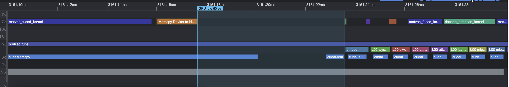
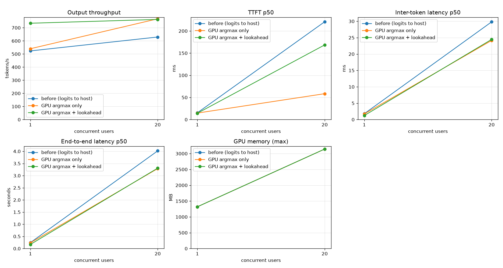

# 008 – Keeping the GPU busy between two decode steps

GPT-2 small, RTX 3060, KV cache on, fused matrix-vector kernels (`004`, `007`), one-block layernorm (`005`), optional fp16 weights (`006`).
Start: the state after `007` (87 launches per decode step).
Sections 1 to 5 were written **before** I changed any engine code. The sections after that are filled in after the change.

## 1. What the timeline shows

In `007` I made the steps shorter. What is left is the time **between** two steps: the GPU has finished the head matrix-vector product and then waits until the CPU has

1. copied the 50257 logits (200 KB) back, with a synchronous `cudaMemcpy`,
2. looked for the largest one (the greedy choice),
3. copied the chosen token (4 bytes) to the GPU and launched the first kernel of the next step.

All numbers: fp16 weights, 128-token prompt, GPU 2 for the C benchmark, GPU 1 for the server. Gap = time from the last kernel of one step to the first kernel of the next step.

| | C benchmark (38 steps) | server, 1 stream | server, 20 users (under nsys) |
|---|---|---|---|
| step period | 1.648 ms | 1.570 ms | – |
| kernels running | 1.278 ms (77.5%) | 1.269 ms (80.8%) | 45–48% of the period |
| **gap between two steps (median)** | **0.127 ms (8%)** | **0.183 ms (12%)** | 0.360 ms |
| GPU idle **inside** the step | 0.213 ms | – | 0.85 ms (99% waiting for launches) |

(The "4%" I first saw in the profiler GUI was an overview of the C benchmark. The real server loses more. A run of 38 steps varies by about ±0.05 ms from run to run. The 20-user run is slowed down by the profiler itself: 397 tok/s instead of 627, so only the shape of it counts.)

### Where the gap goes (C benchmark, median CPU time per step)

| piece | time |
|---|---|
| GPU copies the logits to the host (`cudaMemcpy` D2H, GPU side) | ~16 µs |
| `cudaMemcpy` D2H call on the CPU (mostly waiting for the last kernel) | 643 µs |
| C `argmax` over 50257 floats + loop | 59 µs |
| copy of the token to the GPU (H2D, 4 bytes) | 10 µs |
| launch of the embedding kernel | 11 µs |
| launch → kernel start | ~10 µs |
| **CPU-only part after the logits arrived** | **≈ 82 µs** |

In the server there is more on the CPU after the logits have arrived, about 141 µs:
the Python ctypes return and loop (about 116 µs together, with the thread hop of `anyio.to_thread` around 0.11 ms per token on its own), `np.argmax` about 10 µs, the H2D copy 10.8 µs and the launch 10 µs.

Two things that are **not** the problem: the copy itself (16 µs on the GPU) and `np.argmax` (10 µs). What costs time is that **everything happens one after the other**: GPU finishes → CPU wakes up → CPU does its work → CPU launches → GPU starts.

## 2. Hypothesis

* H1: the 200 KB copy and the CPU argmax are a small part of the gap. Moving the argmax to the GPU (a 4-byte copy instead of 200 KB) saves roughly 15 µs of GPU time plus the CPU argmax (59 µs in C, 10 µs in the Python server). It will help the C benchmark a bit and the server almost not at all.
* H2: the gap is mostly the **round trip** (GPU → CPU → GPU), not the amount of data. It goes away only when the CPU does not have to wait for step *n* before it launches step *n+1*. For that the next token must stay on the GPU: the argmax kernel writes it into a device buffer that the embedding kernel of the next step reads. The CPU enqueues step *n+1* and only then waits for the token of step *n* (one step lookahead). Then the CPU work (Python, tokenizer, pydantic, thread hop) happens **while the GPU computes**.
* H3: the GPU idle time **inside** a step (0.213 ms in the C benchmark) is the GPU waiting for launches. With the CPU running ahead there is a queue of launched kernels and this waiting disappears too.

## 3. Design

Two stages, measured separately, because H1 and H2 make different predictions.

**Stage A – argmax on the GPU.**
`argmax_kernel` over the logits row, one block, result is an `int` in device memory. Semantics are the ones of `np.argmax` that the server uses today: the first index of the maximum; a NaN counts as larger than every number (first NaN wins). `gpt2_gpu_prefill_greedy` and `gpt2_gpu_decode_greedy` run the same forward pass as before, add the argmax kernel (launch 88) and copy 4 bytes back. The logits functions stay as they are (tests, golden comparison, sampling later).

**Stage B – one step lookahead.**
The greedy functions keep the token **on the device** (a field in the KV cache object). The embedding of the next step reads it from there. API in C:

* `gpt2_gpu_prefill_start(model, cache, tokens, n)` – enqueues the prefill and the argmax.
* `gpt2_gpu_decode_enqueue(model, cache)` – enqueues one decode step that consumes the device token and produces the next one; a copy of the new token goes to pinned host memory with `cudaMemcpyAsync`, followed by an event.
* `gpt2_gpu_token_wait(cache, slot)` – waits for the event and returns the token.

The server loop becomes: enqueue step *n+1*, then wait for token *n*, then do the Python work for token *n*. If token *n* is EOS or the length limit is reached, step *n+1* has already run. That is one wasted step; the KV cache is released when the session closes, so the extra entry does no harm. The server must **not** enqueue a step past the context limit (1024) or past `max_new_tokens`.

Not part of this step: batching several requests (that needs a scheduler and moves us right on the roofline), CUDA graphs (the CPU will run ahead anyway, so launch cost should hide).

## 4. Change (summary)

(In the code the functions are called `gpt2_gpu_prefill_enqueue`, `gpt2_gpu_decode_enqueue` and `gpt2_gpu_token_wait`, and the Python session has `start / enqueue / take`. I wrote other names in section 3 before I started.)

Stage A: `engine/src/argmax.cu`, `gpt2_gpu_*_greedy`, Python `CachedSession.prefill_greedy / decode_greedy`, server uses them.
Stage B: device token buffer + pinned host slots + event in the KV cache object, the three functions above, Python `CachedSession.start / enqueue / wait`, server loop with lookahead, C benchmark uses the same API.

## 5. Prediction (written before the change)

**Stage A**

| quantity | before | predicted after |
|---|---|---|
| GPU time of the last copy | 16 µs | 4-byte copy ≈ 5 µs plus argmax kernel ≤ 15 µs (**no gain on the GPU**, I expect the same or slightly more) |
| C benchmark gap between steps | 127 µs | 70–95 µs (CPU argmax 59 µs is gone) |
| server 1 stream step period | 1.570 ms | 1.53–1.57 ms (within about 3%) |
| launches per step | 87 | 88 |

I would be wrong about H1 if the server gains more than 5% from stage A (then the 200 KB copy or the numpy call costs more than I think), or if the C benchmark gap does not shrink.

**Stage B**

| quantity | before | predicted after |
|---|---|---|
| server 1 stream, gap between steps (median) | 0.183 ms | < 0.03 ms |
| server 1 stream, step period | 1.570 ms | 1.30–1.40 ms (kernels 1.27 ms + a little idle inside the step) |
| C benchmark step period | 1.648 ms | 1.30–1.40 ms |
| C benchmark fp16 decode throughput | 696 tok/s | 740–800 tok/s |
| server 20 users fp16 | 627 tok/s | 680–760 tok/s (the upper bound is 1 / 1.27 ms ≈ 790 tok/s) |
| server 20 users fp32 | 422 tok/s | 430–450 tok/s (kernels are 2.04 ms, the gap is a smaller part) |

I would be wrong about H2 if the gap in the server stays above 0.08 ms after stage B (then the gap is not the round trip but something on the GPU side, e.g. the launch queue running dry), or if the step period does not fall below 1.45 ms.
I would be wrong about H3 if the idle time inside the step stays above 0.1 ms in the C benchmark.

Tokens must be **identical** to the logits path (greedy) in every test, and the logits path must stay bit-identical to the golden files (`scripts/golden_logits.py compare`).

## 6. Tests (written first, before the code)

Every group was red against a stub before the implementation, and green after it.

| Test file | What it pins |
|---|---|
| `engine/tests/test_argmax.cu` (7 tests) | maximum at the start, end, middle and around the block and warp borders (50257 values); first index on ties, also across threads and inside one thread; `-0.0 == 0.0`; all `-inf`; a NaN wins and the first NaN wins; sizes 1 to 2049; 20 random vectors with many ties against a CPU reference |
| `engine/tests/test_gpt2_gpu_greedy.c` (12 tests) | the greedy and queued tokens are exactly the tokens of the logits path (fp32 and fp16); the KV cache holds the same K and V after a greedy step; one greedy step is 88 launches; invalid input is rejected and leaves the cache as it was; two caches that take turns do not mix tokens; `enqueue` returns while the GPU is still busy (`cudaStreamQuery == NotReady`); the queue limit and the cache length; no token on the GPU means no enqueue; a full context; a reset cache with steps still running starts clean |
| `pytorch/tests/test_native_gpu.py` (+4 tests, 7 cases) | the queued session gives the logits-path tokens with and without lookahead, fp32 and fp16; the same without KV cache; three threads at once; misuse raises; a reused cache starts clean |
| `pytorch/tests/test_server.py` (rewritten fakes, +4 tests) | the order of the calls: with lookahead `start, enqueue, take, enqueue, take, …`; without it `take` comes before `enqueue`; at most one unread step after EOS; no step beyond `max_new_tokens` or the 1024 context |

**Mutation checks** (a change to the code that the tests must notice; each one was applied alone, the tests were run, the file was restored):

| Mutation | Result |
|---|---|
| argmax: larger index wins ties | caught |
| argmax: NaN ignored | caught |
| argmax: last warp skipped | caught |
| argmax: loop misses the last element | caught |
| decode reads the wrong token slot | caught |
| `take` does not wait for the event | caught |
| queue limit off by one | caught |
| `reset` keeps queued tokens | caught |
| greedy decode does not grow the cache length | caught |
| `decode_enqueue` without the "token exists" check | caught |
| server: no limit on queued steps | caught |
| server: limit off by one | caught |
| server: never queues ahead | caught |
| server: context limit ignores the prompt length | caught |

All 14 mutations were caught.

**Other checks**

* The logits path is unchanged: `scripts/golden_logits.py compare` gives 0 differing values for fp32 and fp16 (12.4 M values each).
* compute-sanitizer **memcheck**: 0 errors on the 29 model tests (a no-fork debug build). **racecheck** and **synccheck** on the 7 argmax tests: 0 hazards. (The first memcheck run showed failures. That was my mistake: `CUDA_DEVICE_ORDER` was not set, device 2 was the P2000 and the binary had no sm_61 code. With the right device all pass.)
* `make check` is clean. Suites: `test-gpu` 67, `gpt2-gpu-test` 29, `make test` 20, `pytest` 42.

## 7. Result

How I measured: fp16 weights unless said otherwise, 128-token prompt. C benchmark on GPU 2 (`--decode-mode logits|greedy|queued`, new). Server on GPU 1, `scripts/benchmark_throughput.py --users 1 20 --max-new-tokens 128 --requests-per-user 3`, **two repetitions per configuration**, shown as the mean of the two. "before" is the old path, run through the same new server with a 10-line patch that makes `start/enqueue/take` call `prefill/decode` and `np.argmax` (so everything else, including the new GPU library, is the same).

### 7.1 C benchmark, nsys (38 decode steps)

| | logits to host (before) | GPU argmax | GPU argmax + lookahead |
|---|---|---|---|
| launches per step | 87 | 88 | 88 |
| median step period | 1.473 ms | 1.413 ms | **1.371 ms** |
| kernels running | 1.287 ms (84.8%) | 1.306 ms (91.4%) | 1.306 ms (95.1%) |
| idle **between** two steps (median) | 0.127 ms | 0.034 ms | **0.008 ms** |
| idle **inside** a step | 0.097 ms | 0.086 ms | 0.057 ms |
| …of it, GPU waited for a launch | 0.046 ms | 0.032 ms | **0.000 ms** |

Decode time per token with a longer run (800 tokens after a 128-token prompt, median of 5 runs, the spread is under 0.01 ms):

| | logits | GPU argmax | + lookahead |
|---|---|---|---|
| fp16 | 1.950 ms | 1.882 ms | 1.879 ms |
| fp32 | 2.709 ms | 2.647 ms | 2.642 ms |
| fp16 with 100 µs of host work per token | 2.042 ms | 1.984 ms | **1.881 ms** |
| fp32 with 100 µs of host work per token | 2.807 ms | 2.746 ms | **2.645 ms** |

`--host-work-us 100` busy-waits after each token, as a stand-in for what the server does with a token (tokenizer, JSON, thread hop). Without lookahead the 100 µs are added to the token time (+0.10 ms). With lookahead they cost **0.002 ms**: the work is hidden behind the GPU. That is the effect of stage B in one number.

The README table workload (`make bench-gpu` with `--kv-cache`: 32-token prompt, 16 decode tokens, the prefill is part of the first step, median of 5): fp16 456.4 → 469.7 → 470.9 tok/s, fp32 333.5 → 351.7 → 352.4 tok/s. With 200 decode tokens: fp16 694.6 → 724.3 → 725.8, fp32 456.0 → 467.8 → 468.9.

### 7.2 The real server, one stream (nsys)

| | before | GPU argmax (`--no-lookahead`) | + lookahead |
|---|---|---|---|
| median step period | 1.516 ms | 1.613 ms | **1.273 ms** |
| kernels running | 1.269 ms | 1.187 ms | 1.186 ms |
| idle between two steps (median) | 0.183 ms | **0.319 ms** | **0.014 ms** |

### 7.3 Server throughput (two runs each, mean)

fp16, 128 new tokens per request:

| | before | GPU argmax only | + lookahead |
|---|---|---|---|
| 1 user, tok/s | 516 | 544 | **728** |
| 1 user, inter-token p50 | 1.8 ms | 1.7 ms | 1.2 ms |
| 1 user, end-to-end p50 | 0.245 s | 0.235 s | **0.175 s** |
| 20 users, tok/s | 629 | **765** | **763** |
| 20 users, inter-token p50 | 29.9 ms | 24.1 ms | 24.5 ms |
| 20 users, end-to-end p50 | 4.04 s | 3.31 s | 3.31 s |
| 20 users, TTFT p50 | 0.22 s | 0.06 s | 0.17 s |

fp32: 1 user 371 → 402 (runs 380 and 423) → **477**; 20 users **421 → 485 → 485** tok/s.

### 7.4 Why 20 users gained from stage A (I predicted nothing)

In the 20-user nsys run the old path had a step period of 2.37 ms, the kernels ran 45% of the time, and **99% of the idle time inside a step was the GPU waiting for a launch**. With stage A only the period is **1.25 ms**, the kernels run 86.5% of the time and that waiting is 1%.

The cause is not the 200 KB copy. The old `decode()` held the engine lock (`NativeGPT2.guard`, needed because the model has one set of buffers) **for the whole step including the wait for the logits**. While one session waited for the GPU, no other session could queue its kernels. The new `take()` waits on a CUDA event **without** the lock, so the other 19 sessions queue their steps meanwhile. I checked this with a patched `take()` that waits while holding the lock (greedy path, no lookahead, otherwise the same): 597 tok/s at 20 users, back to the old level (629), against 765 without the lock.

So at 20 users the lookahead adds nothing (763 against 765), because other sessions already fill the gaps. At 1 user, where there is nobody else, it adds 34% (544 → 728).

## 8. Prediction against result

| Prediction | Result | |
|---|---|---|
| H1: stage A helps the C benchmark gap, 127 → 70–95 µs | 127 → **34 µs** | better than predicted |
| H1: server, 1 stream, within about 3% after stage A | tok/s +5% (516 → 544); nsys gap **0.183 → 0.319 ms** and median period **1.516 → 1.613 ms** | tok/s roughly as predicted; the nsys gap went the wrong way (see 9) |
| H1: stage A would be wrong if the server gains >5% | 1 user +5%, **20 users +22%** | **wrong at 20 users** (section 7.4: the lock) |
| H2: server 1 stream, gap < 0.03 ms | **0.014 ms** | right |
| H2: server 1 stream, step period 1.30–1.40 ms | **1.273 ms** | slightly better |
| H2: C benchmark step period 1.30–1.40 ms | **1.371 ms** | right |
| H2: C benchmark fp16 throughput 740–800 tok/s | 725.8 tok/s (32-token prompt, 200 tokens; 470.9 with 16 tokens) | **below the range**; the kernels grew a little with the argmax and the 88th launch |
| H2: wrong if the server gap stays above 0.08 ms or the period stays above 1.45 ms | no | held |
| H3: idle inside a step < 0.1 ms in the C benchmark | 0.057 ms, and 0 ms of it waiting for a launch | right |
| 20 users fp16: 680–760 tok/s | 763 | slightly above |
| 20 users fp32: 430–450 tok/s | **485** | **above**, same cause as above |
| launches 87 → 88 | 88 | right |
| tokens identical to the logits path, logits path bit-identical | yes, yes | right |

What I got wrong: I thought of the problem as "the GPU waits for the host between two steps of **one** sequence". With 20 users the larger loss was that sessions blocked each other through the lock. The lookahead is the right tool for one stream and for a single request's latency; the lock-free wait is what mattered for throughput under load. Batching (one launch for all sessions) will make this question go away, because one scheduler thread will own the model.

## 9. What I do not know yet

* **Why the server gap under nsys got larger with stage A only** (0.183 → 0.319 ms), while the tok/s without the profiler went up by 5%. The kernel time also fell (1.269 → 1.187 ms), so the runs differ in more than the gap. nsys changes the timing of the CPU side, and I ran one profile per configuration. I do not trust that number until I repeat it.
* The old path under nsys has a median period of 1.516 ms, but the benchmark's end-to-end time (0.245 s for 128 tokens, 15 ms TTFT) implies about 1.8 ms per token. The new path agrees with its profile (1.273 ms against 1.23 ms from the benchmark). So the old profile hid about 0.25 ms per token somewhere.
* **TTFT p50 at 20 users went from 0.06 s to 0.17 s with the lookahead** (p95 is the same, 0.33 s). The throughput is the same. I think the first token of a request now waits for one more `enqueue` call on the contended lock before `take`, but I did not test this.
* The pinned host memory and the 4 token slots per KV cache cost almost nothing (GPU memory in the benchmark is unchanged at 1319 MB for fp16 at 1 user), but I did not measure the pinned memory with 32 sessions.
* One step after EOS is computed and thrown away. It costs about 1.3 ms per request, and nothing else.
* `take()` waits without the lock. This is safe because it only reads this cache's slots and the event, and the sessions of the server use one cache each. Two threads that `take` from the same session would break it. I did not add a guard against that.

## 10. Next

* The honest bottleneck is no longer the host: at 20 users the kernels run 86% of the time, and throughput is capped at about 1 / 1.19 ms = 840 tok/s by one sequence per step. **A scheduler with batched decode** (one step for all running sessions, reading each weight once) is the step that moves us to the right on the roofline.
* Smaller things: more blocks for the MLP-down and projection products (24 blocks on 28 SMs reach 38–58% of the bandwidth), `ncu` on the attention kernel (now 22% of a step), a CUDA graph for the 88 launches (the lookahead already hides the launch cost for the server).

## 11. Files

* New: `engine/include/argmax.h`, `engine/src/argmax.cu`, `engine/src/gpt2_gpu_greedy.cu` (token queue, greedy and enqueue functions), `engine/include/gpt2_gpu_internal.h` (structs shared by the two `gpt2_gpu*.cu` files), tests `test_argmax.cu` and `test_gpt2_gpu_greedy.c`.
* Changed: `gpt2_gpu.cu` (prefill and decode split into `*_core` functions that only queue work), `gpt2_gpu.h` (public API), `native.py` (`start / enqueue / take`), `server.py` (lookahead loop, `--no-lookahead`), the C benchmark (`--decode-mode`, `--host-work-us`), `scripts/nsys_gap_analysis.py` (`--server`, median period).
* Reports: `build/report_008_cbench_{logits,greedy,queued}.nsys-rep`, `build/report_server_1stream_gap_{before,after_greedy,after_lookahead}.nsys-rep`, `build/report_server_20users_gap_{before,after_greedy}.nsys-rep`, benchmarks in `build/benchmarks/h_*`.
