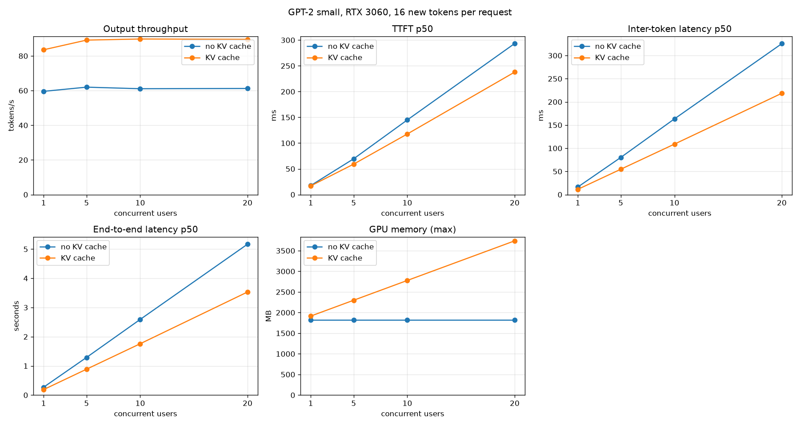
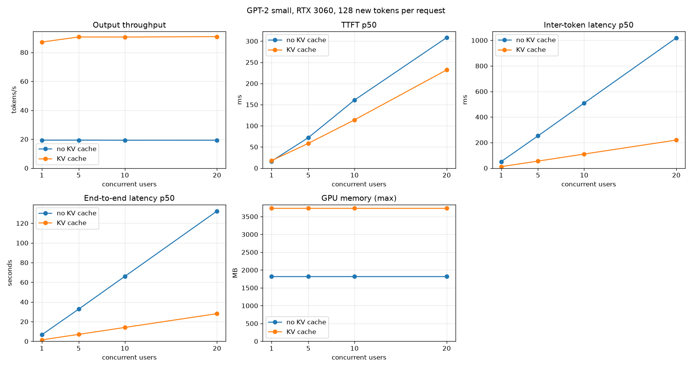

# 003 – KV cache

GPT-2 small, fp32, RTX 3060. Start: the state after `002` (coalesced matmul), served by the FastAPI server
with one engine and no KV cache. Goal: stop re-computing the whole sequence at every generated token.

## 1. Problem

Before this change every decode step ran the forward pass over the **whole sequence** (prompt + all tokens so far).
Time for one `forward_last` call, measured with the rebuilt library (`002` kernels):

| tokens in the sequence | 1 | 32 | 128 | 512 | 1000 |
|---|---|---|---|---|---|
| one forward pass | 11 ms | 21 ms | 92 ms | 366 ms | 895 ms |

- The cost grows linearly with the length, so generating N tokens costs O(N²) in total.
- Decode speed of the C benchmark (32-token prompt) fell as the output got longer: 34.7 tok/s for 16 tokens, 11.0 for 200, 6.3 for 400, 2.7 for 900.
- The py-spy profile of the server showed that most of the busy time is the CPU waiting in `cudaMemcpy` for the GPU. Python and JSON overhead are small. So the GPU work itself is the thing to reduce.

## 2. Why a KV cache is the fix

For the new token at position *t*, attention needs the keys and values of positions 0..*t*.
The K and V of an old token depend only on that token and the tokens before it (the mask is causal), so they never change.
We can compute them once, keep them, and in each step only compute the **new token's** row.

- Per step the matmuls shrink from `[t, 768]` inputs to `[1, 768]`. The MLP, projections and layer norms do `1/t` of the work.
- The attention for the new token reads the cached K and V: O(t) work, instead of O(t²) for the whole sequence.
- The price is memory: 2 (K and V) × 12 layers × 1024 positions × 768 × 4 bytes = **72 MiB per sequence** (nvidia-smi shows 96 MiB per cache, probably allocator rounding).

This is the same idea that every serving engine uses. It is also the first thing a batching scheduler needs:
a batch is made of independent sequences, and each one needs its own state that lives between steps.

## 3. Design

Two phases per request:

| phase | what it does | function |
|---|---|---|
| prefill | one forward pass over the prompt. Saves K and V of every layer and token into the cache | `gpt2_gpu_prefill` |
| decode | one token at position `length`: compute its K and V, store them, attend to the cache | `gpt2_gpu_decode` |

Decisions and the reasoning behind them:

- **The cache is a separate object (`GPT2GpuKvCache`), not part of the model.** The weights are shared and read-only. The cache is per sequence. Several sequences need several caches (next step: scheduler and batching). The type is opaque in the header, so the layout can change later (paged blocks) without touching callers.
- **Layout `[position][768]` per layer, for K and for V.** The same as the scratch buffers of the block. Prefill saves a layer with one `cudaMemcpyAsync` (device to device), and decode writes the new row to the right place with the normal `linear_device` call (output pointer = cache row), without an extra copy.
- **Prefill shares the code of `forward_last`.** The body moved into a static `forward_pass(model, cache, ...)`. With `cache = NULL` it is the old function, so no existing caller changed. The copy of K and V happens right after the block returns and before the next layer overwrites the scratch buffers.
- **`position_offset` in the embedding kernel.** A decode token at position 700 must get position embedding 700, not 0. Forgetting this gives fluent but wrong text.
- **`length` is set only after success.** A rejected call leaves the cache as it was.
- **A new decode block (`transformer_block_decode_device`) instead of branches in the old one.** It is a copy with `sequence_length = 1`, and it is easier to read and to profile.

### The decode attention kernel

The old kernel runs one thread per (query row, head). In decode there is one query row, so that is 12 threads for the whole GPU.
I wrote it in two steps and measured both (C benchmark, 32-token prompt, 200 decode tokens, run 3 times):

| version | decode speed | last step |
|---|---|---|
| no KV cache | 11.0 tok/s | 157 ms |
| KV cache, one thread per head (12 threads) | 40.3 tok/s | 35.5 ms |
| KV cache, one block per head, 128 threads split the keys | **91.6 tok/s** | **11.0 ms** |

- Version 1 was correct but slow: each thread walked through up to 232 cached rows alone. The average step took 25 ms and the last one 35.5 ms, so the step time still grew with the length.
- Version 2: 12 blocks of 128 threads. The threads split the keys (scores into shared memory), do a block-wide max and sum (a plain softmax over the shared scores, not the online one), and then split the 64 output dimensions. The step time is now flat: 11.0 ms at the end of 200 tokens.
- The kernel output is checked against the last row of the CPU causal attention for 1, 5 and 300 cached rows (12 heads × 64 for the long one).

## 4. Correctness

Everything is tested against something independent:

- `prefill` returns exactly the logits of `forward_last` (0 difference, same kernels).
- The K and V stored for every layer match values that the **CPU** recomputes from the CPU weights and the CPU block outputs (1e-3).
- `prefill` + 12 greedy `decode` steps match a full `forward_last` over the same tokens at every step (logits 1e-3 and the same argmax).
- A cache that was reset and reused gives the same result as a fresh one (a longer earlier sequence left data in the rows).
- Bad input is rejected and leaves the cache unchanged: `NULL` arguments, empty cache for decode, token out of range, 1025 tokens, decode when the context is full (1024).
- Python: 20 greedy tokens generated with the cache are the same as with recomputation. Concurrent sessions do not mix their caches. A cache is given back after an error and when a session is closed twice.
- `make test-gpu`: 23 passed. `make gpt2-gpu-test`: 11 passed. `pytorch/tests`: 29 passed. `make check`: clean.
- To see that the tests can fail I broke the code on purpose several times (a copy that is one row short, `length` not set, a missing `cudaFree`) and each time a test failed.

## 5. Serving changes

- `NativeGPT2.open_session()` gives a `CachedSession` (`prefill`, then `decode`). The server loop is the same for all engines: `prefill(prompt)`, then `decode(token)` per step.
- Caches are pooled: a session takes a free cache or creates one, and gives it back on `close()`. The server closes the session in a `finally`, so a client that leaves (disconnect) also frees its cache.
- A semaphore limits the sessions that are open at the same time (`--max-sessions`, default 32 → at most ~3 GB of cache). Further requests wait. That wait counts as TTFT, which is what a client sees.
- `--no-kv-cache` keeps the old behaviour (a `RecomputeSession`), so the baseline can be measured again at any time.
- The server no longer computes logits for the last token of a request that nobody reads (a unit test found this: 5 tokens used 5 decode calls instead of 4).

## 6. Results

### 6.1 One sequence, C benchmark (`make bench-gpu`, 32-token prompt)

| decode tokens | no cache | KV cache | speedup |
|---|---|---|---|
| 16 (default) | 34.7 tok/s | 86.7 tok/s | 2.5x |
| 100 | 17.8 tok/s | 92.7 tok/s | 5.2x |
| 400 | 6.3 tok/s | 91.3 tok/s | 14.6x |
| 900 | 2.7 tok/s | 88.0 tok/s | 32x |

- Without the cache the speed falls as the sequence grows. With the cache it is flat (88 to 93 tok/s) up to 900 tokens. The small drop at the end (92.7 to 88.0 tok/s) is probably the attention over more cached rows. I did not check.
- Prefill is not changed (22 ms for 32 tokens, as before). The cache only helps the tokens after the first one.
- These runs used the second RTX 3060 of the machine (`GPU=2`), the server runs used the first (`GPU=1`). Same card model, and the no-cache default workload matches the README (34.7 vs 35.5 tok/s).

### 6.2 Server under load (`scripts/benchmark_throughput.py`)

Closed loop, streaming, short prompts, same workload before and after. "Before" is `--no-kv-cache` on the same code, so only the cache differs.

**16 new tokens per request** (3 requests per user):

| Users | tok/s before | tok/s after | Speedup | TTFT p95 before | TTFT p95 after | Inter-token p50 before | after | End-to-end p50 before | after |
|---|---|---|---|---|---|---|---|---|---|
| 1 | 59.6 | 83.5 | 1.4x | 19 ms | 19 ms | 16.4 ms | 11.4 ms | 0.27 s | 0.19 s |
| 5 | 62.0 | 89.1 | 1.4x | 87 ms | 84 ms | 80.2 ms | 54.7 ms | 1.29 s | 0.89 s |
| 10 | 61.1 | 89.8 | 1.5x | 184 ms | 171 ms | 163.4 ms | 108.9 ms | 2.59 s | 1.76 s |
| 20 | 61.2 | 89.6 | 1.5x | 372 ms | 316 ms | 325.6 ms | 218.5 ms | 5.17 s | 3.53 s |

**128 new tokens per request** (2 requests per user):

| Users | tok/s before | tok/s after | Speedup | TTFT p95 before | TTFT p95 after | Inter-token p50 before | after | End-to-end p50 before | after |
|---|---|---|---|---|---|---|---|---|---|
| 1 | 19.3 | 87.2 | 4.5x | 20 ms | 18 ms | 50.8 ms | 11.4 ms | 6.61 s | 1.46 s |
| 5 | 19.3 | 90.7 | 4.7x | 389 ms | 82 ms | 252.4 ms | 55.0 ms | 32.73 s | 7.05 s |
| 10 | 19.3 | 90.6 | 4.7x | 779 ms | 152 ms | 508.6 ms | 110.0 ms | 65.96 s | 14.08 s |
| 20 | 19.3 | 90.9 | 4.7x | 1656 ms | 276 ms | 1019.3 ms | 219.7 ms | 132.40 s | 28.08 s |

How I read it:

- **The longer the output, the bigger the gain.** 1.4x at 16 tokens, 4.5x at 128 tokens. With the cache the speed per request does not depend on the length, without it, it does.
- **TTFT p50 stays the same (about 17 ms for one user).** Prefill did not change. The p95 under load is lower with the cache (389 to 82 ms at 5 users and 128 tokens). I did not investigate why.
- **Throughput is still flat when users are added (about 90 tok/s from 1 to 20 users).** The cache removes work, but the server still runs one request after the other: the inter-token latency grows in step with the number of users (11 ms, 55 ms, 110 ms, 220 ms), because each request waits for the others. Fixing that needs batching (several sequences in one forward pass), not a cache. The cache is what makes batching possible.
- **GPU memory is now per session:** 1.8 GB with the weights alone, then +96 MB per session in use (1915 MB with 1 user, 2299 with 5, 2779 with 10, 3739 with 20). With 128 tokens all 20 caches had been created already, so the table shows the maximum (3739 MB) at every level. This is the number a scheduler has to manage.

## 7. What I do not know yet

- **Where the 11 ms of a decode step goes.** The weights are ~500 MB. At the 360 GB/s of the card, reading them once takes ~1.4 ms, so I expect the step to be far above the memory limit. The likely cause is the matmul kernel with one row (the `002` kernel is a plain loop, with one thread per output value, and 12 layers × 6 matmuls + the head). That is an estimate from the arithmetic, not a measurement. I have not profiled a decode step with nsys or ncu.
- The stage table of `bench` (`GpuTimer`) only covers the full forward pass. `gpt2_gpu_decode` takes a timer already, but the benchmark does not use it yet.
- Long prompts: prefill with the 1024-token limit and the quadratic part of the old attention kernel have not been measured with the cache.
- The cache is fp32 and one contiguous 72 MiB block per sequence. Most sequences use a small part of it, so memory is wasted. That is what paged attention solves.

## 8. Next steps (by expected gain)

1. Profile one decode step (nsys, then ncu on the 1-row matmul). Probably the biggest gain per token.
2. A scheduler loop with a request queue and batched decode. The step time barely depends on the batch size when the weights are read once per step, so throughput should rise with the number of sequences. This is what makes the throughput curve go up with the users.
3. Paged KV cache with a block allocator, to stop reserving 72 MiB for short sequences.

## 9. Files

- Engine: `engine/src/gpt2_gpu.cu` (cache, prefill, decode), `engine/src/transformer_block.cu` (decode block), `engine/src/attention.cu` (decode attention), `engine/src/embedding.cu` (`position_offset`).
- Python: `pytorch/src/mini_llm/native.py` (sessions, cache pool), `pytorch/src/mini_llm/server.py` (`--no-kv-cache`, `--max-sessions`).
- Tests: `engine/tests/test_gpt2_gpu.c`, `test_kv_cache.cu`, `test_multi_head_attention.cu`, `test_embedding.cu`, `pytorch/tests/test_native_gpu.py`, `test_server.py`.
- Tools: `scripts/benchmark_throughput.py`, `scripts/compare_benchmarks.py` (the plots above), `make bench-gpu BENCH_ARGS="--kv-cache --decode-tokens 200"`.
- Raw results: `build/benchmarks/{baseline16,kv16,baseline128,kv128}/*.json` (`build/` is not in git).
