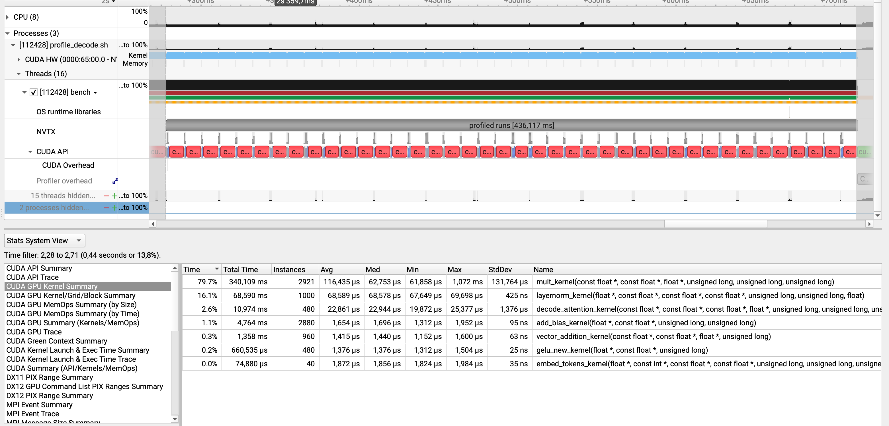
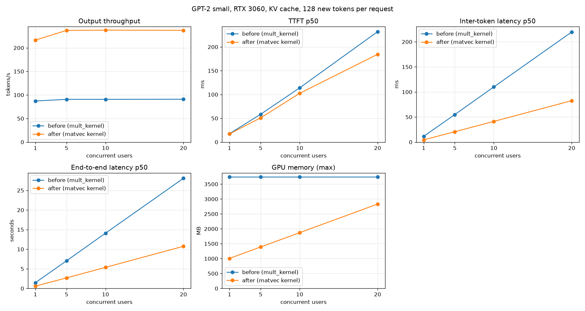

# 004 – Matrix-vector kernel for decoding (`mult_kernel` with one row)

## 1. Nsys Profile

Nsight Systems, `make profile-nsys-decode` (128-token prompt, 40 cached decode steps after the prefill, GPU 2).

- The GPU is busy during the whole captured range. The gap between two kernels has a median of 0.6 µs, and 1.3% of a step is idle.
- One step is 10.67 ms of kernel time. The step has 219 kernel launches.
- The long `cudaMemcpy` bars on the CPU row are the CPU waiting for the GPU (the call is synchronous). The copy itself takes about 16 µs.

| stage | per step | avg per call | ms / step | share |
|---|---|---|---|---|
| mlp_down (3072→768) | 12 | 246.5 µs | 2.958 | 27.7% |
| qkv_linear (3 × 768→768) | 12 | 195.2 µs | 2.343 | 22.0% |
| layernorm | 25 | 68.5 µs | 1.714 | 16.1% |
| mlp_up (768→3072) | 12 | 123.8 µs | 1.486 | 13.9% |
| lm_head (768→50257) | 1 | 1066.7 µs | 1.067 | 10.0% |
| attn_proj (768→768) | 12 | 64.4 µs | 0.773 | 7.2% |
| attention (decode) | 12 | 22.8 µs | 0.273 | 2.6% |
| residual, gelu, embed | | | 0.052 | 0.5% |
| **sum** | | | **10.67** | |

The five matmul stages together take **8.63 ms of the 10.67 ms (81%)**. They include the small `add_bias_kernel` that follows each matmul (1.7 µs, 48 times per step).

## 2. Nsight Compute: what limits the single-row matmul

`ncu --set full` on the decode matmuls (GPU 2). ncu runs the kernels slower than nsys (80 µs instead of 62 µs for the 768→768 case, probably locked clocks), so I only use ratios from it.

| matmul | grid | DRAM read | bandwidth | % of DRAM peak |
|---|---|---|---|---|
| 768→768 (q, k, v, attn_proj) | 48 blocks × 256 threads | 2.4 MB | 41 GB/s | 11.7% |
| 768→3072 (mlp_up) | 192 blocks | 9.5 MB | 62 GB/s | – |
| 3072→768 (mlp_down) | 48 blocks | 9.5 MB | 31 GB/s | – |
| 768→50257 (lm_head) | 3142 blocks | 154 MB | 125 GB/s | 35.7% |

Detail for the 768→768 case:

- A scheduler has 1.05 active warps and issues an instruction in 6% of the cycles. In 94% of the cycles no warp can issue.
- A warp spends 13.4 of its 17 cycles per instruction waiting for a memory result (scoreboard dependency).
- Active threads per warp instruction: 16.25 of 32. Achieved warps active: 3.9% of the peak.
- DRAM bytes read equal the weight size (2.37 MB for a 2.36 MB matrix) and the sectors per request are ideal. The access pattern is **not** the problem here, unlike in `002`.

## 3. Hypothesis

`mult_kernel` is a matrix-matrix kernel with a 16×16 block: columns on `x`, rows on `y`. In decoding the input has **one row**. Then:

1. 15 of the 16 thread rows of every block have `row >= a_rows` and exit at once. Of the 8 warps in a block, 7 do nothing. The 8th has 16 of 32 lanes busy.
2. The grid is `ceil(N/16)` blocks, which is 48 for N = 768. That is about one working warp per block, on 28 SMs.
3. Each thread sums over the whole `K` alone (768 or 3072 iterations). Loads are issued one after the other, so very few bytes are in flight.

A matrix-vector product reads every weight once and does 2 FLOPs per 4 bytes. It should be limited by DRAM bandwidth. To reach it, the GPU needs many loads in flight at the same time. The current kernel has too few. It is **latency-bound**, not bandwidth-bound.

Evidence for it: ncu (section 2) shows no warp ready in 94% of the cycles, memory stalls as the main reason, 4% warp occupancy, and the slowest matmul is the one with the longest per-thread loop (`mlp_down`, K = 3072, 31 GB/s).

What I do **not** know: how much of the remaining gap to the memory limit comes from other things (L2, launch size on the SMs, the bias kernel after the matmul). I only see the main cause.

## 4. Change

A separate kernel for `a_rows == 1` (a matrix-vector product, "GEMV"). `matrixmult_device` picks it. Rows > 1 keep the old kernel, which is correct for prefill.

Design, and why:

- **Block = 32 columns × 16 K-slices (512 threads).** The 32 lanes of a warp read 32 neighbouring columns of one row of `B`: 128 contiguous bytes, 4 sectors, no waste. 16 warps per block give many loads in flight per SM.
- **Split K inside the block.** Each of the 16 slices sums every 16th row of `B` for its 32 columns. Then a shared-memory reduction adds the 16 partial sums. This replaces one thread doing 3072 iterations with 16 threads doing 192 each.
- **Unroll 4 with independent loads.** The 4 loads of one iteration do not depend on each other, so 4 loads per thread are in flight, not 1.
- **The input vector goes to shared memory once per block.** All threads of the block read it, so it does not come from global memory again for each product.
- **Scalar loads, not `float4`.** `lm_head` has N = 50257, which is not a multiple of 4. The rows are not 16-byte aligned, so a vector load cannot be used there. I keep one kernel for all shapes. If the other shapes turn out to need it, `float4` is a next step.
- **The summation order changes** (partial sums per slice). Results differ from the old kernel by rounding, around 1e-6 relative. The tests compare against the CPU with a tolerance.

Not changed: `layernorm`, the attention, the separate `add_bias_kernel`, and the three launches for q, k and v.

## 5. Prediction

- The minimum time for the weights of one step: 494 MB at 360 GB/s = **1.37 ms**. The kernel will not reach 100%. I expect 60–80% of the peak for the matmul stages, which is **1.7–2.3 ms** for the weights.
- Matmul stages including their bias kernels: 8.63 ms → **2.2–3.0 ms**.
- Whole step (kernel time): 10.67 ms → **4.2–5.0 ms**. Layernorm (1.71 ms), attention (0.27 ms) and the rest do not change.
- C benchmark, 32-token prompt, 200 decode tokens, KV cache: 91.6 tok/s → **180–220 tok/s**.
- Server, 128 tokens, 20 users: about 90 tok/s → **170–200 tok/s**. The inter-token latency under load should fall by the same factor.
- Per matmul: the 768→768 launch from 62 µs to **15–25 µs**. `mlp_down` from 246 µs to **60–90 µs**. `lm_head` from 1067 µs to **450–600 µs**.
- After the change `layernorm` becomes the largest single stage (about 1.7 ms of ~4.6 ms, 37%).
- It would be wrong if: the matmul stages stay above 4 ms (then the latency is not the only problem), or the 768→768 case is slower than 30 µs.

## 6. Tests (written first, before the kernel)

Sections 1 to 5 were written before I changed the kernel. The tests in `engine/tests/test_matrix_mult.cu` were also written first:

1. **Red:** the tests did not compile (`matvec_device` was missing).
2. **Red on behaviour:** with a do-nothing stub, 5 tests failed and 26 passed (the ones that only use the old kernel).
3. **Green:** the kernel. 31 passed.
4. **Dispatch test:** a launch counter (`matvec_launch_count`) shows which kernel `matrixmult_device` used. I added it after a mutation check showed that my first "very long K" test passed even with the dispatch turned off, because the old kernel gives the same result.

What the tests check (all against the CPU matmul):

| test | what it covers |
|---|---|
| small product `[1,2,3] x [3,2]` | exact result by hand |
| `k=1, n=1` | smallest shape |
| `(17,33) (5,70) (100,31) (65,32) (3,1000)` | `k` and `n` that do not divide the slice count (16), the unroll (4) or the warp (32) |
| `(768,768) (768,3072) (3072,768)` | the attention and MLP shapes, tolerance 1e-3 |
| `(768,50257)` | the output head. 50257 is odd |
| `matrixmult_gpu` with 1 row | the public path gives the same result |
| `matrixmult_gpu` with 7 rows | several rows still use the matrix-matrix kernel |
| `k=20000` with 1 row | falls back (the input vector does not fit in shared memory), launch count unchanged |
| dispatch counter | 1 row increases the count, 8 rows do not |

**Mutation checks** (I broke the kernel on purpose and ran the tests):

| change | tests that failed |
|---|---|
| removed the tail loop (`k` not a multiple of 64) | 3 |
| reduction skips one slice | 4 |
| dispatch turned off | 1 (the dispatch test) |

Model level: `prefill` + 12 `decode` steps still match the full forward pass (1e-3, same argmax) with the new kernel. Those tests are in `test_gpt2_gpu.c` from `003`.

Totals: `make test-gpu` 32 passed, `make gpt2-gpu-test` 11 passed, `pytorch/tests` 29 passed, `make test` 20 passed, `make check` clean.

## 7. Result

### 7.1 Kernel time per decode step (`make profile-nsys-decode`, 128-token prompt, 40 steps, GPU 2)

The same capture as in section 1, taken again after the change. `scripts/nsys_stage_breakdown.py` read both reports.

| stage | before: avg per call | before: ms/step | after: avg per call | after: ms/step | change |
|---|---|---|---|---|---|
| mlp_down | 246.5 µs | 2.958 | 33.2 µs | 0.399 | 7.4x |
| qkv_linear (3 launches) | 195.2 µs | 2.343 | 34.7 µs | 0.417 | 5.6x |
| mlp_up | 123.8 µs | 1.486 | 34.8 µs | 0.417 | 3.6x |
| lm_head | 1066.7 µs | 1.067 | 477.6 µs | 0.478 | 2.2x |
| attn_proj | 64.4 µs | 0.773 | 11.4 µs | 0.137 | 5.6x |
| layernorm | 68.5 µs | 1.714 | 68.5 µs | 1.711 | none |
| attention | 22.8 µs | 0.273 | 22.6 µs | 0.271 | none |
| residual, gelu, embed | | 0.052 | | 0.049 | none |
| **sum** | | **10.67** | | **3.88** | **2.75x** |

The five matmul stages: 8.63 ms → 1.85 ms (4.7x). Everything else did not change, as expected.

Effective bandwidth of the matmuls (weight bytes divided by the stage time):

| stage | MB per step | GB/s before | GB/s after |
|---|---|---|---|
| qkv_linear | 84.9 | 36 | 204 |
| attn_proj | 28.3 | 37 | 207 |
| mlp_up | 113.2 | 76 | 272 |
| mlp_down | 113.2 | 38 | 284 |
| lm_head | 154.4 | 145 | 323 |
| **all** | **494** | **57** | **267** (74% of the 360 GB/s peak) |

### 7.2 Prediction against result

| | prediction | result | |
|---|---|---|---|
| matmul stages with bias | 2.2–3.0 ms | **1.85 ms** | faster than predicted |
| whole step (kernel time) | 4.2–5.0 ms | **3.88 ms** | faster than predicted |
| matmul share of the weights' peak | 60–80% | **74%** | in range |
| 768→768 launch | 15–25 µs | 34.7 µs (q/k/v range), **11.4 µs** (attn_proj) | see below |
| `mlp_down` | 60–90 µs | **33.2 µs** | faster |
| `lm_head` | 450–600 µs | **477.6 µs** | in range |
| C bench decode, 200 tokens | 180–220 tok/s | **246.9 tok/s** | faster |
| server, 128 tokens, 20 users | 170–200 tok/s | **237 tok/s** | faster |
| layernorm is the largest stage | ~37% | **44.1%** | yes |

My prediction was too cautious. One row needs a comment:

- The "768→768 launch" row compared different things. The stage `qkv_linear` is **three** launches in one range, so 34.7 µs is the range, not one launch. 3 × 11.4 µs ≈ 34.2 µs matches `attn_proj` (one launch, 11.4 µs). So one 768→768 launch takes about 11.4 µs, below my predicted 15–25 µs.
- `mlp_up` and `mlp_down` both read 113 MB per step and take 33–35 µs per launch, which is 270–284 GB/s. I expected `mlp_down` to be slower because of its longer `k`. The split over 16 slices removed that difference.

### 7.3 End to end

C benchmark, 32-token prompt, KV cache, one sequence (`make bench-gpu`):

| decode tokens | before (`003`) | after | |
|---|---|---|---|
| 16 | 86.7 tok/s | 204.8 tok/s | 2.4x |
| 200 | 91.6 tok/s | 246.9 tok/s | 2.7x |
| 900 | 88.0 tok/s | 222.4 tok/s | 2.5x |

Server (`scripts/benchmark_throughput.py`), KV cache on, same workload as `003`. "Before" is the `003` run.

128 new tokens per request:

| Users | tok/s before | tok/s after | Speedup | Inter-token p50 before | after | End-to-end p50 before | after |
|---|---|---|---|---|---|---|---|
| 1 | 87.2 | 216.4 | 2.5x | 11.4 ms | 4.5 ms | 1.46 s | 0.58 s |
| 5 | 90.7 | 237.0 | 2.6x | 55.0 ms | 20.7 ms | 7.05 s | 2.69 s |
| 10 | 90.6 | 237.6 | 2.6x | 110.0 ms | 41.2 ms | 14.08 s | 5.37 s |
| 20 | 90.9 | 237.2 | 2.6x | 219.7 ms | 82.6 ms | 28.08 s | 10.75 s |

16 new tokens per request:

| Users | tok/s before | tok/s after | Speedup | Inter-token p50 before | after | End-to-end p50 before | after |
|---|---|---|---|---|---|---|---|
| 1 | 83.5 | 196.9 | 2.4x | 11.4 ms | 4.2 ms | 0.19 s | 0.08 s |
| 5 | 89.1 | 217.4 | 2.4x | 54.7 ms | 19.9 ms | 0.89 s | 0.36 s |
| 10 | 89.8 | 217.6 | 2.4x | 108.9 ms | 39.9 ms | 1.76 s | 0.72 s |
| 20 | 89.6 | 215.1 | 2.4x | 218.5 ms | 81.4 ms | 3.53 s | 1.47 s |

- **The kernel time per step fell from 10.67 ms to 3.88 ms (2.75x), and the server gained 2.4 to 2.6x.** The server is a bit below what the kernel time suggests: 237 tok/s is 4.2 ms per token against 3.88 ms of kernel time. The rest (about 0.3 ms) is the work between steps (copy of the logits, argmax, tokenizer decode, launches). It was negligible before, and it is a larger share now.
- **Throughput is still flat as users are added** (about 237 tok/s from 1 to 20 users). The server still handles one request at a time. This change was not meant to fix that.
- **TTFT p95 under load at 128 tokens is slightly higher after** (93 ms vs 82 ms at 5 users, 309 ms vs 276 ms at 20 users), while the p50 got better (184 ms vs 232 ms at 20 users). I did not investigate. With 2 requests per user, p95 rests on few samples.
- **One measurement went wrong first.** My first server run used the old library. `make serve-gpu` rebuilds it, but I started the server directly with `uv run scripts/serve.py`, which does not. The result looked like no change (90 tok/s). I saw that the library file was older than the kernel source, rebuilt it and measured again. The numbers above are from the rebuilt library.

## 8. What I do not know yet

- **Why `lm_head` is at 323 GB/s while the others reach 204–284.** `lm_head` has 50257 columns, which is odd, so the last block is partly empty. That alone cannot explain a difference this size. I have not profiled it with ncu after the change. `qkv_linear` and `attn_proj` are the slowest per byte (about 205 GB/s). They launch only 24 blocks of 32 columns, which may fill the 28 SMs only partly. That is a guess, not a measurement.
- **I have not run ncu on the new kernel.** The bandwidth figures come from nsys stage times and the weight sizes, not from DRAM counters. They count weight bytes only, not the input vector or the output.
- **How to reach the peak (360 GB/s).** The average is 74%. A `float4` version or a different block shape could add some. I tried neither.
- **Where the extra ~0.3 ms per token in the server comes from.** I measured the difference, not its causes.
- **Layernorm is now 44% of the step.** It runs as one block of 256 threads per call (68.5 µs, 25 calls per step). It is the next target. I have not read the kernel closely or run ncu on it.
- **Precision.** The sums are in a different order than before. The tests pass at 1e-3 against the CPU, and greedy generation is the same in the Python tests. I did not measure the largest difference for the real weights.

## 9. Next

1. Layernorm for one row: split the sum and the variance over the whole block. Expected: 1.71 ms → under 0.3 ms per step, taking the step from 3.88 ms to about 2.5 ms.
2. Fuse the bias into the matvec kernel (48 extra launches per step, 1.7 µs each, 0.08 ms) and launch q, k and v as one kernel.
3. The scheduler and batched decode. The weights are read once per step, so a batch of sequences should raise the throughput with the number of users. The decode step is now short enough that Python overhead per step starts to matter.

## 10. Files

- Kernel and dispatch: `engine/src/matrixmult.cu` (`matvec_kernel`, `matvec_device`, `matrixmult_device`), `engine/include/matrix_mult.h`.
- Tests: `engine/tests/test_matrix_mult.cu`.
- Tools: `scripts/nsys_stage_breakdown.py` (the stage tables above), `make profile-nsys-decode`.
- Raw data: `build/report_decode_before_gemv.nsys-rep`, `build/report_decode_after_gemv.nsys-rep`, `build/benchmarks/{kv16,kv128,gemv16,gemv128}/*.json` (`build/` is not in git).
