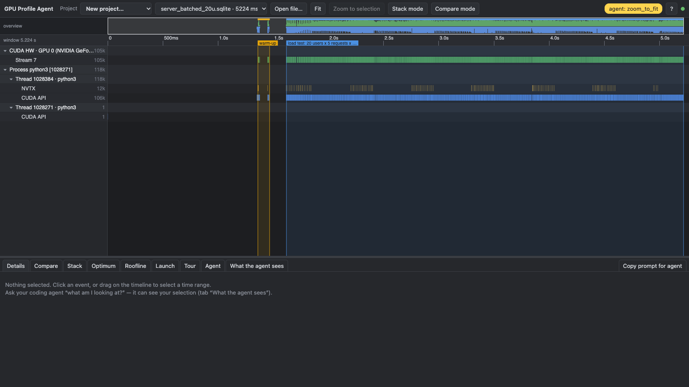
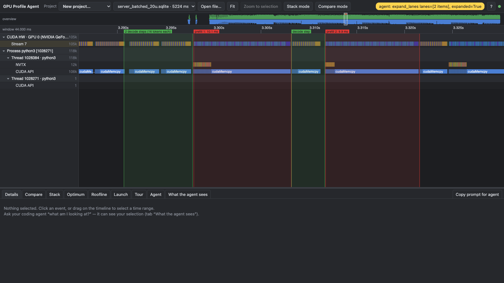
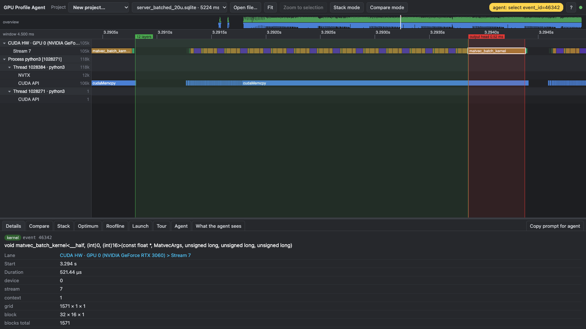
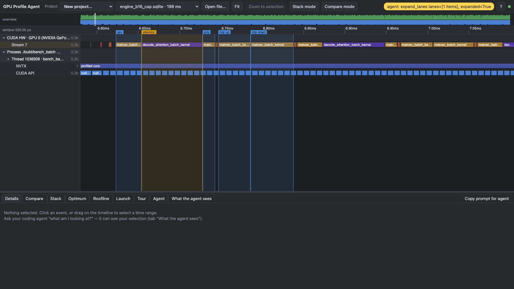
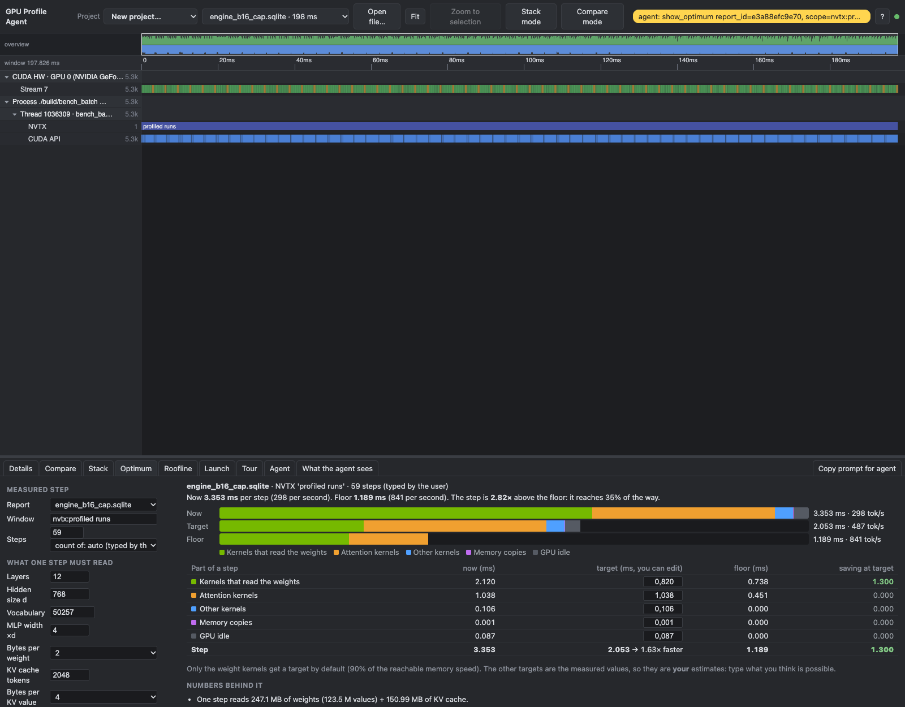
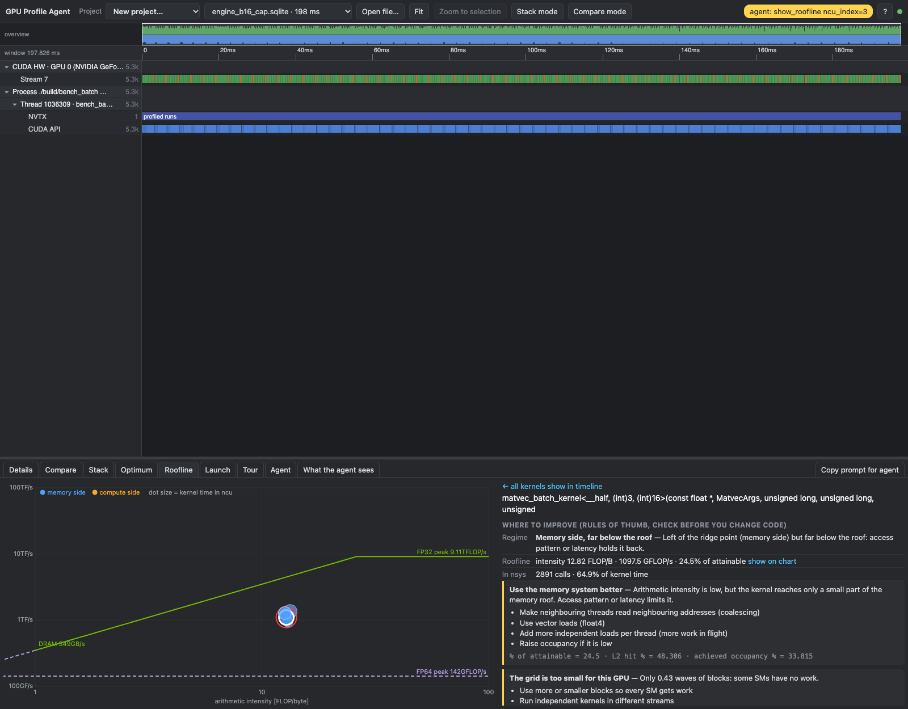
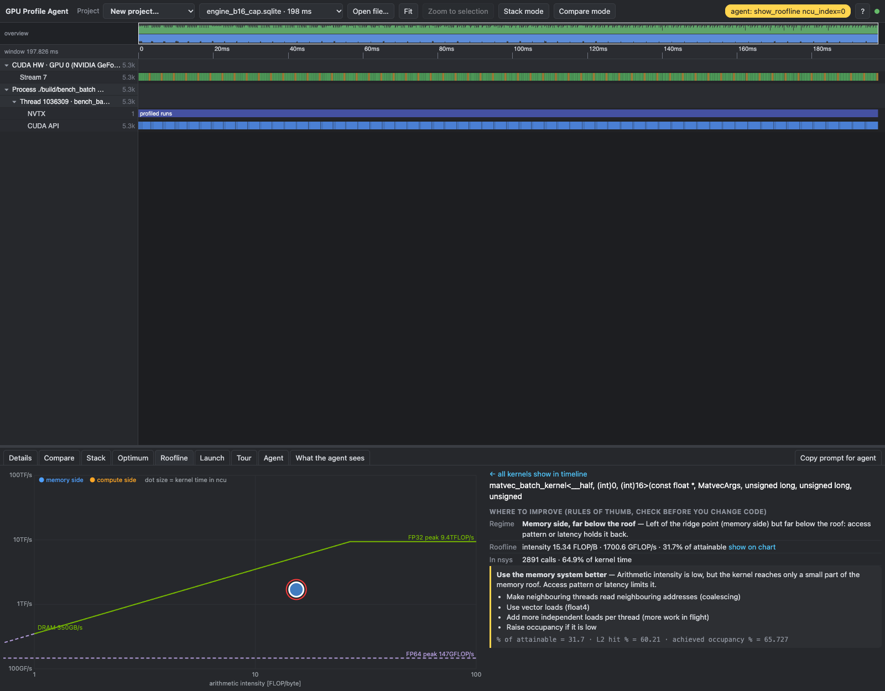

# Profile 001 – batched decode, before the next optimization

State: commit `384f895` (report 009, scheduler and batched decode kernels), fp16 weights in decode.
GPU: RTX 3060 (PCI bus `B3:00.0`, `GPU=2` in the Makefile). The other 3060 runs vLLM, so it was not used.
Nothing was changed in the engine for this profile. Only `bench_batch` got a `--profile` option (see the end).

The screenshots come from the GPU profile viewer (`gpu_profile_agent`), driven through its MCP tools. How: [section 6](#6-how-this-was-made).

## 1. Summary

| | |
|---|---|
| Server, 20 users, 128 new tokens (3361 tok/s) | reproduces report 009 (3352 tok/s) |
| Engine, B = 16, context 128 | 3.35 ms per step, 4773 tok/s (report 009: 4642) |
| Memory floor of that step (weights 247 MB + KV cache 151 MB at 335 GB/s) | 1.19 ms, 13 500 tok/s. The step is **2.8x above the floor** |
| GPU time of the load test | decode steps 58%, prefills 26%, idle 16% |
| Biggest item inside a decode step | the batched matrix kernel: 2.12 ms of 3.35 ms, **2.9x above its own floor** (0.74 ms) |

Shares of the 3.86 s load-test window: the batched matrix kernel 46%, prefill 26%, idle 16%, decode attention 9%, layernorm 2%.

## 2. Server under load (nsys)

Command: `nsys profile --trace=cuda,nvtx` around `scripts/serve_batched.py --fp16-weights`, then
`benchmark_throughput.py --users 20 --requests-per-user 5 --max-new-tokens 128`.
Result of the load test: **3361 tok/s**, inter-token p50 3.1 ms, TTFT p50 64 ms, p95 409 ms, end-to-end p50 0.60 s.
Scheduler statistics: 893 decode steps, 101 prefills, mean batch size 14.2.

The load test starts at 1.6 s. The two short blocks before it are the warm-up requests.

### Where the GPU time goes (3.86 s from the first to the last kernel of the load test)

| | Time | Share | Note |
|---|---|---|---|
| Decode steps | 2.23 s | 57.7% | 893 steps, 2.50 ms of kernels per step, 88 launches each |
| Prefills | 1.00 s | 26.0% | 100 prefills, about 10 ms each |
| GPU idle | 0.63 s | 16.2% | between steps: 0.26 ms median per step |

Kernel time by kernel (whole file, summed from the nsys SQLite; kernels busy 3245 ms, load-test window 3861 ms):

| Kernel | Time | Share of kernel time | Share of window | What it is |
|---|---|---|---|---|
| `matvec_batch_kernel` (all variants, B = 16 and smaller) | 1794 ms | 55% | 46% | the four matrix products per layer and the output head |
| `mult_kernel` | 789 ms | 24% | 20% | prefill matrix products (old general kernel, fp32 weights) |
| `decode_attention_batch_kernel` | 342 ms | 11% | 9% | decode attention |
| `multi_head_attention_kernel` | 149 ms | 4.6% | 3.9% | prefill attention |
| `layernorm_kernel` | 82 ms | 2.5% | 2.1% | |
| `matvec_fused_kernel` | 48 ms | 1.5% | 1.3% | prefill output head |

### A decode step against a prefill

A prefill takes about 10 ms. A decode step for 14 to 16 sequences takes about 3.4 ms. In this 44 ms window 20 ms are prefill, and
during a prefill no sequence advances. The row `cudaMemcpy` is the host that waits for the token of the step. After it the host
needs about 0.25 ms (scheduler, Python, 88 launches) before the GPU gets the first kernel of the next step.

### One decode step

The selected kernel is the output head: grid 1571 blocks, 521 µs. It is 15% of the step.

## 3. Engine alone, B = 16 (nsys, 59 steps)

`make profile-nsys-batch GPU=2 BATCH_ARGS="--batch 16 --fp16-weights"`. Period 3.35 ms, kernels running 97%, idle inside the step 0.09 ms.
This is the clean view of the decode step: no prefill, no Python.

One layer is: layernorm, qkv, attention, proj, layernorm, mlp up, mlp down. The attention kernel is the longest single bar.

| Part of a step | Now | Floor | Now / floor | Per layer (nsys) |
|---|---|---|---|---|
| qkv (one launch, three products) | 0.365 ms | 0.127 ms | 2.9x | 30.4 µs |
| attention projection | 0.17 ms | 0.042 ms | 4.0x | 14.3 µs |
| mlp up (gelu) | 0.464 ms | 0.169 ms | 2.7x | 38.6 µs |
| mlp down | 0.61 ms | 0.169 ms | 3.6x | 51 µs |
| output head | 0.517 ms | 0.230 ms | 2.2x | – |
| **matrix products together** | **2.12 ms** | **0.738 ms** | **2.9x** | |
| decode attention (16 sequences, fp32 KV cache) | 1.04 ms | 0.451 ms | 2.3x | 86.5 µs |
| layernorm, argmax, embedding | 0.11 ms | – | – | |
| idle inside the step | 0.09 ms | – | – | |
| **step** | **3.35 ms** | **1.19 ms** | **2.8x** | |

Floor = bytes / 335 GB/s (data sheet 360 GB/s, times 0.93). The KV cache term uses 16 sequences x 128 tokens, fp32.
The two proj/down numbers are read from single events of one step; the sum of the "epilogue 3" kernel (0.775 ms) agrees.

The Optimum tab says the same: the weight kernels read at 117 GB/s, 35% of the reachable speed. If they reached 90% of it, the step would be 2.05 ms (1.63x faster).

## 4. Nsight Compute on the batched matrix kernel (B = 16)

Two captures: the first five `matvec_batch_kernel` launches (layer 0) and the output head. ncu locks the clocks, so its
durations are about 1.4x the nsys durations; compare ratios, not microseconds.

| Product | Grid (blocks) | ncu time | SM throughput | Memory throughput | Share of attainable speed | Achieved occupancy |
|---|---|---|---|---|---|---|
| qkv | 24 x 3 = 72 | 44.8 µs | 51% | 48% | 29% | 58% |
| attention projection | **24** | 20.2 µs | 37% | 35% | – | – |
| mlp up | 96 | 56.9 µs | 53% | 50% | 29% | 58% |
| mlp down | **24** | 69.0 µs | 43% | 38% | 24% | **34%** (theoretical 67%) |
| output head | 1571 | 733.9 µs | 65% | 62% | 32% | 66% |

"Share of attainable speed" is from the roofline tool (bytes per second against the DRAM roof at the arithmetic intensity of the kernel).
A dash means that I did not read the value. With 2 resident blocks per SM, 24 blocks are 0.43 waves on 28 SMs; 72 blocks are 1.3 waves, 96 blocks 1.7 waves.

What ncu says about the mlp-down kernel (the same pattern holds for the attention projection):

- **The grid is too small.** 24 blocks of 512 threads on 28 SMs. Four SMs have no work, and the others have one block. 0.43 waves per SM.
- Only 1.01 warps per scheduler are eligible in each cycle (4 are active). The kernel waits on memory latency, it does not saturate the bandwidth: 24% of the DRAM peak.
- Shared-memory stores have a 3.6-way bank conflict (72% of the store wavefronts are conflicts). This is the write of x into shared memory.
- Registers (64) and shared memory limit the theoretical occupancy to 67%.

The output head has enough blocks, but reaches only 32% of the attainable speed. SM (65%) and memory (62%) are both medium busy, so it is neither
memory-bound nor compute-bound in a clean way. I did not look at its warp stall reasons or its source lines yet.

## 5. What this profile says

1. **The batched matrix kernel is the largest item** (46% of the load-test window, 63% of an engine step), and the products with 768 output columns
   (proj, mlp down) are the worst: 24 blocks do not fill the GPU.
2. **Prefill is the second item** (26%). It runs the general `mult_kernel` with fp32 weights at 10 rows. One prefill reads 500 MB of fp32 weights
   (floor about 1.5 ms) and takes 10 ms.
3. **Idle is 16%.** Of it, about 0.26 ms per step is the host between two steps; the rest is around prefills and the wait for new requests.
   The "waits for a launch" part inside a step is only 0.013 ms.
4. **Decode attention is 28% of an engine step at B = 16** and 2.3x above its floor. The KV cache is fp32; fp16 would halve the bytes.
5. 30% of all kernels are shorter than 4 µs (layernorm, argmax, embedding, small matrix products). They are not a big cost in time (0.11 ms per step), but they limit the gain from more launches being hidden.

## 6. How this was made

| Step | Command or tool |
|---|---|
| Server profile | `CUDA_DEVICE_ORDER=PCI_BUS_ID CUDA_VISIBLE_DEVICES=2 nsys profile --trace=cuda,nvtx -o build/prof010/server_batched_20u uv run scripts/serve_batched.py --fp16-weights`; stop with SIGINT to `nsys`, not to the server |
| Load | `uv run --group dev scripts/benchmark_throughput.py --users 20 --requests-per-user 5 --max-new-tokens 128` |
| GPU time split | `uv run scripts/nsys_gap_analysis.py --server build/prof010/server_batched_20u.nsys-rep` |
| Engine profile | `make profile-nsys-batch GPU=2 BATCH_ARGS="--batch 16 --fp16-weights"` (new) |
| ncu | `/usr/local/cuda/bin/ncu --set full -k regex:matvec_batch_kernel -c 5 ./build/bench_batch --batch 16 --fp16-weights --steps 2 --repeats 1`, and the same with `-s 48 -c 1` for the head |
| Viewer | reports copied to the Mac, opened with the MCP tools `open_report`, `open_ncu`; numbers from `get_summary`, `find_gaps`, `show_optimum`, `roofline` |
| Screenshots | A local helper (not in git, it needs a viewer on the Mac): it calls the same MCP tools to set the view and then takes a screenshot of the viewer in headless Chrome |

Raw data: `build/prof010/` on mlserver (`server_batched_20u.nsys-rep`, `engine_b16.nsys-rep`, two `.ncu-rep` files).

## 7. Limits of this profile

- One run each. The server number (3361 tok/s) agrees with report 009 (3352). The engine number was 4773 tok/s in the profile and 4665 to 4695 in the three plain runs; report 009 has 4642.
- ncu locks the clocks: its times are about 1.4x the nsys times.
- The `roofline` tool prints "64.9% of kernel time" for each `matvec_batch_kernel` entry. It matches by name only, so it adds all variants. Do not use that number.
- The floor ignores compute, launches and dependencies between kernels. No program reaches it.
- Not looked at: stall reasons and source lines of the output head, the host side of the idle time (py-spy), the time to first token tail.
