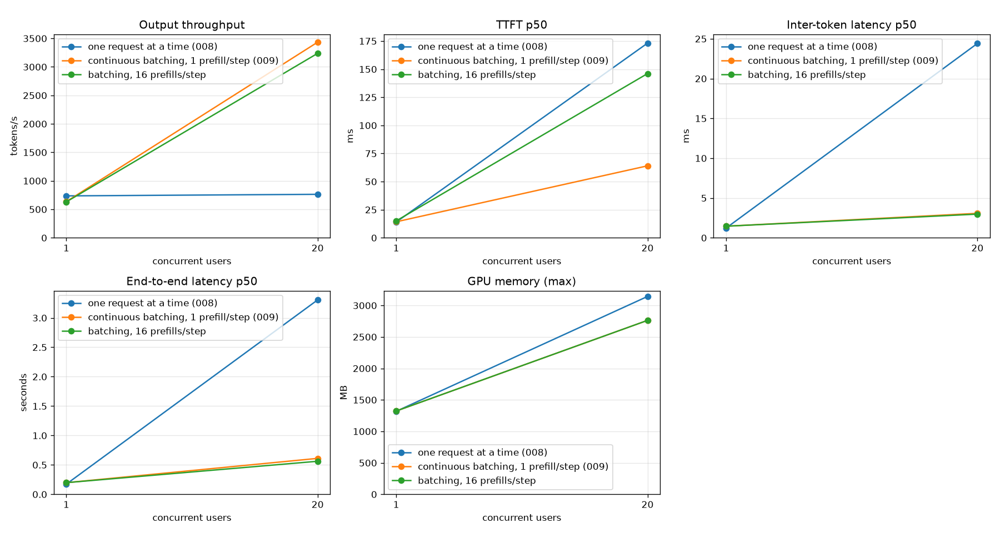

# 009 – A scheduler and batched decode

GPT-2 small, RTX 3060, KV cache, fused matrix-vector kernels (`007`), token chosen on the GPU (`008`).
Start: the state after `008`.
Sections 1 to 5 were written **before** I changed any engine code. The sections after that are filled in after the change.

## 1. What the measurements say

After `008` the server does not wait for the host any more. At 20 users:

| | |
|---|---|
| throughput (fp16) | 763 tok/s, flat from 1 to 20 users |
| kernels running | 86.5% of the step period (nsys) |
| one decode step | ~1.25 ms, **for one token** |
| the cap with one sequence per step | 1 / 1.19 ms of kernels ≈ 840 tok/s |

So the GPU is busy, but it does the same thing 20 times: every step reads all 247 MB of fp16 weights to produce **one** token, then the next session reads the same 247 MB again. Decode is memory-bound (`006`: 63–86% of the DRAM peak), so the time of a step is the time to read the weights. If the 20 sequences share one pass over the weights, one step should cost **about as much as one step for one sequence**, and produce 20 tokens. This is the idea of batching and of the roofline: the same bytes, B times the FLOPs.

Two numbers I measured for this step:

* **The Python side has a ceiling.** I ran the real server (HTTP, JSON, tokenizer, threads) with an engine that costs nothing (every session answered at once; 128 new tokens, same load test): **2760 tok/s at 1 user, 3190 at 5 users, 2720 at 20 users**. At 20 users the server process used ~140% of a core and the load generator ~110%, so I could not say which of the two was the limit. I removed that throw-away script afterwards. The number was only used for the prediction below.
* **The benchmark prompts are short** (5 to 13 tokens, 128 new tokens), so a context has at most ~141 tokens and attention is cheap. The prefill of such a prompt is a few ms.

What the current server does with several sessions: each of the 20 HTTP handler threads owns one session, takes the engine lock for every step and runs one sequence. The GPU is time-shared. There is no scheduler, nobody decides who runs next, and no step ever has more than one sequence.

## 2. Hypothesis

* H1: **one batched step is almost as fast as one single step.** With the weights read once for B sequences, a step with B = 16 takes at most ~2× a step with B = 1, so the engine alone produces ≥ 8× the tokens per second.
  * It holds only if the batched matrix kernel stays memory-bound. The risk is that it becomes limited by the shared-memory reads of x or by re-reading x from L2 in every block (see 3).
* H2: attention is not a problem at these context lengths. It costs per sequence, but it was latency-bound with only 12 blocks (one per head), so the first few sequences are free.
* H3: with continuous batching (sequences join and leave at every step) the server reaches the Python ceiling or close to it, about **2× to 3×** the 763 tok/s of today. It would not reach the engine's ceiling, because of the 2700 tok/s above.
* H4: with one sequence the new design is a little **slower** than `008`: the lookahead (the next step is queued before the host reads the token) does not carry over to a batch whose members can change at every step. I accept this for now and write it down.

## 3. Design

### Engine: one decode step for B sequences

`gpt2_gpu_decode_batch(model, caches[B], tokens[B], next_tokens[B])`, greedy, B ≤ 16. Each sequence has its own KV cache and its own length, so a batch mixes different positions.

| piece | change |
|---|---|
| embedding | new kernel: row *i* gets token *i* and position *i* (the positions differ) |
| layernorm | no change, it already has one block per row |
| matrix products | new **batched matrix-vector kernel**: `out[B, n] = x[B, k] × W[k, n]`. A thread keeps B accumulators in registers, so each weight value it loads is used for B rows. Same grid, same slices and same order of additions as the single-row kernel; the epilogues (bias, gelu, residual) stay in the kernel |
| attention | grid (heads, B). Block (h, b) attends over `length[b]` rows of sequence b's cache. It also copies the new K and V row of its head into the cache first (so q, k, v are one launch, and nothing scatters them afterwards) |
| output head | the same batched kernel, 50257 columns, then `argmax` per row (the argmax kernel gets a grid over rows) |
| launches | **88 per step, whatever B is** (test) |

The tokens, positions and the cache pointers of the 12 layers are uploaded in one small copy at the start of a step.

x is read through shared memory in tiles of the k dimension (`[row][b]` layout, so a thread reads 4 values of b with one 16-byte load).
Known risks that I will look at with `ncu` if the result is bad: (a) every block loads the whole x tile again from L2, which for B = 16 costs as many bytes as the fp16 weights of the block; (b) 16 FMAs per weight and 4 shared loads per row may start to compete with the memory system.

**Batch invariance** is a property I want, and test: the result for sequence *i* must not depend on which other sequences are in the batch. The kernel adds in the same order for every row, so a sequence decoded alone (B = 1 through the batch kernel) and in a batch of 16 must give **identical bits**. The comparison with the old single-row kernel is by tolerance and by chosen tokens (a different but equally valid order of additions is allowed).

### Scheduler: continuous batching

One thread owns the engine. Every iteration:

1. **Admit**: take waiting requests while there is a free KV cache and fewer than `max_batch` running sequences. At most `max_prefills_per_step` (default 1) are prefilled per iteration. A prefill of a new prompt blocks the decode of the running sequences for its duration, so this knob is the trade between the time to first token of new requests and the inter-token latency of running ones.
2. **Decode**: one batched step for all running sequences.
3. **Deliver**: each new token goes to the queue of its request. Finished sequences (end-of-text, `max_new_tokens`, full context, or a client that left) are removed **at once**, their cache goes back to the pool, and a waiting request can take the place in the next iteration. This is what makes it continuous: a batch is not a fixed group that waits for its slowest member.

The HTTP handlers become `async`: they put the request in the waiting queue and read tokens from an asyncio queue that the scheduler thread fills with `call_soon_threadsafe`. No thread per request, and no thread hop per token. Detokenizing stays in the handler (the event loop), so that the scheduler thread only does engine work.

Not part of this step: a paged KV cache (each sequence still has a 72 MB cache for 1024 positions), chunked prefill, the lookahead for batches, more than 16 sequences, preemption, sampling.

## 4. Change (summary)

Engine: `embed_decode_batch` kernel, `matvec_batch` kernel, `decode_attention_batch` kernel, `argmax` over rows, `gpt2_gpu_decode_batch`.
Python: `NativeGPT2.decode_batch`, `scheduler.py` (queue, admission, continuous batching), async server path (`--max-batch`; `--max-batch 1` is the current per-session path).
Benchmark: `--batch B` in the C benchmark (B sequences, one step each).

## 5. Prediction (written before the change)

**Engine (C benchmark, fp16, 128-token contexts, ms per step for the whole batch)**

| B | 1 | 4 | 8 | 16 |
|---|---|---|---|---|
| predicted step | 1.4 | 1.6 | 1.9 | **2.0 to 3.0** |
| predicted tokens/s | 710 | 2500 | 4200 | **5300 to 8000** |

Reasoning: matrix products 1.18 ms (B = 1) → ≤ 1.6 ms (B = 16) if memory-bound; attention 0.28 → ~0.5 ms; the rest (layernorm, embedding, argmax) 0.2 → 0.3 ms.
I would be wrong about H1 if a step with B = 16 takes **more than 4 ms** (then the kernel is not memory-bound any more and the batching win is below 4×), or if it takes less than 1.4 ms (then I misread something).

**Server (fp16, 128 new tokens, closed loop)**

| | 008 | predicted |
|---|---|---|
| 20 users, tok/s | 763 | **1500 to 2300** |
| 20 users, inter-token p50 | 24.5 ms | 7 to 14 ms |
| 20 users, kernels running (nsys) | 86% | ≥ 70% of the step period (the host does more per step now: 16 tokens) |
| 16 users, tok/s | – | 1400 to 2200 |
| 1 user, tok/s | 728 | 550 to 700 (H4: no lookahead in batches) |
| TTFT p95, 20 users | 0.33 s | 0.2 to 0.4 s (one prefill per iteration) |
| GPU memory, 20 users | 3143 MB | about 3200 MB (nothing new is allocated per sequence) |

I would be wrong about H3 if the server stays below 1000 tok/s (then the host side of the scheduler costs more than I think) or goes above 3200 (above the ceiling I measured, then the ceiling was the fake engine's problem).

**Correctness** (must hold exactly): a batch of any size and mix of lengths chooses the same tokens as the same sequences decoded one by one; batch invariance by bits; every request gets its tokens in order and exactly once; a request that is cancelled gives its cache back; and the old per-session path and its tests are unchanged.

## 6. Tests (written first, before the code)

Every group was red against a stub (or a missing module) before the implementation, and green after it.

| Test file | What it pins |
|---|---|
| `engine/tests/test_matvec_batch.cu` (7) | a batched product is **bit-identical** to the single-row kernel, for every row count 1 to 16, fp16 and fp32, all four epilogues, three products in one launch, odd sizes, the 50257-column head, and one launch; a row does not change when the other rows change (the output buffers are pre-filled with garbage, so a kernel that writes nothing cannot pass) |
| `engine/tests/test_decode_batch_kernels.cu` (5) | batch embedding with different positions; batch attention bit-identical to the single kernel, with different lengths per sequence (1 to 1024), 16 sequences, and the K/V rows stored in the right place of every cache |
| `engine/tests/test_argmax.cu` (+1) | `argmax_rows`: the index inside each row, NaN, last place, one launch |
| `engine/tests/test_gpt2_gpu_batch.c` (11) | the tokens of a batch equal the tokens of every sequence decoded alone (fp32, fp16, 1 / 2 / 5 / 16 sequences); a sequence gets the same tokens alone and next to six others; a long and a short sequence in one batch; 88 launches for every batch size; sequences join and leave between steps; invalid input (NULL, 0 or 17 sequences, an empty or full cache, the same cache twice, a bad token) changes nothing; fp16 reads the fp16 kernels (launch counters); queued tokens are dropped |
| `pytorch/tests/test_scheduler.py` (17) | admission, `max_batch`, `max_prefills_per_step`, a request without a free cache waits and is not lost, join and leave, `stop` / `length` / `context` finish reasons, the first token ends a request, cancel (running and waiting), an engine error, a failing prefill fails only its request, a raising callback drops only its request, statistics, the thread sleeps when idle and stops |
| `pytorch/tests/test_batched_server.py` (22) | blocking and streaming results, 400 for bad requests before anything is sent, 404, a held-back half character, many clients at once, the cancel path when the client leaves, the explicit close of the inner generator, an error line in a stream and a 500 for blocking, `/metrics`, prompt cutting |
| `pytorch/tests/test_native_gpu.py` (+4) | the batch API on the real library: tokens equal to the single path, cache hand-out, bad input raises, a released cache starts clean |

**Mutation checks** (a change to the code that the tests must notice; each was applied alone):

| Group | Mutations | Result |
|---|---|---|
| batch kernels | slices summed in reverse, wrong residual row, K written to the wrong row, per-row length ignored, `argmax_rows` all use row 0, positions ignored | 6 caught |
| batch kernels | last tile without a bounds check | **not caught**, see section 9 |
| `decode_batch` | position off by one, cache layer ignored, length not grown, duplicate caches allowed, queue not cleared, projection residual wrong | 6 caught |
| `decode_batch` | `max_length` too small, fp16 weights ignored | **survived the first tests**; two tests were added (a long sequence next to a short one, which now crashes with an illegal address; the launch counters for fp16), and both are caught now |
| scheduler | finished request stays, cache not released (finish / error / failing prefill), no prefill limit, no batch limit, waiting request dropped, cancel ignored, length and context off by one, token not fed back | 11; the failing-prefill one survived until a test for it was added |
| batched service | no cancel, inner generator not closed, error not reported, blocking error becomes 200, half character not held back, prompt not cut, no end-of-text token, validation after streaming starts, metrics empty | 9; the first two and the prompt cutting survived until the tests were made stricter |

Other checks: the logits path is unchanged (`scripts/golden_logits.py compare`: 0 differing values for fp32 and fp16); the 8 completions of a concurrent request set are **identical** to the output of the old server (40 tokens each, fp16); compute-sanitizer memcheck, racecheck and synccheck report 0 errors on the 80 GPU kernel tests; `make check` is clean. Suites: `test-gpu` 80, `gpt2-gpu-test` 40, `make test` 20, `pytest` 86.

## 7. Result

### 7.1 Engine alone (`make bench-batch`, context 128, clean GPU, median of 7 runs, spread under 0.01 ms)

| B | 1 | 2 | 4 | 8 | 16 |
|---|---|---|---|---|---|
| fp16 step | 1.517 ms | 1.543 ms | 1.702 ms | 2.194 ms | 3.447 ms |
| fp16 tokens/s | 659 | 1296 | 2350 | 3646 | 4642 |
| fp32 step | 2.179 ms | 2.197 ms | 2.304 ms | 2.983 ms | 4.062 ms |
| fp32 tokens/s | 459 | 910 | 1736 | 2681 | 3939 |

In an nsys profile of the engine alone (an earlier run on the same code, fp16) the step of B = 16 is 3.26 ms of period with 3.18 ms of kernels: matrix products 2.12 ms, attention 0.96 ms, layernorm 0.08 ms. For B = 1: 1.58 ms, products 1.14 ms, attention 0.25 ms. The attention grows with the batch (it is per sequence), the products grow because every thread now has 16 accumulators.

### 7.2 Server (clean GPU 1, 128 new tokens, 3 requests per user, two runs each, mean)

| fp16 | tok/s | inter-token p50 | TTFT p50 | TTFT p95 | e2e p50 | GPU memory |
|---|---|---|---|---|---|---|
| one request at a time (008), 1 user | 737 | 1.2 ms | 15 ms | 17 ms | 0.17 s | 1319 MB |
| one request at a time (008), 20 users | 762 | 24.4 ms | 178 ms | 327 ms | 3.31 s | 3143 MB |
| batched, 1 prefill/step, 1 user | 635 | 1.5 ms | 15 ms | 16 ms | 0.20 s | 1323 MB |
| batched, 1 prefill/step, 20 users | **3352** | **3.0 ms** | 64 ms | 685 ms | **0.61 s** | 2763 MB |
| batched, 4 prefills/step, 20 users | 3241 | 3.0 ms | 81 ms | 770 ms | 0.60 s | 2763 MB |
| batched, 16 prefills/step, 20 users | 3104 | 3.0 ms | 144 ms | 787 ms | 0.57 s | 2763 MB |

| fp32 | tok/s | inter-token p50 | TTFT p95 | e2e p50 |
|---|---|---|---|---|
| one request at a time, 20 users | 484 | 39.6 ms | 342 ms | 5.24 s |
| batched, 4 prefills/step, 20 users | 2883 | 3.6 ms | 834 ms | 0.68 s |

The mean batch size of the scheduler in these runs was 8.9 to 9.0 (statistics from `/metrics`).

### 7.3 Where the GPU time of the server goes (nsys, 20 users, 5 requests per user, GPU 2, free before and after)

This run is a different workload from the table above (5 requests per user instead of 3, so more of the run is steady state), and it ran under the profiler: 3202 tok/s, mean batch size 14.2 (the scheduler statistics).

| | |
|---|---|
| decode steps analysed | 892, all with 88 launches |
| median decode step, first to last kernel | 2.66 ms (the contexts are short here: prompt 5–13 tokens, so attention is cheaper than in `bench_batch` with 128 tokens) |
| inside a step, GPU idle | 0.08 ms (1.8%), of it 28% waiting for a launch |
| load-test window (3.8 s), kernels running | 84.6% |
| …of it, decode steps | about 60% (everything that is not a prefill-type kernel; the layernorm kernels of prefills are counted here, a small error) |
| …of it, prefills (99 of them, about 9.5 ms of GPU time each) | **24.7%** |
| load-test window, GPU idle | about 15% |

Prefill takes a quarter of the GPU time of the whole run. A prefill still uses the old kernels from before report 004 (the general matrix kernel and the one-pass attention kernel, 7272 launches of `mult_kernel` in this run), and during a prefill no sequence of the batch advances. This is the largest cost that is not decode, and it is where the "server reaches only part of the engine rate" goes. I had listed prefill as a candidate; now it is measured.

(The first 1.4 s of the profile is startup and model loading and is not part of the window. A whole-run view of the same file says the kernels were busy 59% of the 5.5 s including startup.)

### 7.4 Pageable against pinned control copy (free GPU, `bench_batch`, fp16, context 128, median of 7)

| | B = 1 | B = 16 |
|---|---|---|
| synchronous `cudaMemcpy` from pageable memory | 1.530 ms | 3.481 ms |
| pinned buffer + `cudaMemcpyAsync` (the code) | 1.532 ms | 3.469 ms |

No difference (0.1% to 0.4%, inside the spread). See section 9.

## 8. Prediction against result

| Prediction | Result | |
|---|---|---|
| H1: step with B = 16 takes 2.0 to 3.0 ms, 5300 to 8000 tok/s | **3.45 ms, 4642 tok/s** | **wrong** (slower), but better than my "wrong if above 4 ms" line |
| H1: B = 1: 1.4 ms | 1.52 ms | close |
| H1: B = 4 / 8: 1.6 / 1.9 ms | 1.70 / 2.19 ms | slower |
| H2: attention is cheap at these lengths | 0.25 ms (B = 1) → 0.96 ms (B = 16), 28% of the B = 16 step | **wrong**: it is per sequence and no longer free |
| H3: server 20 users 1500 to 2300 tok/s | **3352** | **above the range** |
| H3: wrong if above 3200 (my measured Python ceiling) | 3352 | **the ceiling was wrong**: I measured it with the old server design (a thread per request, a thread hop per token). The new design has no thread hop per token. I did not measure the cost of the new path separately, so I do not know which part of the difference matters |
| inter-token p50 at 20 users 7 to 14 ms | 3.0 ms | better |
| TTFT p95 at 20 users 0.2 to 0.4 s | 0.69 s | **worse** |
| 1 user: 550 to 700 tok/s | 635 | right |
| GPU memory about 3200 MB | 2763 MB | lower (16 caches instead of 20 sessions) |
| correctness: tokens equal to the single path, bit-invariance | yes (tests, 8 identical completions) | right |

What I got wrong, in order of size (the nsys result of section 7.3 adds a fourth point): (1) I took the throughput of a server with a free engine as a ceiling of the whole Python side. It was the ceiling of that one design, and the new server passed it. (2) I expected the batched matrix kernel to stay memory-bound up to 16 rows; it does not, 16 accumulators and the reads of x cost time (B = 16 costs 2.3x the time of B = 1, not 1.5x). (3) I did not expect the time to first token to get worse at the tail; my explanation (20 users share 16 slots, and requests of the next round queue behind a full batch) is plausible but I did not test it. (4) I did not expect prefill to be a quarter of the GPU time at all, because the prompts are only 5 to 13 tokens long. Each prefill costs about 9.5 ms because it still runs the old general matrix kernel at a few rows.

## 9. What I do not know yet

* **Why the batched matrix kernel is slower than my 1.6 ms for B = 4 and 2.0 to 3.0 for B = 16.** Candidates: the re-reads of x from L2 in every block, the shared-memory traffic of x (a `float4` read per row group), or register pressure (16 accumulators). I did not run `ncu` on it. That is the next measurement before changing the kernel.
* **Where the other part of the server's GPU time goes** is answered in section 7.3 for GPU time (prefill 25%, decode 60%, idle 15% of the load-test window). What I did not separate is the 15% idle part: Python work per token, the scheduler thread competing for the GIL with the event loop, and the wait for the next request of a closed-loop user.
* **The tail of the time to first token** (0.69 s at p95) comes from waiting for one of 16 slots. I believe it, but I did not test it with `--max-batch 24`-like settings (the engine limit is 16).
* **One bounds check in the batched matrix kernel is not pinned by a test.** I removed the `row < k` check in the accumulation (the weight is only loaded when it is in range) and all tests still passed. I did not investigate why. My guess is that x is zero past the end of k, so a stale register value times zero adds nothing, unless the stale value is a NaN or an infinity; that was not tested and I did not confirm it. The check stays in the code.
* **One-user throughput is 14% lower** than the old server. I believe it is the missing lookahead; I did not measure it separately. (In the engine alone, B = 1 through the batched path costs 1.52 ms, the same as the single-sequence path, so the difference is not in the kernels.)
* **The per-step control block (tokens, positions, lengths and the cache pointers, 3 KB).** My first measurement of the batched engine gave 3.05 ms per step at B = 1, and an nsys timeline showed the small host-to-device copy of this block waiting about 1 ms before it started. I wrote the pinned-buffer change, and the next run gave 1.52 ms, so I credited the change. **That was wrong, and the evidence is in my own log:** that build had failed to compile, so the 1.52 ms run used the *unchanged* binary. The same code measured 3.05 ms and then 1.52 ms a few minutes apart, and section 7.4 shows both variants are the same on a free GPU. So the 3 ms was not the code. Most likely another job shared the GPU at the first measurement (runs of the same code on a busy GPU later gave 2.9 ms), which would also explain the 1 ms wait of the copy in that timeline; I did not prove that. The pinned buffer stays in the code; it does no harm and costs nothing, but it is not an optimization.

## 10. Next

* **Prefill** (25% of the GPU time at 20 users): a matrix kernel for a few rows, and batching the prefills of several waiting requests into one pass. This is now the largest single item, ahead of the batched matrix kernel.
* `ncu` on the batched matrix kernel (what limits it at B = 16), then one change.
* A scheduler step that does not wait for the host: queue the next step for the sequences that cannot end (not at their limit) before the tokens are read, to get the lookahead back.
* A paged KV cache: now every sequence reserves 72 MB for 1024 positions, so 16 sequences cost 1.2 GB although the prompts here are about 140 tokens long.
* Chunked prefill, so that a long prompt does not stop the decode of the others.

## 11. Files

* New engine files: `matvec_batch.cu`, `matvec_common.h` (shared with `matvec.cu`), `transformer_block_batch.cu`, `gpt2_gpu_batch.cu`, `bench/bench_batch.c`; the batch kernels in `attention.cu`, `embedding.cu`, `argmax.cu`; tests listed in section 6.
* New Python files: `scheduler.py`, `batched_service.py`, `batched_main.py` (entry point), `batch_api.py` (engine side), `api_common.py` (what both servers share), `scripts/serve_batched.py`.
* Makefile: `bench-batch`, `serve-batched`.
* Measurements: `build/benchmarks/m_*` (server), `build/report_server_batched_20users.nsys-rep` (profile of the 20-user run), `scripts/nsys_gap_analysis.py --server` (now knows batched steps and prints where the GPU time of a whole run goes).
