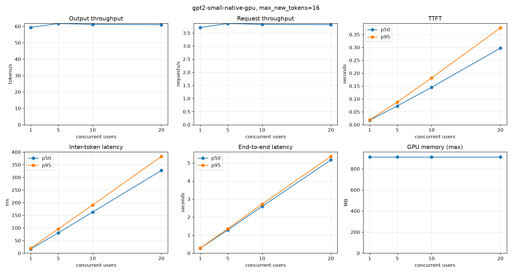
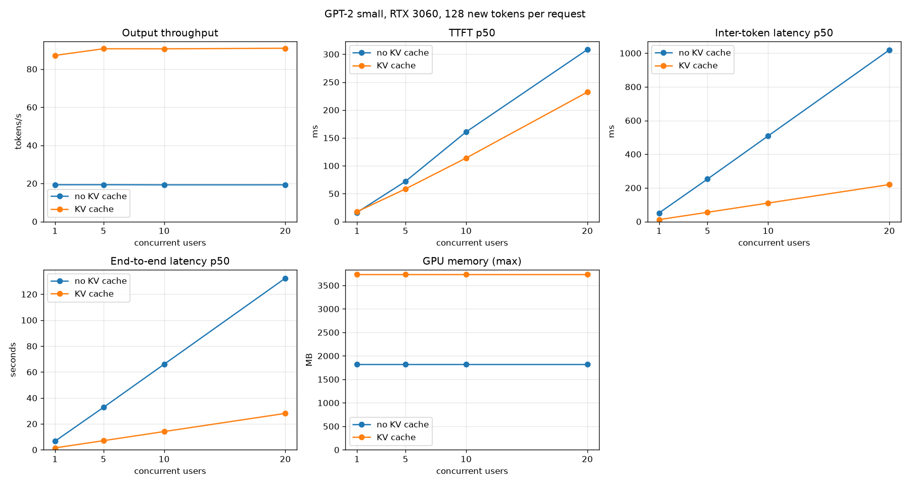
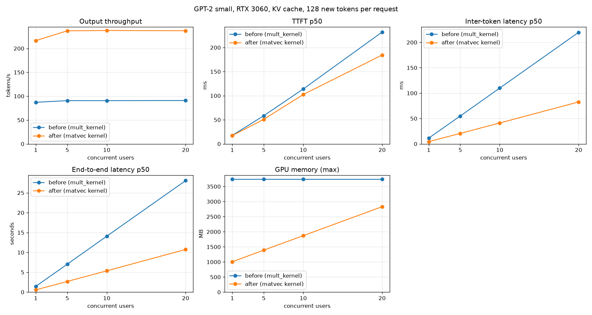
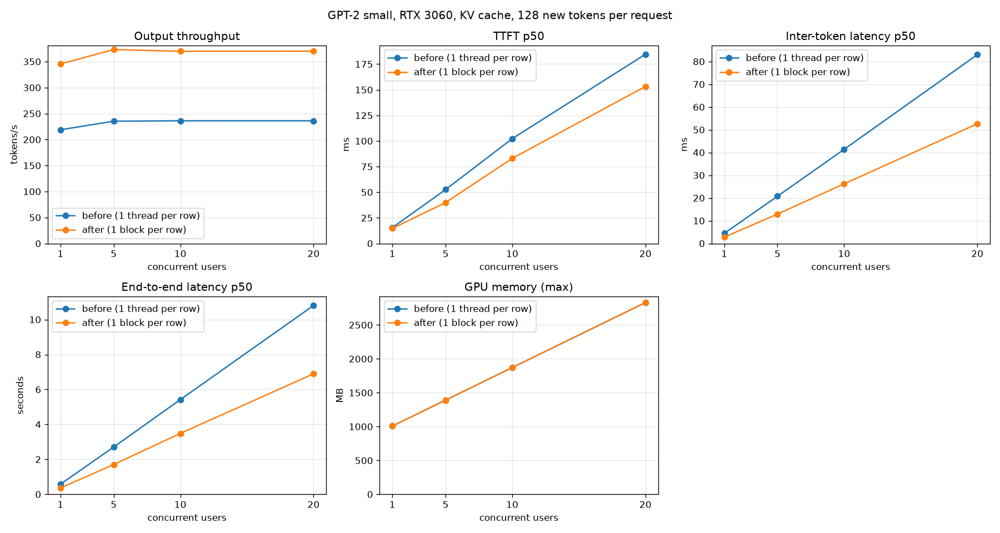
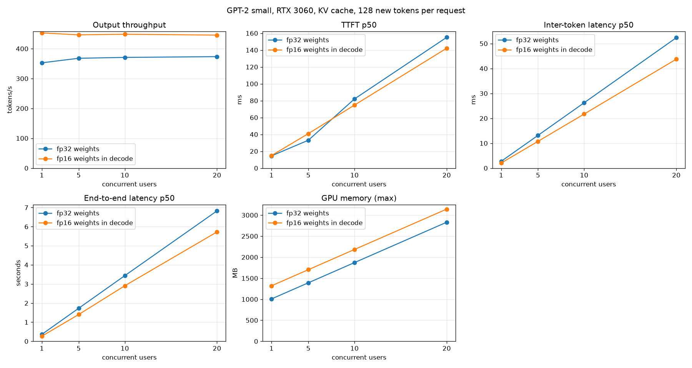
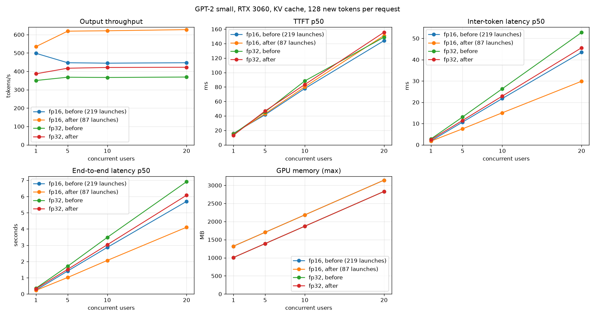
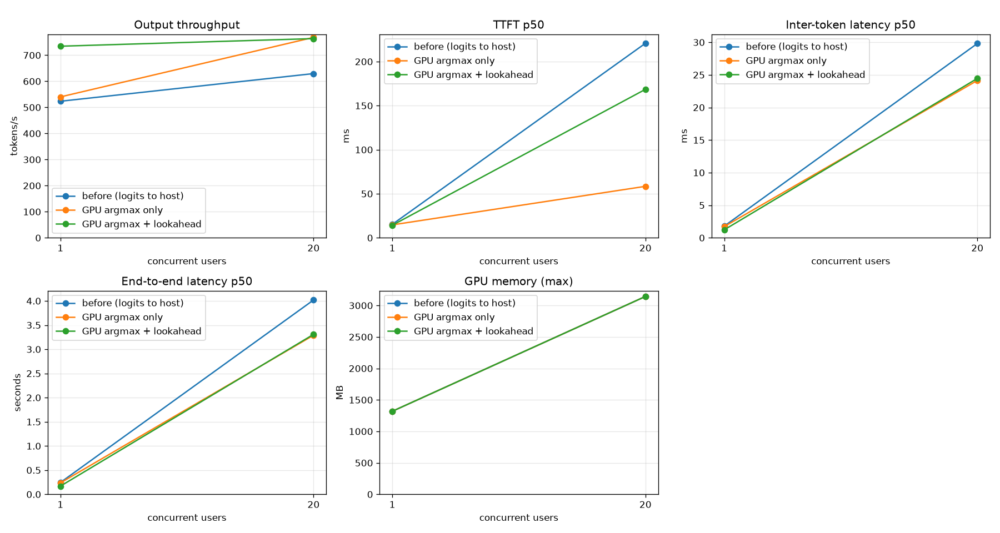
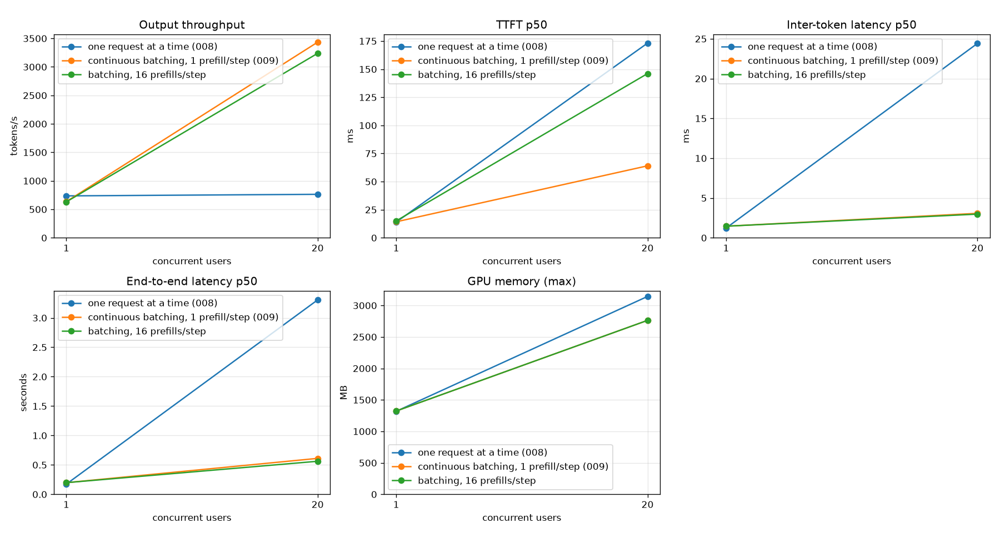

# Serving

The server, the load test and what each step changed at 1 to 20 concurrent users. Reports 003 to 007 are kernel steps and live in [../kernels/](../kernels/README.md); their server results are repeated here. Reports 008 and 009 are about the serving loop itself and live in this folder.

| Report | Topic |
|---|---|
| [008](008_gpu_cpu_token_loop.md) | argmax on the GPU, next step queued before the token is read |
| [009](009_batched_decode.md) | scheduler, continuous batching, batched decode kernels |

Closed-loop load test with `scripts/benchmark_throughput.py`: N concurrent users, each sends requests one after another. Streaming, short prompts, same GPU as above. There are two servers: `make serve-gpu` (FastAPI, one engine, a KV cache per running session, requests are processed one at a time; `--no-kv-cache` gives the very first behaviour) and `make serve-batched` (scheduler thread, continuous batching, report 009).

At a glance, 20 concurrent users, 128 new tokens per request. Each row is one report; the runs were made on different days, so small differences between rows are not only the change:

| Step | Output tok/s | Inter-token p50 | End-to-end p50 | Report |
|---|---|---|---|---|
| No KV cache (baseline) | 19.3 | 1019 ms | 132.4 s | [003](../kernels/003_kv_cache.md) |
| + KV cache | 90.9 | 220 ms | 28.1 s | [003](../kernels/003_kv_cache.md) |
| + matrix-vector kernel | 237.2 | 82.6 ms | 10.8 s | [004](../kernels/004_gemv.md) |
| + layernorm, one block per row | 370.0 | 52.6 ms | 6.9 s | [005](../kernels/005_layernorm.md) |
| + fp16 weights in decode (opt-in) | 445.4 | 43.7 ms | 5.7 s | [006](../kernels/006_fp16_weights.md) |
| + fewer launches (fp32 weights: 422.4 tok/s, 45.6 ms, 6.1 s) | 627.3 | 29.9 ms | 4.1 s | [007](../kernels/007_fewer_launches.md) |
| + token chosen on the GPU, lock-free wait (fp32 weights: 485 tok/s, 39.6 ms, 5.2 s) | 762 | 24.4 ms | 3.3 s | [008](008_gpu_cpu_token_loop.md) |
| + **scheduler, continuous batching, batched decode kernels** (fp32 weights: 2883 tok/s, 3.6 ms, 0.68 s) | **3352** | **3.0 ms** | **0.61 s** | [009](009_batched_decode.md) |

Up to report 008 the throughput is flat from 1 to 20 users in every row, because the requests wait for each other and every token reads all the weights again. The latency grows with the number of users instead. Report 009 (batching) is the first row where throughput grows with the number of users.

### Baseline: no KV cache (`--no-kv-cache`)

16 new tokens per request:

| Users | Output tok/s | Req/s | TTFT p50 | TTFT p95 | Inter-token p50 | End-to-end p50 | End-to-end p95 |
|---|---|---|---|---|---|---|---|
| 1 | 59.6 | 3.72 | 18 ms | 19 ms | 16.4 ms | 0.27 s | 0.28 s |
| 5 | 62.0 | 3.87 | 70 ms | 87 ms | 80.2 ms | 1.29 s | 1.34 s |
| 10 | 61.1 | 3.82 | 145 ms | 184 ms | 163.4 ms | 2.59 s | 2.72 s |
| 20 | 61.2 | 3.83 | 293 ms | 372 ms | 325.6 ms | 5.17 s | 5.35 s |

- Throughput is flat at about 60 tok/s: more users only add waiting time. Latency grows linearly with the number of users.
- A single user gets the same speed as the engine alone. The py-spy profile shows most of the time waiting for the GPU (`cudaMemcpy` of the logits), so Python is not the bottleneck.
- Every decode step runs the whole sequence again. One forward pass takes 11 ms for 1 token, 92 ms for 128 tokens and 895 ms for 1000 tokens.

### With the KV cache ([report 003](../kernels/003_kv_cache.md))

Same workload, only the cache is different. Speedup is output tok/s after / before.

16 new tokens per request:

| Users | tok/s before | tok/s after | Speedup | Inter-token p50 before | after | End-to-end p50 before | after |
|---|---|---|---|---|---|---|---|
| 1 | 59.6 | 83.5 | 1.4x | 16.4 ms | 11.4 ms | 0.27 s | 0.19 s |
| 5 | 62.0 | 89.1 | 1.4x | 80.2 ms | 54.7 ms | 1.29 s | 0.89 s |
| 10 | 61.1 | 89.8 | 1.5x | 163.4 ms | 108.9 ms | 2.59 s | 1.76 s |
| 20 | 61.2 | 89.6 | 1.5x | 325.6 ms | 218.5 ms | 5.17 s | 3.53 s |

128 new tokens per request:

| Users | tok/s before | tok/s after | Speedup | Inter-token p50 before | after | End-to-end p50 before | after |
|---|---|---|---|---|---|---|---|
| 1 | 19.3 | 87.2 | 4.5x | 50.8 ms | 11.4 ms | 6.61 s | 1.46 s |
| 5 | 19.3 | 90.7 | 4.7x | 252.4 ms | 55.0 ms | 32.73 s | 7.05 s |
| 10 | 19.3 | 90.6 | 4.7x | 508.6 ms | 110.0 ms | 65.96 s | 14.08 s |
| 20 | 19.3 | 90.9 | 4.7x | 1019.3 ms | 219.7 ms | 132.40 s | 28.08 s |

- The longer the output, the bigger the gain: 1.4x at 16 tokens, 4.5x at 128 tokens. One sequence in the C benchmark (32-token prompt, `make bench-gpu`): 2.5x at 16 tokens, 14.6x at 400 and 32x at 900.
- TTFT does not change (prefill is the same, about 18 ms).
- Throughput is still flat when users are added (about 90 tok/s). The server still runs one request at a time, so batching is the next step.
- GPU memory: 1.8 GB for the weights, then +96 MB for each running session (the KV cache). It is 3.7 GB with 20 sessions.
- Reproduce: `make serve-gpu SERVE_ARGS=--no-kv-cache` (baseline) or `make serve-gpu` (cache), then `uv run --group dev scripts/benchmark_throughput.py --max-new-tokens 128`. `scripts/compare_benchmarks.py` draws two runs in one plot.

### With the matrix-vector kernel ([report 004](../kernels/004_gemv.md))

The decode step multiplies one row by a weight matrix. The old matmul kernel left 15 of 16 thread rows idle in that case and read the weights at 31 to 62 GB/s (ncu: no warp ready to issue in 94% of the cycles). A separate kernel for one row splits `K` over 16 slices per block, keeps 4 loads in flight per thread and reads the weights at 267 GB/s (74% of the peak). Same workload, KV cache on in both columns:

128 new tokens per request:

| Users | tok/s before | tok/s after | Speedup | Inter-token p50 before | after | End-to-end p50 before | after |
|---|---|---|---|---|---|---|---|
| 1 | 87.2 | 216.4 | 2.5x | 11.4 ms | 4.5 ms | 1.46 s | 0.58 s |
| 5 | 90.7 | 237.0 | 2.6x | 55.0 ms | 20.7 ms | 7.05 s | 2.69 s |
| 10 | 90.6 | 237.6 | 2.6x | 110.0 ms | 41.2 ms | 14.08 s | 5.37 s |
| 20 | 90.9 | 237.2 | 2.6x | 219.7 ms | 82.6 ms | 28.08 s | 10.75 s |

- One decode step: 10.67 ms → 3.88 ms of kernel time. The five matmul stages went from 8.63 ms to 1.85 ms.
- Layernorm is now the largest stage (44% of the step) and the next target.
- Throughput is still flat when users are added, because the server handles one request at a time.

### With the layernorm kernel ([report 005](../kernels/005_layernorm.md))

After report 004, layernorm was 44% of a decode step. The kernel used one thread per row, so a decode step (one row) ran on one thread of one SM: 68 µs for 12 KB of data. A kernel with one block per row, where the 256 threads split the 768 values and add them with warp shuffles, takes 2.8 µs per call. Same workload, matrix-vector kernel in both columns:

128 new tokens per request:

| Users | tok/s before | tok/s after | Speedup | Inter-token p50 before | after | End-to-end p50 before | after |
|---|---|---|---|---|---|---|---|
| 1 | 218.7 | 345.4 | 1.58x | 4.4 ms | 2.8 ms | 0.58 s | 0.36 s |
| 5 | 235.3 | 373.2 | 1.59x | 20.8 ms | 12.9 ms | 2.71 s | 1.71 s |
| 10 | 236.1 | 369.8 | 1.57x | 41.4 ms | 26.2 ms | 5.42 s | 3.48 s |
| 20 | 236.0 | 370.0 | 1.57x | 83.0 ms | 52.6 ms | 10.80 s | 6.90 s |

- One decode step: 3.87 ms → 2.29 ms of kernel time. Layernorm: 1.709 ms → 0.070 ms.
- Prefill (32 tokens) also gains: 21.8 ms → 16.3 ms. Layernorm was 20% of that pass.
- Since the KV cache (report 003), server throughput at 20 users went 90.9 → 237 → 370 tok/s.
- Batching the decode of several requests is the next step for throughput.

### With fp16 weights in decode ([report 006](../kernels/006_fp16_weights.md))

A decode step reads every weight once, so it is limited by memory bandwidth (ncu: 63–86% of the DRAM peak, compute units 70–80% idle). With fp16 weights it reads 247 MB instead of 494 MB. The accumulation, activations, KV cache, layernorm and biases stay fp32, and prefill still uses the fp32 weights. It is opt-in (`make serve-gpu SERVE_ARGS=--fp16-weights`) and costs +247 MB of GPU memory. Same workload, fp32 server in the same session:

128 new tokens per request:

| Users | tok/s fp32 | tok/s fp16 | Speedup | Inter-token p50 fp32 | fp16 | End-to-end p50 fp32 | fp16 |
|---|---|---|---|---|---|---|---|
| 1 | 352.6 | 452.7 | 1.28x | 2.7 ms | 2.0 ms | 0.36 s | 0.27 s |
| 5 | 367.9 | 446.3 | 1.21x | 13.1 ms | 10.8 ms | 1.73 s | 1.40 s |
| 10 | 370.7 | 448.4 | 1.21x | 26.2 ms | 21.7 ms | 3.43 s | 2.90 s |
| 20 | 373.3 | 445.4 | 1.19x | 52.4 ms | 43.7 ms | 6.82 s | 5.72 s |

- One decode step: 2.30 ms → 1.57 ms of kernel time (1.46x). The five matrix-vector stages went from 1.90 ms to 1.18 ms (1.61x).
- The server gains less than the kernels (1.19x–1.28x). The time outside the kernels grew from 0.38 to 0.68 ms per token (30% of a token). I did not find the cause yet.
- Accuracy over 1200 teacher-forced positions: top-1 agreement 100%, mean KL 5.7e-06 nats, and all 12 prompts give the same 100 greedy tokens. The largest single logit difference is 3.5 (at a top logit of 42), above the 0.1 that I had set as a limit, so that criterion is reported as not met. See the report.

### With fewer launches per decode step ([report 007](../kernels/007_fewer_launches.md))

A decode step had 219 kernel launches. The CPU needs about 3 µs to launch a kernel, and 61% of the kernels (bias, residual add, gelu, small layernorms) run for less than that, so the GPU waited for the CPU: with fp16 weights it was idle 20% of the step (0.40 ms of 1.93 ms), and 71% of that idle time was waiting for a launch. The bias, gelu and residual add now happen in the epilogue of the matrix-vector kernel, and q, k and v are one launch with three products: **87 launches** per step. The logits are bit-for-bit the same as before (12.4 M values checked). Same workload, before and after in the same session:

128 new tokens per request, fp16 weights:

| Users | tok/s before | tok/s after | Speedup | Inter-token p50 before | after | End-to-end p50 before | after |
|---|---|---|---|---|---|---|---|
| 1 | 498.3 | 534.8 | 1.07x | 1.8 ms | 1.7 ms | 0.24 s | 0.22 s |
| 5 | 447.0 | 618.9 | 1.38x | 10.7 ms | 7.5 ms | 1.41 s | 1.02 s |
| 10 | 444.6 | 621.1 | 1.40x | 21.7 ms | 15.0 ms | 2.87 s | 2.07 s |
| 20 | 447.0 | 627.3 | 1.40x | 43.5 ms | 29.9 ms | 5.70 s | 4.11 s |

With fp32 weights: 369 → 422 tok/s at 20 users (1.14x).

- One fp16 decode step: 1.93 ms → 1.53 ms from one step's first kernel to the next one's. The GPU idle time inside a step fell from 0.40 ms to 0.12 ms.
- The server gained more than the kernel time suggests (1.40x against 1.22x). The time outside the kernels fell from 0.68 to 0.31 ms per token; I did not prove why.
- A first version of the fused kernel was slower than the old kernels (a 96-byte stack frame from indexing the kernel arguments). The report describes the fix.
- Compute-sanitizer memcheck and racecheck report no errors on the 60 kernel tests.

### With the token chosen on the GPU ([report 008](008_gpu_cpu_token_loop.md))

After report 007 the GPU was idle between two decode steps: it waited while the host copied the 50257 logits (200 KB) back, took the argmax, and launched the next step (8% of the step in the C benchmark, 12% in the server). Two changes: the **argmax runs on the GPU** (only the 4-byte token is copied back), and the **next step is queued before the host reads the previous token**, so the Python work (tokenizer, JSON, thread hop) runs while the GPU computes. The logits path is bit-for-bit unchanged and the chosen tokens are identical (tested). fp16 weights, 128 new tokens per request, two runs per configuration (mean):

| | before | GPU argmax only | + queued one step ahead |
|---|---|---|---|
| 1 user, tok/s | 516 | 544 | **728** |
| 1 user, end-to-end p50 | 0.245 s | 0.235 s | **0.175 s** |
| 20 users, tok/s | 629 | **765** | **763** |
| 20 users, inter-token p50 | 29.9 ms | 24.1 ms | 24.5 ms |

With fp32 weights: 20 users 421 → 485 tok/s, 1 user 371 → 477.

- Idle time between two steps in the C benchmark: 0.127 ms → 0.034 ms (GPU argmax) → 0.008 ms (queued). Real server, one stream: 0.183 ms → 0.014 ms.
- With 100 µs of host work per token, the C benchmark loses 0.10 ms per token without the lookahead and **0.002 ms** with it.
- **I predicted the wrong cause for the 20-user gain.** The old `decode()` held the engine lock while it waited for the logits, so no other session could queue kernels: in the nsys run of 20 users the kernels ran only 45% of the time and 99% of the idle time was the GPU waiting for a launch. Waiting on a CUDA event without the lock fixed that (86% busy). A control run that waits while holding the lock gives 597 tok/s again. At 20 users the lookahead itself adds nothing; for a single stream it adds 34%.
- Not understood yet: the nsys gap for the server with stage A only got larger (0.18 → 0.32 ms) although tok/s went up; TTFT p50 at 20 users is 0.06 s with stage A and 0.17 s with the lookahead. Both are listed in the report.
- Next: a scheduler with batched decode.

### With a scheduler and batched decode ([report 009](009_batched_decode.md))

Until here every request had its own thread and took the engine lock for each step, so one step produced one token and read all 247 MB of fp16 weights for it. Now one scheduler thread owns the engine. In every iteration it admits waiting requests (prefill), runs **one batched decode step for all running sequences** (up to 16, each with its own KV cache and length), and hands every new token to its request. A finished request leaves at once and a waiting one takes its place (continuous batching). A batched matrix-vector kernel keeps one accumulator per sequence in registers, so a weight that is loaded once is used for all of them. The step is still 88 launches. The result for a sequence is bit-identical whatever the other sequences in the batch are (tested). Same workload, fp16 weights, mean of two runs:

128 new tokens per request:

| Users | tok/s before | tok/s after | Speedup | Inter-token p50 before | after | End-to-end p50 before | after |
|---|---|---|---|---|---|---|---|
| 1 | 737 | 635 | 0.86x | 1.2 ms | 1.5 ms | 0.17 s | 0.20 s |
| 20 | 762 | 3352 | 4.4x | 24.4 ms | 3.0 ms | 3.31 s | 0.61 s |

With fp32 weights at 20 users: 484 → 2883 tok/s (6.0x).

Engine only (`make bench-batch`, context 128, one batched step for B sequences):

| B | 1 | 2 | 4 | 8 | 16 |
|---|---|---|---|---|---|
| fp16 step | 1.52 ms | 1.54 ms | 1.70 ms | 2.19 ms | 3.45 ms |
| fp16 tokens/s | 659 | 1296 | 2350 | 3646 | 4642 |
| fp32 step | 2.18 ms | 2.20 ms | 2.30 ms | 2.98 ms | 4.06 ms |
| fp32 tokens/s | 459 | 910 | 1736 | 2681 | 3939 |

- Batching works as the roofline says: 16 sequences cost 2.3x the time of one and give 16 tokens, so 7.0x the tokens per second. It is less than the 16x a perfectly memory-bound step would give: the attention (per sequence) and the matrix kernels (16 accumulators per thread) grow with the batch.
- The server reaches about 89% of what the engine alone does at the same mean batch size (8.9, interpolated between the B = 8 and B = 16 steps: about 3800 tok/s). An nsys profile of 20 users shows where the rest goes: in the load-test window the kernels were busy 85% of the time, **25% of it prefill** (still the old general matrix kernel, about 9.5 ms per prompt of 5 to 13 tokens), 60% decode, 15% idle.
- One user is 14% slower than before: with a batch that can change at every step, the next step cannot be queued before the token is read.
- Time to first token at p95 is 0.69 s (before 0.33 s), probably because 20 users compete for 16 slots (not tested), and a prefill delays the running sequences. `--max-prefills-per-step` trades the two; 16 per step more than doubles the median time to first token (64 ms → 144 ms) and gives a slightly lower throughput (3104 tok/s), so the default stays at 1.
- Next: prefill (the largest item that is not decode), then `ncu` on the batched matrix kernel. What is not understood yet is in section 9 of the report.
